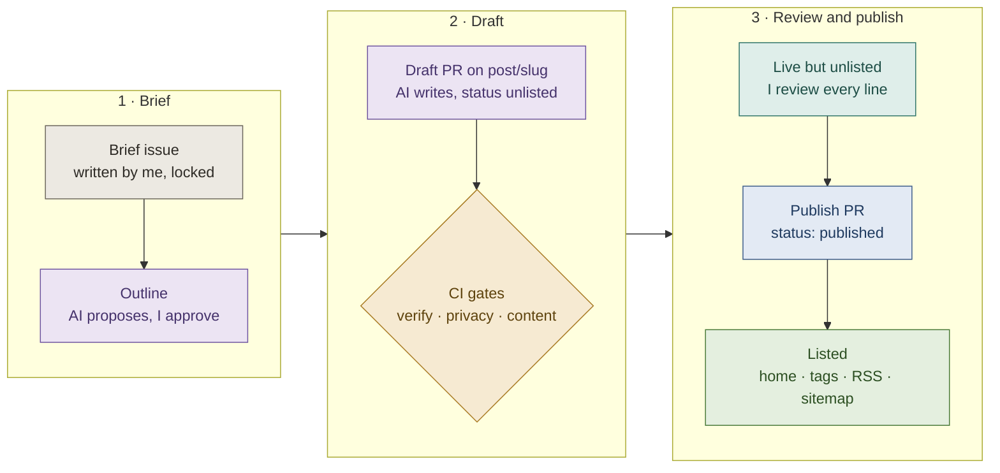
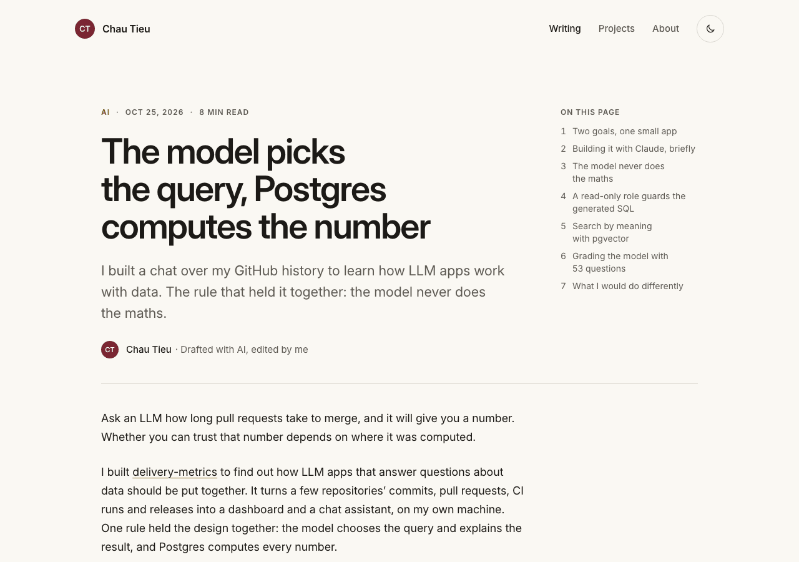
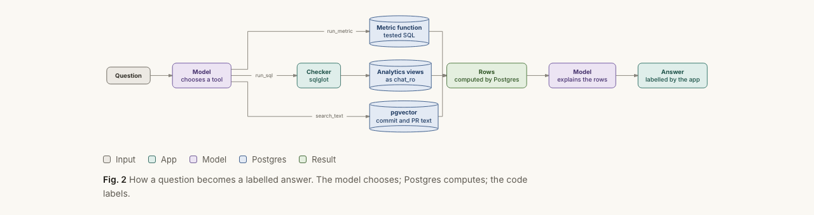
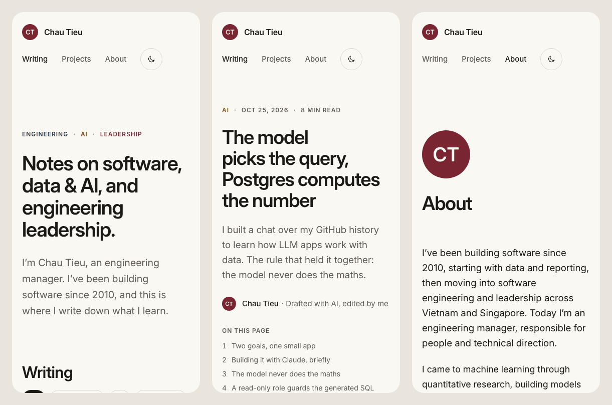
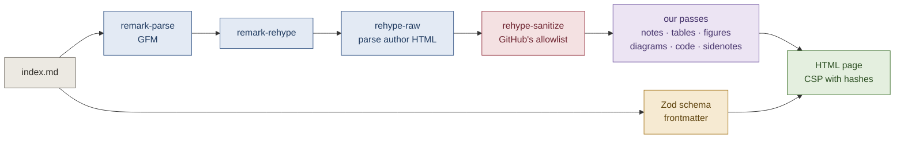
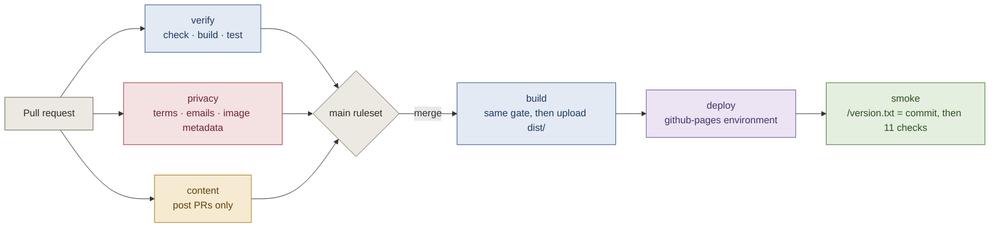

<p align="center">
  <a href="https://chau-minh-tieu.github.io"></a>
</p>

<h1 align="center">chau-minh-tieu.github.io</h1>

<p align="center">
  <strong>Notes on software, data &amp; AI, and engineering leadership.</strong><br>
  The source of <a href="https://chau-minh-tieu.github.io">chau-minh-tieu.github.io</a>, the notebook of Chau Tieu, an engineering manager.
</p>

<p align="center">
  <a href="https://github.com/chau-minh-tieu/chau-minh-tieu.github.io/actions/workflows/deploy.yml"></a>
</p>

<p align="center">
  <a href="https://chau-minh-tieu.github.io">Read the site</a> ·
  <a href="https://chau-minh-tieu.github.io/posts/model-picks-postgres-computes/">Latest post</a> ·
  <a href="docs/runbook.md">Runbook</a> ·
  <a href="STYLE.md">How posts are drafted</a> ·
  <a href="docs/features/">How it was built</a>
</p>

<picture>
  <source media="(prefers-color-scheme: dark)" srcset="docs/readme/home-dark.png">
  
</picture>

A static site with no server, no database and nothing that tracks the reader. Astro renders every page once, at build time; GitHub Actions tests the result and GitHub Pages serves exactly the files that passed. Posts start as an issue I write, are drafted by an AI, and go live only after I have reviewed every line in a pull request.

## At a glance

| | This site |
|---|---|
| **Pages** | Plain HTML and CSS, rendered once by Astro. Light and dark themes, readable at 375 px |
| **JavaScript shipped** | Two small scripts: the theme toggle and the copy buttons on code blocks |
| **Third-party requests** | None. Fonts are self-hosted; no analytics, no cookies, no CDN |
| **Lighthouse** (desktop, live) | Performance 100, accessibility 100 on Home and on the post |
| **Content Security Policy** | `default-src 'self'`; inline scripts and styles only by SHA-256 hash |
| **Tests** | 232 Vitest tests, plus 11 smoke checks against the live site after every deploy |

## How a post gets published

Every state of a post lives in exactly one place: an issue, a pull request, or one line of frontmatter on `main`.



1. **Brief.** I file an issue from the [post brief form](.github/ISSUE_TEMPLATE/post-brief.yml): thesis, audience and the insight only I can supply. A workflow locks it within seconds, so only collaborators can add to what becomes the AI's input, and scans it for private terms.
2. **Draft.** The drafting AI follows [`STYLE.md`](STYLE.md): it reads only collaborators' text, proposes an outline, then writes the post on a `post/<slug>` branch as `unlisted`.
3. **Gates.** The pull request must pass `verify` (types, build, tests), `privacy` (files and commit messages) and `content` (the PR may touch only its post, names its brief, and every link resolves).
4. **Review and publish.** I read the diff and the live unlisted page, then merge a one-line change to `published`. The [runbook](docs/runbook.md) covers publishing, unpublishing and rolling back.

## What a post looks like

<picture>
  <source media="(prefers-color-scheme: dark)" srcset="docs/readme/post-dark.png">
  
</picture>

Posts are plain Markdown (`.md`, so GitHub's preview matches the site). The build turns conventions into components: numbered sections with a contents list, footnotes as sidenotes in the margin, GitHub alerts as notes, captioned tables with a verdict row, code blocks with file names, highlighted lines and a copy button, and screenshots in a quiet window frame. The full list is in [`STYLE.md`](STYLE.md#7-markdown).

Diagrams are Mermaid fences in the post, drawn to SVG during the build. One SVG serves both themes: its colours are classes that CSS fills from the figure palette.

<picture>
  <source media="(prefers-color-scheme: dark)" srcset="docs/readme/diagram-dark.png">
  
</picture>

On a phone the layout folds into one column: sidenotes move under their paragraph, the contents list moves under the title.

<picture>
  <source media="(prefers-color-scheme: dark)" srcset="docs/readme/phones-dark.png">
  
</picture>

## Under the hood

**From Markdown to HTML.** A post's body is untrusted input, because it may contain raw HTML. The pipeline parses the author's HTML first, sanitises once, and only then runs our own passes; nothing after the sanitiser parses author text as HTML. Diagrams are sanitised a second time, with an SVG-only allowlist, because the renderer turns author text into markup.



**From pull request to live site.** The build is tested once and those exact bytes are deployed. The only job that can write to Pages runs no repository code, and the smoke checks wait until the live site serves the new commit before they pass.



## Guardrails

| Concern | How it is handled |
|---|---|
| Privacy | The repository is public. A privacy check scans every commit, commit message, PR and brief for a private term list it never prints, and for email addresses; images may carry no EXIF, GPS, XMP or C2PA data, committed or served |
| Prompt injection | Only collaborators can open issues; briefs lock on creation; the drafting AI reads collaborators' text only |
| Untrusted HTML | Markdown is sanitised after the author's HTML is parsed; diagram SVG gets its own allowlist |
| Browser | A Content Security Policy in a `<meta>` tag: same origin only, no `'unsafe-inline'`, no inline `style` attributes |
| Supply chain | Exact dependency pins and a frozen lockfile; only GitHub-made actions, each pinned to a full commit SHA |
| Deploys | Only from `main`, through the `github-pages` environment; least-privilege tokens per job |
| `main` | A ruleset requires a pull request and the `verify`, `privacy` and `content` checks; no force pushes, no deletion, no bypass |

## Stack

| Layer | Choice |
|---|---|
| Site | [Astro](https://astro.build), static output, TypeScript in strict mode |
| Styling | Plain CSS with custom properties; `light-dark()` tokens for both themes |
| Type | Inter and JetBrains Mono, self-hosted from `@fontsource-variable` |
| Content | Content collections with a Zod schema; a unified (remark and rehype) pipeline with our own plugins |
| Code | Shiki at build time with a custom theme that emits classes, not inline styles |
| Diagrams | Mermaid source rendered to SVG at build time by `beautiful-mermaid` |
| Images and icons | `sharp`: favicons and the social card are drawn from the monogram during the build |
| Tests | Vitest: unit tests, plugin tests through Astro's own Markdown processor, tests over the built `dist/` |
| CI/CD | GitHub Actions and GitHub Pages; smoke checks and scripts use Node built-ins only |

Exact versions: [`package.json`](package.json) and [`docs/00-plan.md`](docs/00-plan.md).

## Run it locally

You need Node 26.12.1 (see [`.nvmrc`](.nvmrc)) and pnpm 12.15.0 through corepack, which Node 26 no longer bundles:

```bash
nvm install && npm install -g corepack@0.36.0 && corepack enable
pnpm install
pnpm dev
```

| Command | What it does |
|---|---|
| `pnpm install` | Installs the pinned dependencies and enables `.githooks/` (privacy check on every commit and commit message) |
| `pnpm dev` | Dev server on http://localhost:4321. Drafts show; the CSP is not active |
| `pnpm build` | Static build into `dist/` |
| `pnpm preview` | Serves `dist/` with the CSP active |
| `pnpm check` | Typechecks `.astro`, `.ts` and `.js` files |
| `pnpm test` | Vitest: unit tests, plus build-output tests over `dist/` (skipped without a build) |
| `pnpm privacy` | Privacy check over all tracked files; needs a local `.privacy-terms` |
| `pnpm links <slug>` | After a build: checks every external link on those posts' pages |
| `pnpm smoke [url]` | Smoke checks against the live site, or `http://localhost:4321` under `pnpm preview` |

Before a pull request: `pnpm check && pnpm build && pnpm test && pnpm privacy`.

Two things to know:

- **Use corepack's pnpm.** A standalone pnpm install (the `@pnpm/exe` build) records itself in `pnpm-lock.yaml`; a test fails if that entry is committed.
- **Changed a plugin in `src/plugins/`?** Delete `node_modules/.astro/data-store.json` before building. Astro caches each post's rendered HTML there and does not notice that the code that rendered it changed. CI always starts clean.

## Repository layout

```text
.
├── src/
│   ├── content/posts/<slug>/    one folder per post: index.md and its images
│   ├── content.config.ts        the posts and "Now" collections
│   ├── data/now.yaml            "Now" on About
│   ├── pages/                   routes: pages, tag pages, RSS, sitemap, icons, version.txt
│   ├── layouts/  components/    the base layout, the post layout, small components
│   ├── lib/                     schema, post rules, projects, brand drawing
│   ├── plugins/                 remark and rehype passes: notes, tables, figures, diagrams, code
│   ├── scripts/                 the two browser scripts: theme and copy
│   └── styles/                  tokens, base, prose, code and figure styles
├── public/brand/                the CT monogram in three colours
├── scripts/                     privacy check, post gates, link check, smoke checks
├── tests/                       tests over dist/ and over the repository itself
├── .github/                     workflows, the shared setup action, the brief form, the post PR template
├── .githooks/                   pre-commit and commit-msg privacy checks
└── docs/                        plan, runbook, feature briefs and debriefs, mockup
```

## Documentation

| Document | What it holds |
|---|---|
| [`HANDOFF.md`](HANDOFF.md) | The source of truth: scope, guardrails, design system, content model, feature plan |
| [`CLAUDE.md`](CLAUDE.md) | Standing rules for Claude Code in this repository |
| [`STYLE.md`](STYLE.md) | How the drafting AI writes a post, from brief to pull request |
| [`docs/00-plan.md`](docs/00-plan.md) | Architecture, pinned versions, decisions and where documentation forced a change |
| [`docs/runbook.md`](docs/runbook.md) | Publishing a post end to end, unpublishing, rolling back a deploy |
| [`docs/features/`](docs/features/) | One brief and one debrief per feature, F0 to F8 |
| [`docs/deep-dives.md`](docs/deep-dives.md) | Topics parked during a review for a longer answer |
| [`docs/design/mockup/`](docs/design/mockup/) | The reference mockup the design started from |

## How it was built

Feature by feature, with [Claude Code](https://claude.com/claude-code) writing the code and me reviewing it. Each feature has a one-page brief I approved, a pull request, and a debrief that teaches what was built and why.

| | Feature | |
|---|---|---|
| F0 | Kickoff and GitHub setup | [brief and debrief](docs/features/00-kickoff.md) |
| F1 | Scaffold and design foundation | [brief and debrief](docs/features/01-scaffold.md) |
| F2 | Content model and post page | [brief and debrief](docs/features/02-content-model.md) |
| F3 | Deploy to Pages | [brief and debrief](docs/features/03-deploy.md) |
| F4 | Diagrams | [brief and debrief](docs/features/04-diagrams.md) |
| F5 | Pages and brand | [brief and debrief](docs/features/05-pages.md) |
| F6 | Content workflow | [brief and debrief](docs/features/06-content-workflow.md) |
| F7 | First post end to end | [brief and debrief](docs/features/07-first-post.md) |
| F8 | Site polish and documentation | [brief and debrief](docs/features/08-polish.md) |

## Licence

The code is released under the [MIT licence](LICENSE).

The writing and the identity are not: the posts in `src/content/posts/`, the copy of the site's pages, the CT monogram in `public/brand/` and the design mockups in `docs/design/` are © Chau Tieu, all rights reserved. The fonts, Inter and JetBrains Mono, are installed from npm under the SIL Open Font License.
