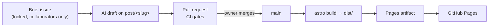

# Plan

Status: approved on 2026-10-25. The owner accepted the default for every question below. `HANDOFF.md` is the source of truth; this page records how its decisions are implemented, where current documentation forced a change, and the decisions taken at kickoff.

## Architecture



Three workflows: `pr.yml` (typecheck, build, tests, privacy check; content gates on `post/*` PRs), `deploy.yml` (on `main`: check, build and test, upload the Pages artifact, deploy through the `github-pages` environment, smoke-check the live site) and `lock-briefs.yml`. `verify` and the deploy build share their setup through the local action `.github/actions/setup` (F3).

## Versions

Checked on 2026-10-25 against the npm registry and official release pages. Pinned exactly when F1 scaffolds.

| Tool | Version | Note |
|---|---|---|
| Node | 26.x (26.12.1 today) | Active LTS from 2026-10-28; 24 entered maintenance on 2026-10-20 ([schedule](https://github.com/nodejs/Release#release-schedule)). Q1 |
| pnpm | 12.15.0 via corepack 0.36.0 | Node 25 and later no longer bundle [corepack](https://github.com/nodejs/corepack); install it from npm. Q2 |
| Astro | 7.4.2 | [Docs](https://docs.astro.build); requires Node ≥ 22.23 |
| TypeScript | 6.0.3 | Not 7.x: `@astrojs/check` 0.9.12 supports TypeScript 5–6 only |
| `@astrojs/check` · `rss` | 0.9.12 · 4.0.19 | Sitemap: own endpoint, not `@astrojs/sitemap` (deviation 8) |
| Shiki, `@shikijs/transformers` | 4.5.0 | [Transformers](https://shiki.style/packages/transformers) |
| Zod | from `astro/zod` (Zod 4) | No separate dependency ([collections](https://docs.astro.build/en/guides/content-collections/)) |
| Vitest | 5.0.5 | |
| Fonts | `@fontsource-variable/inter`, `@fontsource-variable/jetbrains-mono` 5.3.0 | OFL, self-hosted |
| `@astrojs/markdown-remark` | 7.3.4 | F2: keeps the remark/rehype pipeline (deviation 6) |
| `rehype-raw` · `rehype-sanitize` | 7.0.0 · 6.0.0 | |
| `unist-util-visit` · `hast-util-to-string` | 5.1.0 · 3.0.1 | Not 5.2.0: younger than pnpm 12's one-day [`minimumReleaseAge`](https://pnpm.io/settings/dependency-resolution#minimumreleaseage) on 2026-10-25 |
| `beautiful-mermaid` | 1.1.3 | F4: diagrams to SVG at build time ([repository](https://github.com/lukilabs/beautiful-mermaid)); brings `elkjs` 0.11.1 and `entities` 7.0.1 |
| `hast-util-from-html` · `hast-util-sanitize` · `hast-util-to-html` (dev) | 2.0.3 · 5.0.2 · 9.0.5 | F4: parse and sanitise the rendered SVG; already in the tree through `rehype-raw`, `rehype-sanitize` and Astro |
| `sharp` | 0.35.5 | F5: favicons and the default Open Graph image rendered from the monogram at build time; the version Astro already installs (optional dependency until now) |
| GitHub actions | `checkout` v7.0.1 · `setup-node` v7.1.0 · `cache` v6.1.0 · `upload-pages-artifact` v5.0.0 · `deploy-pages` v5.0.1 | Pinned by commit SHA (Q5), rechecked 2026-10-25 in F3. `configure-pages` is not used: it adapts other generators' configs, and Astro's `site` is fixed. GitHub's Pages guide still shows older majors |

## Fixed decisions (HANDOFF.md 4.2): implementation notes

| Concern | How |
|---|---|
| Framework | Astro 7, static output, `tsconfig` extends `astro/tsconfigs/strict` |
| Packages | Single package; `packageManager` field and `.nvmrc` pin pnpm and Node |
| Content | `src/content.config.ts`, `glob()` loader over `src/content/posts/*/index.md` (id = folder name), schema of section 6.2 in `src/lib/schema.ts` |
| Code highlighting | Custom Shiki theme from the 5.1 code tokens; `transformerMetaHighlight`; our own transformer turns token colours into classes (`tok-keyword`), so code carries no inline styles (see CSP). Runs in our rehype step after the sanitiser (deviation 7) |
| CSP | Astro's built-in `security.csp` (stable since Astro 6) writes the `<meta>` tag with hashes for the scripts and styles it emits; `default-src 'self'` and the other directives are added through `directives`. It does not hash `is:inline` scripts, so `astro.config.mjs` hashes the theme script itself. Astro documents that it does not cover Shiki's inline styles, which F2 replaces with classes ([reference](https://docs.astro.build/en/reference/configuration-reference/)) |
| Styling | Plain CSS with custom properties; F1 makes the case against a framework |
| Fonts | Astro's Fonts API, `fontProviders.local()` over the woff2 files of the `@fontsource-variable` packages, Latin subset: no CDN at build or run time, generated fallback metrics, Inter preloaded ([guide](https://docs.astro.build/en/guides/fonts/)). Deviation 5 |
| Privacy check | `scripts/privacy-check.ts`, run by Node's built-in TypeScript type stripping (no `tsx`); pre-commit hook in `.githooks/`, enabled by a `prepare` script setting `core.hooksPath`. Q10 |
| Tests | Vitest for utilities and plugins; a build-output test over `dist/` for privacy and metadata rules |

## Proposed defaults (HANDOFF.md 4.3)

**Diagrams.** Posts keep Mermaid in ```` ```mermaid ```` fences, which GitHub's PR preview renders natively. Only the build-time renderer is open. Q3.

| Option | C4 (mockup Fig. 2) | CI cost | Light and dark | Verdict |
|---|---|---|---|---|
| `beautiful-mermaid` 1.1.3 (pure TypeScript, no browser) | No C4 type: draw Fig. 2 as a flowchart with boundary subgraphs | Negligible | One SVG themed by CSS custom properties | **Chosen in F4** after the spike (Fig. 1 and Fig. 2 in 1–63 ms each). Young library, last release Feb 2026 |
| `rehype-mermaid` 3.0 + Playwright Chromium | Yes (Mermaid's C4 is experimental) | Browser download, roughly 30–60 s per run, cacheable | Two renders, or `themeCSS` mapped to variables | Fallback |
| D2 CLI | Through containers | Binary download in CI | Own themes, mapped by hand | No: GitHub's preview shows only the source |
| Pre-rendered SVGs, committed | Any | None | Manual | Last resort |

**Comments.** None on the site; each post ends with "Discuss on GitHub →", a link to a pre-filled new Discussion in the "Posts" category. Rejected: giscus and utterances, which load third-party scripts and iframes (section 3.4). Q4.

**Tag filtering.** Static `/tags/<tag>/` pages: no JavaScript, crawlable, nothing for the CSP to allow. Rejected: client-side filtering. Q4.

**Now.** A section inside About for v1, not its own page. Q4.

## Deviations from HANDOFF.md, forced by current documentation

1. "Node active LTS": no release line is in active LTS between 20 and 28 October 2026. Node 26 is the line that becomes it (Q1).
2. "pnpm via corepack": corepack has to be installed from npm on Node 26 (Q2).
3. "Latest stable versions": TypeScript stays on 6.0.3 until `@astrojs/check` supports 7.
4. Issue creation can now be restricted to collaborators natively ([changelog, June 2026](https://github.blog/changelog/2026-06-29-restrict-issue-creation-to-collaborators-only/)), so no expiring interaction limit is needed (Q6).
5. Fonts (F1): in Astro 7.4.2 the `npm` font provider with `remote: false` fails the build. unifont returns `file://` URLs, and Astro's font fetcher reads only plain paths. The `local` provider over the same package files gives the same result. Revisit when Astro fixes it.
6. Markdown (found while writing the F2 brief): since Astro 7 the default `.md` processor is Sätteri, Astro's native pipeline, which has its own plugin API and does not run remark/rehype plugins ([Markdown processors](https://docs.astro.build/en/guides/markdown-content/)). F2 uses `@astrojs/markdown-remark` with `processor: unified()` to keep the remark/rehype pipeline of HANDOFF.md 4.2.
7. Highlighting (F2): in `unified()`, Astro runs its Shiki step before user rehype plugins and rehype-raw after them (read in the 7.3.4 source; the docs do not say). Sanitising after Astro's Shiki would mean allowlisting every class it emits, so `markdown.syntaxHighlight` is off and `src/plugins/rehype-code.ts` highlights after rehype-sanitize. HANDOFF.md 4.2's choice (Shiki with a custom theme and transformers) is unchanged.
8. Sitemap (F2): our own `src/pages/sitemap.xml.ts` instead of `@astrojs/sitemap`, whose `filter` sees only URLs: leaving out unlisted posts would need a second frontmatter parser in `astro.config.mjs`. A build-output test checks that the sitemap lists exactly the indexable pages.
9. Diagrams (F4): `beautiful-mermaid` reports no syntax errors; it skips a line it cannot parse. `src/plugins/rehype-diagrams.ts` renders each diagram line by line and fails the build on a line that changes nothing or drops an arrow. Its start arrowhead (`<---`, `<-->`) is drawn reversed in 1.1.3; the theme pass corrects it. Mermaid's own C4 diagram is experimental with a fixed style, so C4 views are flowcharts with a boundary subgraph (HANDOFF.md 4.3 lists C4).

## Kickoff decisions

Asked as open questions in F0; the owner accepted all ten defaults on 2026-10-25. Q7 was confirmed during setup: the global address belongs to a different account ID.

1. **Node 26** (26.12.1), not 24. It becomes active LTS on 28 October and is supported to April 2029; 24 is already in maintenance.
2. **Install corepack 0.36.0 from npm and pin pnpm 12.15.0 in `packageManager`**; CI does the same with `npm install -g`. It keeps the handoff's decision without a third-party pnpm action.
3. **Diagrams: Mermaid source, F4 starts with a 15-minute `beautiful-mermaid` spike** on Fig. 1 and Fig. 2, falling back to `rehype-mermaid`. No browser in CI, and one SVG serves both themes.
4. **Accept the 4.3 defaults for comments, tag pages and Now.** All three ship zero JavaScript and no third party.
5. **Pin actions to full commit SHAs and turn on "Require actions to be pinned to a full-length commit SHA".** Tags can be moved after the fact; SHAs cannot.
6. **Restrict issue creation with the native "Collaborators only" setting.** Interaction limits expire after at most six months and would also stop readers from commenting in Discussions.
7. **Set a repo-local `user.email` to the no-reply address of `chau-minh-tieu`.** The global git config on this machine uses the no-reply address of a different login, so commits would not link to the repository owner.
8. **Keep the `Co-Authored-By: Claude` trailer on commits Claude makes.** The trailer carries Anthropic's non-personal no-reply address, the same kind of address as the owner's own commit identity, and matches the site's AI disclosure. This page does not spell it out, because committed files contain no email addresses.
9. **Commit the mockup monograms as they are, strip their metadata when F5 copies them to `public/brand/`.** They carry a C2PA content-credentials block naming the generating tool; it holds no personal data and the privacy scan is clean.
10. **Pre-commit hook without a dependency** (`.githooks/` and `core.hooksPath`). Nothing extra to trust or update, compared with husky or lefthook.

## Later decisions

- **2026-10-25, after F1: the time budget may run over.** Nothing is scoped down at the checkpoints of HANDOFF.md 2.4, and features run in the order of section 8. Elapsed time is still reported in every debrief.
- **2026-10-25, at the start of F2: one feature per chat.** Each feature's chat writes its own brief against current docs and waits for "go"; builds and opens the PR; waits while the owner reviews and asks questions (logged in the debrief's Q&A); on "review done" gives the merge command and never merges; verifies the merge read-only; and ends with a handoff prompt for the next chat. A debrief's "Next" names the next feature instead of containing its brief. Recorded in HANDOFF.md 2.1 and 7, and CLAUDE.md rules 1 and 6.
- **2026-10-25, during the F2 review: feature-branch pushes need no approval.** Claude Code commits, pushes to `feat/*` and `post/*` and opens the PR without asking; the owner runs the merge. `.claude/settings.json` now allows `git push [-u] origin feat/*` and `post/*` and asks only for a bare `git push`, whose target the rule cannot see; pushes to `main`, force pushes and deletions stay denied. Recorded in HANDOFF.md 3.2 and CLAUDE.md.
