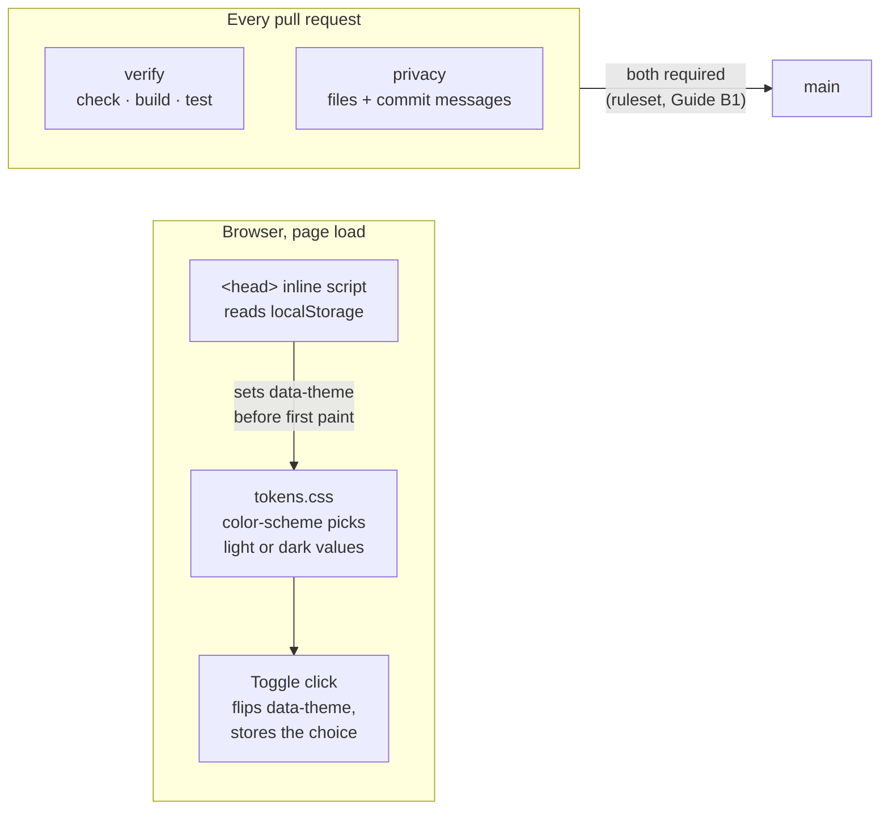

# F1 — Scaffold and design foundation

## Brief

**Purpose.** Build the empty shell every page will share: the Astro project, self-hosted fonts, the colour tokens for both themes, the base layout with nav and footer, a theme toggle without a flash of the wrong theme, and the Content Security Policy. Add the PR workflow every later feature must pass, and the ruleset that makes passing it mandatory (Setup Guide B1).

**What you will learn**

- `[Astro]` Project anatomy: `astro.config.mjs`, `src/pages/` as routes, layouts and components. Static output means each page is a server-side template rendered once at build time into a file.
- `[CSS]` Custom properties as configuration injected at runtime: `tokens.css` defines `--bg`, `--ink` and the rest; the dark theme swaps the values, never the rules.
- `[CSS]` `prefers-color-scheme` with a `data-theme` override, and why the override must be applied before the first paint.
- `[CI/CD]` Workflow anatomy: trigger, jobs, steps, per-job `permissions`, and how a job name becomes a required status check.
- `[TS]` Strict mode and `astro check`, the type checker that also understands `.astro` files.

**Decisions** (defaults in bold)

1. **Scaffold from Astro's `minimal` template with `pnpm create astro@latest`, then trim.** Exact version pins (`save-exact`), `.nvmrc` with Node 26.12.1, `packageManager` with pnpm 12.15.0.
2. **Fonts through Astro's Fonts API with `fontProviders.npm({ remote: false })`, reading `@fontsource-variable/inter` and `@fontsource-variable/jetbrains-mono` from `node_modules`.** `remote: false` stops the CDN fallback, so builds make no font requests and the site serves the files itself. Astro also generates metric-matched fallback fonts, which cuts layout shift while fonts load, and preloads only the Inter file. Plain `@fontsource` CSS imports are the fallback if the provider misbehaves ([Fonts guide](https://docs.astro.build/en/guides/fonts/), [provider reference](https://docs.astro.build/en/reference/font-provider-reference/)).
3. **No CSS framework.** The tokens already are custom properties; Tailwind would add a build step and a second vocabulary for the same values.
4. **Theme: `<html data-theme>` set by a few lines of inline script in `<head>` before first paint, reading `localStorage` inside `try/catch`.** With no stored choice, CSS follows `prefers-color-scheme`. The toggle is a two-state button (44 px target) that flips the current theme and remembers it.
5. **CSP through Astro's `security.csp`**, which hashes the inline theme script and every stylesheet. Added directives: `default-src 'self'`, `img-src 'self' data:`, `font-src 'self'`, `object-src 'none'`, `base-uri 'self'`, `form-action 'none'`. `frame-ancestors` is ignored in a `<meta>` CSP and GitHub Pages cannot set headers, so clickjacking protection is not available; documented, accepted for a read-only site.
6. **`pr.yml` with two jobs.** `verify`: install, `astro check`, `vitest run`, `astro build`. `privacy`: scans tracked files and the PR's commit messages with `PRIVACY_TERMS`, and skips with a notice when the secret is empty (fork PRs). Node from `.nvmrc`, corepack installed from npm, pnpm store cached with `actions/cache`, every action pinned by SHA.
7. **`scripts/privacy-check.ts`, run by Node's type stripping.** Modes `--staged` (pre-commit), `--tracked` (CI) and `--commits <range>` (CI). It reads `.privacy-terms` locally or `PRIVACY_TERMS` in CI: one term per line, `#` comments, case- and diacritics-insensitive whole-word or whole-phrase matching. It prints file, line and term index only and exits 1 on any hit. It also flags email-like strings in tracked files.
8. **Pre-commit hook in `.githooks/pre-commit`**, enabled by a `prepare` script that runs `git config core.hooksPath .githooks`.
9. **Nav mark: the oxblood monogram, copied to `public/brand/` with its metadata stripped.** Favicon and Open Graph stay in F5.
10. **Setup Guide B1 once the PR's checks are green:** a ruleset on `main` requiring a pull request (0 approvals, since an owner cannot approve their own PR) and the `verify` and `privacy` checks, blocking force pushes and deletion, with no bypass list.

**Acceptance criteria**

- `pnpm dev` shows the shell (nav with monogram, "Chau Tieu", Writing · Projects · About, theme toggle; footer copy from HANDOFF.md 5.3) matching the mockup in light and dark.
- The toggle works, survives a reload, and reloading in either theme shows no flash of the other.
- `pnpm check`, `pnpm test`, `pnpm build` and `pnpm privacy` are green locally. The built HTML carries a CSP `<meta>` starting with `default-src 'self'` and references no external origin.
- `verify` and `privacy` are green on the PR. Screenshots of both themes are in the PR body.
- After Guide B1, read-only checks show the ruleset, and a direct push to `main` is refused.

**Timebox.** 50 minutes of the owner's time.

**Docs.** [Astro project structure](https://docs.astro.build/en/basics/project-structure/) · [Astro `security.csp`](https://docs.astro.build/en/reference/configuration-reference/) · [MDN: `prefers-color-scheme`](https://developer.mozilla.org/en-US/docs/Web/CSS/@media/prefers-color-scheme) · [Workflow syntax](https://docs.github.com/en/actions/writing-workflows/workflow-syntax-for-github-actions) · [About rulesets](https://docs.github.com/en/repositories/configuring-branches-and-merges-in-your-repository/managing-rulesets/about-rulesets)

---

## Debrief

### 1. What was built

The shell every page shares, the checks every PR must pass, and the ruleset that makes them mandatory.



| Area | Result |
|---|---|
| Project | Astro 7.4.2, static output, TypeScript strict, exact pins, Node 26.12.1, pnpm 12.15.0 |
| Fonts | Inter (weight and optical size) and JetBrains Mono from `@fontsource-variable`, served from `/_astro/fonts/`, metric-matched fallbacks, Inter preloaded |
| Design | Colour, type and layout tokens; nav with the monogram, three links and the toggle; footer with the 5.3 copy |
| Theme | OS setting by default; the toggle overrides it, survives reloads, never flashes |
| CSP | `default-src 'self'` and five more directives; inline scripts and styles allowed by SHA-256 hash only |
| Checks | `pnpm check`, `build`, `test` (19 tests), `privacy`; pre-commit and commit-msg hooks; `pr.yml` with `verify` and `privacy` |

Screenshots of both themes are in the PR and in [`img/`](img/).

**Setup Guide B1: ruleset on `main`.** Apply after the PR's checks are green.

1. Repository → **Settings** → **Rules** → **Rulesets** → **New ruleset** → **New branch ruleset**.
2. **Ruleset name** `main`; **Enforcement status** Active; **Bypass list** empty.
3. **Target branches** → **Add target** → **Include default branch**.
4. Rules: keep **Restrict deletions** and **Block force pushes** ticked. Tick **Require a pull request before merging**, required approvals **0**. Tick **Require status checks to pass** → **Add checks** → `verify` and `privacy`, both from GitHub Actions. Leave everything else as it is.
5. **Create**.

Expected end state: one active ruleset targeting the default branch with the rules `deletion`, `non_fast_forward`, `pull_request` and `required_status_checks` (`verify`, `privacy`). Equivalent command, for the owner to run:

```sh
gh api -X POST repos/chau-minh-tieu/chau-minh-tieu.github.io/rulesets --input - <<'JSON'
{
  "name": "main",
  "target": "branch",
  "enforcement": "active",
  "bypass_actors": [],
  "conditions": { "ref_name": { "include": ["~DEFAULT_BRANCH"], "exclude": [] } },
  "rules": [
    { "type": "deletion" },
    { "type": "non_fast_forward" },
    { "type": "pull_request", "parameters": {
        "required_approving_review_count": 0,
        "dismiss_stale_reviews_on_push": false,
        "require_code_owner_review": false,
        "require_last_push_approval": false,
        "required_review_thread_resolution": false } },
    { "type": "required_status_checks", "parameters": {
        "strict_required_status_checks_policy": false,
        "required_status_checks": [
          { "context": "verify", "integration_id": 15368 },
          { "context": "privacy", "integration_id": 15368 } ] } }
  ]
}
JSON
```

`integration_id` 15368 is the GitHub Actions app: only a check reported by Actions satisfies the rule, not one with the same name posted by anything else.

**Verified on 2026-10-25, read-only.** `GET /rulesets`: one ruleset, `main`, `active`, target `~DEFAULT_BRANCH`, no bypass actors, `current_user_can_bypass: never`. `GET /rules/branches/main`: `deletion`, `non_fast_forward`, `pull_request` (0 approvals) and `required_status_checks` (`verify` and `privacy`, integration 15368, not strict). PR #2 stayed `CLEAN` and mergeable with both checks green. The refused direct push was not tried: pushing to `main` is itself against the guardrails, and the rules API shows the push rules that apply to `main`.

### 2. File tour

| File | Single responsibility | Depends on |
|---|---|---|
| `package.json` | Scripts, exact dependency pins, `packageManager` (pnpm 12.15.0), `engines` | — |
| `.nvmrc` | Node version for nvm and for `setup-node` in CI | — |
| `pnpm-workspace.yaml` | pnpm settings; here only `saveExact` (pnpm 11+ reads its settings from this file, not `.npmrc`) | — |
| `pnpm-lock.yaml` | Exact dependency tree; CI installs with `--frozen-lockfile` | `package.json` |
| `astro.config.mjs` | Site URL, fonts, CSP directives, the theme script's hash | `src/scripts/theme-init.js` |
| `tsconfig.json` | Astro's strict preset, Node types, `erasableSyntaxOnly` (only TypeScript that Node can strip) | `astro/tsconfigs/strict` |
| `src/styles/tokens.css` | Design tokens: colours as `light-dark()` pairs, type scale, layout | — |
| `src/styles/base.css` | Element defaults, `.wrap` column, `.label`, skip link | `tokens.css` |
| `src/scripts/theme-init.js` | Applies the stored theme before the first paint | — |
| `src/layouts/BaseLayout.astro` | The HTML document: `<head>`, fonts, nav, `<main>` slot, footer | styles, components, `theme-init.js` |
| `src/components/SiteNav.astro` | Monogram, name, section links with `aria-current`, toggle | `ThemeToggle.astro` |
| `src/components/ThemeToggle.astro` | The 44 px button, its icons and click handler | — |
| `src/components/SiteFooter.astro` | Footer copy and links | — |
| `src/pages/index.astro` | Home; F1 ships the hero only | `BaseLayout.astro` |
| `public/brand/monogram-oxblood.svg` | Nav mark, metadata stripped | — |
| `scripts/lib/privacy.ts` | Matching rules: normalisation, terms, emails, line numbers | — |
| `scripts/privacy-check.ts` | CLI around those rules: what to scan, how to report, exit codes | `scripts/lib/privacy.ts`, `git` |
| `scripts/lib/privacy.test.ts` | Unit tests of the matching rules, with fictitious terms | `privacy.ts` |
| `tests/build-output.test.ts` | Rules on `dist/`: CSP and hashes, no external origins, no emails, clean SVGs | `pnpm build` |
| `.githooks/pre-commit`, `.githooks/commit-msg` | Privacy check on staged files and on the message | `privacy-check.ts` |
| `.github/workflows/pr.yml` | `verify` and `privacy` jobs on every PR into `main` | the scripts above |
| `docs/features/img/01-shell-*.png` | Screenshots for the PR and this debrief | — |

### 3. Concepts

**Astro project anatomy and static output** `[Astro]`
- Mental model: an `.astro` file is a server-side template, like a Thymeleaf or Jinja page, except it is rendered once, at build time, into a plain HTML file. The part between the `---` fences is code that runs during the build; the rest is markup. `src/pages/` is the router: `index.astro` becomes `/index.html`.
- Here: `src/pages/index.astro` wraps its content in `BaseLayout.astro`, which pulls in `SiteNav` and `SiteFooter`. Component `<style>` blocks are scoped: Astro adds a `data-astro-cid-…` attribute to the markup and to the selectors, so `.links` in the nav cannot collide with `.links` in the footer. A component `<script>` is bundled into a module that runs after the page is parsed.
- Mistakes: expecting frontmatter code to run in the browser (it never ships); using `document` or `localStorage` in frontmatter (there is no browser at build time); forgetting that `is:inline` turns off bundling, TypeScript and hashing for that script.
- Docs: [Project structure](https://docs.astro.build/en/basics/project-structure/), [Scripts](https://docs.astro.build/en/guides/client-side-scripts/)

**Custom properties and `light-dark()`** `[CSS]`
- Mental model: a custom property is configuration injected at runtime. Rules read `var(--ink)`; changing the value changes every rule that reads it, with no rule rewritten. `light-dark(a, b)` stores both values in one token, and the `color-scheme` property on `<html>` picks one. `color-scheme: light dark` means "follow the OS", which is `prefers-color-scheme` underneath.
- Here: `src/styles/tokens.css` declares each colour once, for example `--bg: light-dark(#faf8f3, #141311)`. `[data-theme='dark']` sets `color-scheme: dark`, and that is the whole dark theme. Everything else uses the tokens.
- Mistakes: duplicating every token inside a `@media (prefers-color-scheme: dark)` block and again for the override (it works, but the copies drift); using `light-dark()` for non-colour values (it only accepts colours); hard-coding a hex value in a component instead of a token.
- Docs: [MDN: `light-dark()`](https://developer.mozilla.org/en-US/docs/Web/CSS/color_value/light-dark), [MDN: `prefers-color-scheme`](https://developer.mozilla.org/en-US/docs/Web/CSS/@media/prefers-color-scheme)

**Theme without a flash** `[CSS]` `[TS]`
- Mental model: the browser paints as soon as it has the HTML and the CSS. Anything that changes the theme later (a deferred module, a framework hydrating) arrives after the first paint, so the reader sees the wrong theme for a moment. A small synchronous script in `<head>` runs before the body is parsed, so its decision is in place before anything is drawn.
- Here: `src/scripts/theme-init.js` (four lines) is inlined by `BaseLayout.astro` with `is:inline` and sets `data-theme` from `localStorage`. The toggle in `ThemeToggle.astro` is an ordinary bundled script: by the time anyone can click, it has loaded. `aria-pressed` tells screen readers the current state.
- Mistakes: putting the bootstrap in a component script (deferred, so it flashes); reading `localStorage` without `try/catch` (it throws when storage is blocked); storing "dark" even when it matches the OS (harmless, but then later OS changes are ignored; that is the expected trade-off of an explicit choice).
- Docs: [MDN: `Window.localStorage`](https://developer.mozilla.org/en-US/docs/Web/API/Window/localStorage)

**Content Security Policy in a `<meta>` tag** `[Astro]`
- Mental model: an allowlist for what the page may load and execute, enforced by the browser. `default-src 'self'` means same origin only. Inline code is the usual XSS vector, so inline scripts and styles run only if their exact SHA-256 hash is listed, like a checksum allowlist.
- Here: `security.csp` in `astro.config.mjs` adds the hashes of everything Astro emits. Astro does not hash `is:inline` scripts, so the config reads `theme-init.js` and adds its hash itself. `tests/build-output.test.ts` recomputes the hash of every inline script and style in `dist/` and fails if one is missing from the policy.
- Mistakes: testing the CSP in `pnpm dev` (it is only written at build time); adding `'unsafe-inline'` to "fix" a blocked style (it disables protection for the whole directive); inline `style="…"` attributes, which hashes do not cover.
- Docs: [Astro `security.csp`](https://docs.astro.build/en/reference/configuration-reference/), [MDN: CSP](https://developer.mozilla.org/en-US/docs/Web/HTTP/Guides/CSP)

**Workflow anatomy and required checks** `[CI/CD]` `[GitHub]`
- Mental model: a workflow is a pipeline definition. `on:` is the trigger, each job runs on a fresh VM, steps run in order, `permissions:` scopes the job's token. A job's `name:` becomes the check name on the PR, and a ruleset turns named checks into a merge gate.
- Here: `.github/workflows/pr.yml`. `verify` installs, typechecks, builds and tests. `privacy` needs only Node, so it skips the install. Secrets and event data reach scripts through `env:`; the commit range is passed as an argument, never spliced into shell code.
- Mistakes: renaming a job and forgetting the ruleset (the PR then waits forever for a check that never reports); `pull_request_target` to get secrets on forks; a tag pin such as `@v7`.
- Docs: [Workflow syntax](https://docs.github.com/en/actions/writing-workflows/workflow-syntax-for-github-actions), [About rulesets](https://docs.github.com/en/repositories/configuring-branches-and-merges-in-your-repository/managing-rulesets/about-rulesets)

### 4. Verify it yourself

| Do this | Correct result |
|---|---|
| `pnpm install` | Finishes; `git config core.hooksPath` prints `.githooks` |
| `pnpm dev`, open http://localhost:4321 | The page in the screenshots; the moon or sun button flips the theme |
| Click the toggle, reload | Same theme after the reload, no flash of the other one |
| `pnpm check` | `0 errors`, `0 warnings` |
| `pnpm build && pnpm test` | `Tests 19 passed` |
| `pnpm privacy` | `privacy: clean (… file(s), 0 commit message(s), N term(s))` |
| `pnpm preview`, view source | `<meta http-equiv="content-security-policy" content="default-src 'self';…">`; DevTools console shows no CSP errors |
| `gh pr checks 2` | `verify pass`, `privacy pass` |
| `gh api -X GET repos/chau-minh-tieu/chau-minh-tieu.github.io/rules/branches/main --jq '.[].type'` | After Guide B1: `deletion`, `non_fast_forward`, `pull_request`, `required_status_checks` |

### 5. Check your understanding

1. Why does the theme bootstrap live in `<head>` as an inline script, while the toggle's click handler is a normal bundled script?
   <details><summary>Answer</summary>The bootstrap must run before the first paint, so it has to be synchronous and already in the HTML. A bundled module script is deferred and would run after the browser has drawn the page in the default theme. The click handler only has to be ready before someone clicks, so the deferred bundle is fine, and it gets TypeScript and an automatic CSP hash for free.</details>
2. You add `<p style="color: red">` to a page and the colour does not apply after `pnpm build && pnpm preview`, although it does in `pnpm dev`. Why, and what is the right fix?
   <details><summary>Answer</summary>The CSP is only written at build time. Its <code>style-src</code> lists hashes, and hashes do not allow inline <code>style</code> attributes. The fix is a class in a stylesheet (or a scoped <code>&lt;style&gt;</code>), not <code>'unsafe-inline'</code>. The build-output test also fails on any <code>style="</code> attribute.</details>
3. A future PR renames the job `verify` to `ci`. What happens after Guide B1, and what must change?
   <details><summary>Answer</summary>The ruleset still requires a check named <code>verify</code> from GitHub Actions. Nothing reports it any more, so the PR shows "Expected — waiting for status" and cannot be merged. The ruleset has to be updated to the new name in the same change.</details>

### 6. Deviations and gotchas

- **Fonts use the `local` provider, not `npm`.** In Astro 7.4.2, `fontProviders.npm({ remote: false })` fails the build: unifont returns `file://` URLs and Astro's font fetcher only reads plain paths. The `local` provider points at the same `@fontsource-variable` woff2 files through package paths, so the outcome is the one the brief wanted: self-hosted, metric-matched fallbacks, preload. Recorded in `docs/00-plan.md` (deviation 5).
- **Latin subset only.** The site is English only. The `local` provider cannot preload by subset, and the Inter latin-ext file is 133 KB, so only the Latin files are served; rare characters fall back to the system font. JetBrains Mono italic is included now for code comments (F2); browsers fetch it only when it is used.
- **`is:inline` scripts are not hashed by Astro.** The theme script ran anyway because Astro writes the CSP `<meta>` after the head content, and a `<meta>` policy only covers what follows it. Relying on that order would be fragile, so the config hashes the script explicitly and a test checks every inline hash.
- **CSP relaxations: none.** No `'unsafe-inline'`, no external origin. `img-src` allows `data:` for small inline images. Not available through `<meta>`: `frame-ancestors` (clickjacking protection) and reporting; GitHub Pages cannot send headers. Accepted for a read-only site, as the brief said.
- **`light-dark()` instead of a duplicated `@media` block.** Same behaviour as the brief describes, one declaration per token. Supported by all current browsers since 2024; a browser without it shows dark text on white.
- **Step order in `verify` is check, build, test** (the brief listed test before build): the build-output tests need `dist/`. Locally they are skipped without a build; in CI a missing `dist/` fails the run.
- **Added a `commit-msg` hook** next to the pre-commit hook, because commit messages are public too. Commit messages are scanned for terms only: commit trailers carry addresses by design (the co-author line).
- **`PRIVACY_REQUIRE_TERMS`.** The `privacy` job skips the term scan only on fork PRs; on PRs from this repository an empty secret fails the job, so a deleted secret cannot silently pass. A Dependabot PR would also fail it (Dependabot PRs do not get Actions secrets); Dependabot is not configured.
- **Term index** counts terms only: blank and `#` lines are not counted. Each finding also prints the term's line in the list (`term #3 (.privacy-terms line 7)`), so it can be found without printing it.
- **Links that 404 until later features:** Projects, About and Colophon (F5), RSS (F2).
- **The footer year is the build year.** Every deploy rebuilds, so it rolls over with the first deploy of a new year.
- **pnpm 12 settings live in `pnpm-workspace.yaml`**, not `.npmrc`, even in a single-package repository.
- **Screenshots are committed** under `docs/features/img/` so the PR and this debrief can show them. Headless Chrome PNGs, checked: no metadata chunks.
- **The ruleset carries one parameter Guide B1 did not set:** `require_extra_approval_for_unattributed_changes: true`, which GitHub filled in by default. It did not block PR #2, whose commits are all attributed to `chau-minh-tieu`. If a future PR is blocked for an approval that 0 required approvals should not need, check this setting first.
- **No direct push to `main` was attempted** to prove the ruleset; the rules API shows what applies to `main` (part 1).

### 7. Time used

| | Time |
|---|---|
| F1, build | 14:05 to 14:25 by the clock: scaffold, styles, privacy check, CI, PR and these docs |
| F1, review and Guide B1 | 14:25 to 15:00: reading, applying the ruleset, verification |
| F1 total | about 57 minutes (14:05 to 15:02) against the 50-minute timebox, before the merge |
| Cumulative | about 1 h 47 min of 4–6 hours (F0 about 50 minutes) |

Checkpoint: in the planned order the site goes live (F3) at about 3 h 07 min cumulative, after the 2 h 30 min checkpoint. The owner accepted that: the budget may run over, nothing is cut, and features continue in order (Q&A log).

### 8. Q&A log

- **Time checkpoint.** The debrief noted that F2 then F3 would put the site live after the 2 h 30 min checkpoint, and offered running F3 first. Owner: it is fine to extend the time; do not scope anything down; build feature by feature in order. Recorded in HANDOFF.md 2.4, CLAUDE.md rule 9 and `docs/00-plan.md` ("Later decisions"); the F2 brief's fallback was removed.

### 9. Next

F2, content model and post page: [`docs/features/02-content-model.md`](02-content-model.md).
