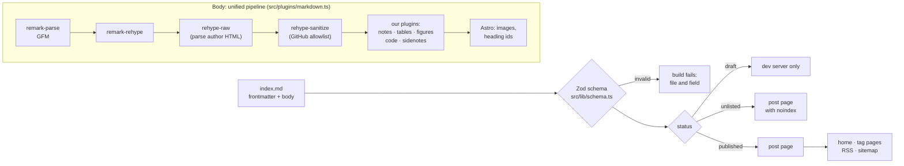

# F2 — Content model and post page

## Brief

**Purpose.** Turn a Markdown file into a finished post page: a typed content collection with the HANDOFF.md 6.2 schema, the mockup's post layout (numbered headings, contents, sidenotes, tables, notes, figures, code blocks with a copy button), statuses that decide what is built and listed, tag pages, RSS and a sitemap. One sample post exercises every component.

**What you will learn**

- `[Content]` Content collections: a typed table of posts validated at build time by a Zod schema, like a Pydantic model. Bad frontmatter fails the build, naming file and field.
- `[Astro]` The Markdown pipeline as a compiler: Markdown → mdast → hast → HTML, plugins as AST passes whose order decides what is safe. Dynamic routes and endpoints.
- `[TS]` Sanitising untrusted HTML with an allowlist, at the right point in the pipeline.
- `[CSS]` One grid for text and margin notes, folding at 960 px; CSS counters.
- `[Astro]` Shiki at build time with a custom theme, emitting classes so the CSP stays strict.

**Decisions** (defaults in bold)

1. **Processor: `@astrojs/markdown-remark` 7.3.4 with `processor: unified()`.** Sätteri, Astro 7's default, runs no remark/rehype plugins. From the package source (the docs are silent): `markdown.shikiConfig` still applies, and Astro runs Shiki *before* our rehype plugins and rehype-raw *after* them.
2. **Sanitise first: our rehype list starts with `rehype-raw` 7.0.0 and `rehype-sanitize` 6.0.0; our transforms and Shiki run after.** The README says to sanitise "after the last unsafe thing", here parsing the author's HTML. Schema: GitHub's default without `<style>` and `mailto:`; `id` and `name` keep the `user-content-` prefix. Astro's own Shiki is off, since sanitising after it would mean allowlisting every class we emit. *The draft sanitised last.*
3. **Collection: `glob()` over `src/content/posts/*/index.md`;** Astro drops `/index` from ids, so the folder name is the slug. Schema in `src/lib/schema.ts`: the 6.2 fields as a strict object (a typo like `pubdate`, or a `slug` key that would change the URL, fails); 1–2 distinct tags; `sources` required with `engineering` or `ai`; `updatedDate` ≥ `pubDate`; `status` required; `brief` optional (F6 requires it on post PRs).
4. **Statuses in `src/lib/posts.ts`:** `draft` is built only by `astro dev`; `unlisted` is built with `noindex` and left out of home, tags, RSS, sitemap and next/previous; only `published` is listed. Dates are formatted in UTC, because a YAML date is UTC midnight.
5. **Code: our `rehype-code.ts` on `shiki` 4.5.0,** with a theme from the 5.1 tokens, `transformerMetaHighlight` (`@shikijs/transformers` 4.5.0) for `{7}`, and a transformer that turns each token colour into a class (`tok-keyword`) and drops `<pre>` styles. Header with file name and language chip, line numbers by CSS counters (always on), horizontal scroll. Unknown languages fail the build; `mermaid` waits for F4.
6. **Copy button rendered `hidden`, revealed by a small bundled script** (hashed by Astro) using `navigator.clipboard`: without JavaScript there is no dead button.
7. **Our plugins in `src/plugins/`, unit-tested through `createMarkdownProcessor`** (Astro's own pipeline): GitHub alerts → notes; footnotes → sidenotes beside their paragraph, below it under 960 px; titled images → "Fig. N", framed as screenshots when named `screenshot-*`; a `Table: …` line above a table → "Table N" caption (Pandoc's convention, readable on GitHub); row headers when the top-left cell is empty; a "Verdict" row with its bold cell in the accent; a plain blockquote → pull quote.
8. **Post page `posts/[slug].astro` with `PostLayout.astro`:** tag, date, reading time (prose words, 230 wpm), title, dek, byline, "On this page" (depth 2), numbered `h2`. One CSS grid with a 680 px column and a 220 px margin replaces the mockup's per-block rows. Accent from the primary tag via `data-tag`. Footer: disclosure, numbered sources, "Discuss on GitHub →" (a pre-filled Discussion in "Posts"), next/previous.
9. **Home gains the Writing list (chips, rows, an empty state); `/tags/<tag>/` exists for all three tags,** so chips never 404. F5 finishes Home.
10. **`@astrojs/rss` 4.0.19 at `/rss.xml`; our own `sitemap.xml.ts` and `robots.txt` instead of `@astrojs/sitemap`,** whose filter sees only URLs and would need a second frontmatter parser to drop unlisted posts. A test checks that the sitemap lists exactly the built pages without `noindex`.
11. **Image metadata, tested:** sharp re-encodes images without it; the kitchen-sink image carries fake EXIF, GPS and XMP, and no served image may. Committed images are public too, so `privacy-check` flags tracked images with metadata (the fixture is allowlisted).
12. **Samples `kitchen-sink` (`unlisted`, fictitious, every component) and `draft-fixture` (`draft`).** Also pinned: `unist-util-visit` 5.1.0 (5.2.0 is younger than pnpm 12's one-day `minimumReleaseAge`), `hast-util-to-string` 3.0.1, `@types/hast` 3.0.5, `unified` 11.0.5. The review loop is recorded in HANDOFF.md 2.1, CLAUDE.md and the plan.

**Acceptance criteria**

- The kitchen-sink post matches `Post.dc.html` in light, dark and at 375 px; screenshots in the PR.
- Schema tests reject a missing `description`, three tags, `engineering` without `sources` and an unknown key; the debrief shows one failing build naming file and field.
- `draft` is absent from `dist/`; `unlisted` has `noindex` and is absent from home, tags, RSS and sitemap.
- Code blocks show theme colours, file name, highlighted line, horizontal scroll and a working copy button; no `style=` in `dist/`, CSP unchanged.
- `<script>`, `<style>`, `<iframe>`, `onerror=` and `javascript:` links in a post render inert.
- No served image carries metadata; `pnpm privacy` flags a tracked image that does.
- `pnpm check`, `build`, `test`, `privacy` green locally; `verify` and `privacy` green on the PR.

**Timebox.** 50 minutes of the owner's time; it may run over, and nothing here is cut (owner decision, 2026-10-25). Highest risk: sidenote placement in the grid and the Shiki class mapping.

**Docs.** [Content collections](https://docs.astro.build/en/guides/content-collections/) · [Markdown processors](https://docs.astro.build/en/guides/markdown-content/) · [Unified reference](https://docs.astro.build/en/reference/markdown-processors/unified/) · [Shiki transformers](https://shiki.style/packages/transformers) · [`rehype-sanitize`](https://github.com/rehypejs/rehype-sanitize) · [RSS recipe](https://docs.astro.build/en/recipes/rss/) · [Endpoints](https://docs.astro.build/en/guides/endpoints/) · [pnpm `minimumReleaseAge`](https://pnpm.io/settings/dependency-resolution#minimumreleaseage) · [GitHub alerts and footnotes](https://docs.github.com/en/get-started/writing-on-github/getting-started-with-writing-and-formatting-on-github/basic-writing-and-formatting-syntax)

---

## Debrief

### 1. What was built

A Markdown file in `src/content/posts/<slug>/index.md` becomes a finished post page, and only the right posts reach the lists and feeds.



| Area | Result |
|---|---|
| Content model | `posts` collection, strict Zod schema of HANDOFF.md 6.2, folder name = slug |
| Statuses | Drafts only on the dev server; unlisted built with `noindex`, never listed; one helper decides for every page |
| Pipeline | Raw HTML parsed, then sanitised, then our trusted transforms; nothing after the sanitiser parses author text as HTML |
| Components | Numbered sections and contents, sidenotes, notes, pull quote, captioned tables with verdict rows, numbered figures, screenshot frame, code blocks |
| Code | Shiki with the 5.1 theme, classes instead of inline styles, file name, language chip, highlighted lines, line numbers, copy button |
| Pages and feeds | Post page, home Writing list, three tag pages, `/rss.xml`, `/sitemap.xml`, `robots.txt` |
| Privacy | Committed and served images checked for metadata; fixture with fake EXIF, GPS and XMP proves the pipeline strips it |
| Checks | 82 tests (63 new): schema, helpers, pipeline, image metadata, build output |

**Writing a post: the conventions**

| You write | You get | GitHub's preview shows |
|---|---|---|
| `## Heading` | Numbered section, listed in "On this page" | A heading |
| `text[^1]` and `[^1]: note` | Sidenote in the margin, below the paragraph on phones | A footnote |
| `> [!NOTE]` (also TIP, IMPORTANT, WARNING, CAUTION) | Note with a label | An alert |
| `> A line` | Pull quote with an accent rule | A blockquote |
| `Table: Caption` right above a table | "Table N" caption | A line above the table |
| Empty top-left header cell | First column as row headers | A table |
| A row starting `Verdict`, best cell in `**bold**` | Verdict row, bold cell in the accent colour | A table |
| `` alone in a paragraph | "Fig. N" figure | The image |
| Image file named `screenshot-*.png` | Figure in a quiet window frame | The image |
| ```` ```sql title="roles.sql" {7} ```` | File name, SQL chip, line 7 highlighted | A code block |

Alt text is required (the build fails without it), and so is a known fence language (`text` for plain text). Mermaid fences wait for F4.

### 2. File tour

| File | Single responsibility | Depends on |
|---|---|---|
| `src/content.config.ts` | Declares the `posts` collection: where files are, which schema | `src/lib/schema.ts` |
| `src/lib/schema.ts` | Frontmatter rules of HANDOFF.md 6.2 | `astro/zod` |
| `src/lib/posts.ts` | Pure rules: statuses, order, neighbours, reading time, dates, footer links, tag copy | `schema.ts` types |
| `src/lib/collection.ts` | `builtPosts()` and `listedPosts()`: the only place that reads the collection | `astro:content`, `posts.ts` |
| `src/plugins/markdown.ts` | Pipeline order and the sanitiser schema, shared by `astro.config.mjs` and tests | the plugins below |
| `src/plugins/rehype-code.ts` | Fence meta kept through rehype-raw; Shiki highlighting; code block markup | `code-theme.ts`, `shiki` |
| `src/plugins/code-theme.ts` | Shiki theme from the 5.1 code tokens; colour → class map | — |
| `src/plugins/rehype-alerts.ts` | GitHub alerts → notes | `hast.ts` |
| `src/plugins/rehype-tables.ts` | Captions, row headers, verdict rows, scroll box | `hast.ts` |
| `src/plugins/rehype-figures.ts` | Alt text required; titled images → figures; screenshot frame | `hast.ts` |
| `src/plugins/rehype-sidenotes.ts` | Footnotes → sidenotes after the block that cites them | `hast.ts` |
| `src/plugins/hast.ts` | Small helpers to build and inspect HTML tree nodes | — |
| `src/layouts/PostLayout.astro` | Post header, contents, body slot, footer, copy script | `posts.ts`, styles |
| `src/pages/posts/[slug].astro` | One page per built post, with its neighbours | `collection.ts` |
| `src/pages/tags/[tag].astro` | One page per tag, published posts only | `collection.ts` |
| `src/pages/index.astro` | Home: hero and Writing list | `PostList`, `TopicChips` |
| `src/pages/rss.xml.ts` · `sitemap.xml.ts` | Feed and sitemap endpoints | `collection.ts` |
| `src/components/PostList.astro` · `TopicChips.astro` | Post rows with an empty state; topic links | `posts.ts` |
| `src/scripts/copy-code.ts` | Reveals copy buttons where the clipboard works; copies the code | — |
| `src/styles/prose.css` · `code.css` | Post layout and Markdown components; code blocks and token colours | `tokens.css` |
| `src/styles/tokens.css` | Gains dek, section and pull-quote sizes, post columns, frame and code colours | — |
| `scripts/lib/image-metadata.ts` | Finds EXIF, XMP, IPTC, C2PA and PNG text blocks in images | — |
| `scripts/privacy-check.ts` | Now also fails on committed images with metadata (fixture allowlisted) | `image-metadata.ts` |
| `tests/build-output.test.ts` | Adds: drafts absent, unlisted kept out, sitemap = indexable pages, components present, hostile HTML inert, images clean | `pnpm build` |
| `src/content/posts/kitchen-sink/` | Unlisted regression page with two generated images, one with fake metadata | — |
| `src/content/posts/draft-fixture/` | A draft that must never be built | — |
| `public/robots.txt` | Allows crawling, points to the sitemap | — |

### 3. Concepts

**Content collections and a Zod schema** `[Content]`
- Mental model: a typed table of posts. The loader is the reader (here: every `*/index.md` file), the schema is the table definition, like a Pydantic model validated on insert. Validation runs at build time, so a bad post never ships: the build fails with the file and the field.
- Here: `src/content.config.ts` points the `glob()` loader at `src/content/posts/` and hands it `postSchema` from `src/lib/schema.ts`. `z.strictObject` rejects unknown keys; `.superRefine` adds the cross-field rules (sources for engineering and AI posts, `updatedDate` ≥ `pubDate`). Pages never call `getCollection` directly: `src/lib/collection.ts` applies the status rules once.
- Mistakes: a plain `z.object`, which silently drops misspelt keys; trusting `getCollection`'s order (it is not guaranteed; `newestFirst` sorts); forgetting that frontmatter rendered as a link (`sources[].url`) is user input too, hence the `http(s)`-only URL rule.
- Docs: [Content collections](https://docs.astro.build/en/guides/content-collections/), [Zod](https://zod.dev/api)

**The Markdown pipeline: passes over a syntax tree** `[Astro]`
- Mental model: a compiler. remark parses Markdown into mdast (a Markdown syntax tree), remark-rehype converts it to hast (an HTML syntax tree), rehype plugins transform hast, and a stringifier writes HTML. Each plugin is a pass over the tree, and the order of passes decides what each one sees.
- Here: `astro.config.mjs` sets `markdown.processor: unified(markdownOptions)`; `src/plugins/markdown.ts` lists our rehype passes. Astro adds its own before and after ours (Shiki before, which is turned off; images, heading ids and rehype-raw after), which is why we parse raw HTML ourselves first. Tests run the same options through `createMarkdownProcessor`, so they exercise the real pipeline.
- Mistakes: assuming a plugin sees parsed HTML (raw HTML is an opaque `raw` node until rehype-raw); keeping data on nodes across rehype-raw (it rebuilds the tree and drops `data`, which is how the fence meta first got lost); writing remark plugins for things that are easier in hast.
- Docs: [Markdown processors](https://docs.astro.build/en/guides/markdown-content/), [Unified reference](https://docs.astro.build/en/reference/markdown-processors/unified/)

**Sanitising after the last unsafe step** `[TS]`
- Mental model: an allowlist firewall for HTML. Everything the author controls is untrusted, including Markdown links (`[x](javascript:…)`) and raw HTML. Sanitise once, at the point after which nothing parses author text as HTML; code after that point is trusted, like code behind an input-validation layer.
- Here: `rehype-raw` turns the author's HTML into real nodes, `rehype-sanitize` with GitHub's schema keeps only allowed elements and attributes (minus `<style>` and `mailto:`, plus `data-meta` on `<code>`), and our plugins add classes, buttons and sidenotes afterwards. Unit tests feed it scripts, styles, frames, handlers and `javascript:` links; a build-output test checks the kitchen-sink page.
- Mistakes: sanitising before rehype-raw (raw HTML is dropped unparsed, so harmless HTML is lost too); sanitising last with a schema widened for your own classes (authors may then use them as well); a plugin after the sanitiser that turns author strings into HTML.
- Docs: [`rehype-sanitize`](https://github.com/rehypejs/rehype-sanitize), [OWASP XSS prevention](https://cheatsheetseries.owasp.org/cheatsheets/Cross_Site_Scripting_Prevention_Cheat_Sheet.html)

**Shiki at build time, classes instead of inline styles** `[Astro]`
- Mental model: Shiki runs the same TextMate grammars as VS Code during the build and emits coloured spans; no JavaScript reaches the browser. A theme maps scopes (`keyword.control`, `string.quoted`) to colours, and the most specific scope wins.
- Here: `code-theme.ts` maps scopes to the eight 5.1 token colours; `transformerTokenClasses()` in `rehype-code.ts` replaces each `style="color:#c4a7e7"` with `class="tok-keyword"`, and `code.css` colours the classes. The CSP allows no inline style attributes, so this keeps highlighting compatible with it. A test keeps the colours in `code-theme.ts` and `tokens.css` in step.
- Mistakes: adding `'unsafe-inline'` to make Shiki's styles work; editing a colour in one place only; expecting every character to get a token (SQL's `;` has no scope and keeps the default colour).
- Docs: [Shiki themes](https://shiki.style/guide/load-theme), [Shiki transformers](https://shiki.style/packages/transformers)

**One grid for text and margin notes; CSS counters** `[CSS]`
- Mental model: CSS grid places items into cells. With two columns and items that only name their column, the browser fills rows in source order: a sidenote placed right after a paragraph lands in the second column of that paragraph's row. Counters are variables CSS increments as it walks the page.
- Here: `.prose` in `prose.css` is `minmax(0, 680px) 220px` with a 56px gap; every block gets column 1, `.sidenotes` column 2. Below 960px there is one column and the notes follow their paragraph. `counter(section)` numbers the `h2`s, and `counter(line)` the code lines; numbers are generated content, so they are not copied.
- Mistakes: a sidenote taller than its paragraph pushes the next block down (the row grows); `display: inline-flex` overriding the `hidden` attribute (hence `.code-copy[hidden]`); `1fr` instead of `minmax(0, …)`, which lets a wide code block stretch the column.
- Docs: [MDN: grid auto-placement](https://developer.mozilla.org/en-US/docs/Web/CSS/CSS_grid_layout/Auto-placement_in_grid_layout), [MDN: CSS counters](https://developer.mozilla.org/en-US/docs/Web/CSS/CSS_counter_styles/Using_CSS_counters)

### 4. Verify it yourself

| Do this | Correct result |
|---|---|
| `pnpm check` | `0 errors`, `0 warnings` |
| `pnpm build` | `5 page(s) built`; no `/posts/draft-fixture/` in the list |
| `pnpm test` | `Tests 82 passed` |
| `pnpm privacy` | `privacy: clean (… file(s), 9 image(s), …)` |
| `pnpm preview`, open http://localhost:4321/posts/kitchen-sink/ | The page in the screenshots: sidenotes in the margin, numbered sections, both code blocks highlighted |
| Click "Copy" on the SQL block, paste into an editor | The seven lines, no line numbers; the button shows "Copied" for two seconds |
| Narrow the window below 960px | Contents and sidenotes move under their text; the page never scrolls sideways |
| View source of the kitchen-sink page | `<meta name="robots" content="noindex">`; no `style="`, no `alert(` |
| Open `/rss.xml`, `/sitemap.xml`, `/` and `/tags/ai/` | No kitchen-sink entry anywhere |
| `pnpm dev`, open http://localhost:4321/posts/draft-fixture/ | The draft renders on the dev server only |
| Signed in to GitHub, click "Discuss this post on GitHub →" | A new discussion form in "Posts" with the title filled in |
| `gh pr checks 3` | `verify pass`, `privacy pass` (CI ran the same 82 tests and scanned 9 images) |
| Add `pubdate: 2026-10-25` to the kitchen-sink frontmatter and run `pnpm build` | `posts → kitchen-sink data does not match collection schema`, `Unrecognized key: "pubdate"`; undo the change |

### 5. Check your understanding

1. Why does our rehype list start with `rehype-raw` when Astro already runs it at the end of the pipeline?
   <details><summary>Answer</summary>Astro runs rehype-raw after our plugins, so when the sanitiser runs, raw HTML in a post is still an unparsed <code>raw</code> node. The sanitiser does not know that node type and drops it, harmless HTML included. Parsing first turns the author's HTML into real elements that the allowlist can inspect one by one. Astro's later rehype-raw then has nothing left to parse.</details>
2. A post body contains `<span style="color:red">`. Which two independent layers stop the colour reaching readers, and which test proves each?
   <details><summary>Answer</summary>The sanitiser drops the <code>style</code> attribute (GitHub's schema does not allow it; <code>src/plugins/markdown.test.ts</code>, "removes scripts, styles…"), and even if one slipped through, the CSP blocks inline style attributes in the browser. The build-output test fails on any <code>style="</code> in <code>dist/</code>, so neither layer can regress silently.</details>
3. You flip a post from `unlisted` to `published`. Which pages change, and how does the sitemap know without being edited?
   <details><summary>Answer</summary>The post page loses its <code>noindex</code>; it appears on the home page, on the tag pages of its tags, in <code>/rss.xml</code>, in <code>/sitemap.xml</code>, and as next/previous on its neighbours. All of them read <code>listedPosts()</code> in <code>src/lib/collection.ts</code>, so one status check drives every list, and the sitemap endpoint builds its list from the same function on every build.</details>

### 6. Deviations and gotchas

- **rehype-raw drops node data, and with it the fence meta.** remark-rehype keeps `title="roles.sql" {7}` in `data.meta` on `<code>`; rehype-raw rebuilds the tree without it. `rehypeCodeMeta` copies it to a `data-meta` attribute first, which is the one addition to GitHub's sanitiser schema. The attribute is read as plain text.
- **Astro's final rehype-raw moves whitespace out of tables.** HTML parsing "foster-parents" the newlines between table rows to before the table (it happens with none of our plugins). `rehype-tables.ts` removes whitespace inside tables, so the HTML stays tidy.
- **Ligatures off in code.** JetBrains Mono drew `->` and `<=` as single arrows; `base.css` sets `font-variant-ligatures: none` on code, so readers see what to type. Not in the brief.
- **Zod reports cross-field rules only once the shape is valid.** A post with three tags and no sources first fails on the tags; the sources error appears on the next build.
- **`@types/hast` 3.0.5 types every property.** `className` is `string[]` and SVG attributes such as `strokeWidth` are strings, so the code uses those types instead of loose values.
- **The copy button was checked with a stand-in for the clipboard.** The in-app browser blocks clipboard reads, so a test replaced `navigator.clipboard.writeText` and confirmed the exact text, the "Copied" label and the reset. Real copying is in part 4.
- **The discussion link: category checked, pre-fill not.** The "Posts" category exists at slug `posts`. Signed out, GitHub sends readers to sign in and keeps the whole pre-filled link; I did not sign in to see the form. Part 4 has the check.
- **One colour for every language chip** (the function blue). The mockup used blue for SQL and teal for Python, but colours in code mean token kinds (HANDOFF.md 5.1), not languages.
- **The default disclosure is HANDOFF.md 5.3's sentence**, which mentions "the project's code". A post without code should set `disclosure`; `STYLE.md` (F6) should say so.
- **A plain blockquote is always the pull quote.** Quoting a source in a blockquote would look like a pull quote; `STYLE.md` (F6) should reserve blockquotes for pull quotes.
- **Only Markdown image syntax goes through the image pipeline.** A raw `` would not be resized, stripped or copied; `STYLE.md` (F6) should forbid it.
- **Figures are column width.** Wide break-out figures arrive with the diagrams in F4, which must also share the "Fig. N" counter.
- **Mobile screenshot.** Headless Chrome has a minimum window width of about 500px, so the 375px screenshot is a 375px iframe, cropped. The in-app browser confirmed the layout at 375px directly.
- **PR screenshots link to a commit, not the branch.** PR #2's images point at `feat/01-scaffold`, which no longer exists, so they are broken now; PR #3's survive the branch deletion.
- **Lockfile.** At the start of this chat `pnpm-lock.yaml` again had the `@pnpm/exe` entry; it was restored before branching. The committed lockfile has none.
- **Open Graph and Twitter meta stay in F5**, with the defaults; posts already have title, description, canonical URL and `noindex` where needed.

### 7. Time used

| | Time |
|---|---|
| F2, brief | 15:23 to 15:35 by the clock: reading, docs and source checks, the revised brief |
| F2, build | 15:38 to 16:05: build, checks, screenshots, PR #3 with both checks green, this debrief |
| F2 so far | about 42 minutes of the 50-minute timebox, before review and merge |
| Cumulative | about 2 h 42 min of the planned 4–6 hours |

### 8. Q&A log

- **Pushes to feature branches (owner instruction).** Committing and pushing feature branches and opening the PR need no permission; the owner runs the merge command. Asked whether `.claude/settings.json` should match, the owner said yes. Mental model: Claude Code checks deny rules first, then ask, then allow, and the first match wins regardless of how specific a rule is ([permissions](https://code.claude.com/docs/en/permissions)). The old ask rule `Bash(git push *)` matched every push, so allow rules alone would have changed nothing. Now: `git push [-u] origin feat/*` and `post/*` are allowed; a bare `git push` still asks, because its target branch is not in the command text; the deny rules still refuse `main`, `--force`, `+refspec` and deletions, even inside an allowed pattern such as `git push origin feat/x:main`. Recorded in HANDOFF.md 3.2, CLAUDE.md and `docs/00-plan.md`.
- **What is a Zod schema?** A validator and a type in one declaration: Pydantic for TypeScript, or Bean Validation annotations plus the record they sit on. TypeScript types are erased at compile time, so data from outside the program (frontmatter, JSON) is never checked unless something checks it at run time; Zod does, and `z.output<typeof postSchema>` derives the static type from the same declaration, so the two cannot drift. Here, `src/content.config.ts` hands `postSchema` (`src/lib/schema.ts`) to the collection: Astro parses every post's frontmatter with it at build time and fails with file and field, and pages get `post.data` fully typed for `pnpm check`. `parse` also returns a cleaned copy: dates coerced, defaults filled, strings trimmed. Mistakes: an `interface` alone for external data (no run-time check); `z.object`, which silently drops a misspelt key, hence `z.strictObject`; expecting all errors at once (refinements run only after the shape is valid). Docs: [Zod API](https://zod.dev/api).
- **How does the site work, from the entry point to the rendered pages?** It is a batch job, not a server: `pnpm build` runs Astro once in Node and writes plain files to `dist/`; GitHub Pages (F3) only serves them. Astro loads `astro.config.mjs`, syncs the collection (`src/content.config.ts`: `glob()` finds the posts, Zod validates the frontmatter, the unified pipeline turns each body into HTML, cached in `.astro/data-store.json`), finds the routes (every file in `src/pages/` is a URL; `getStaticPaths()` expands `posts/[slug]` and `tags/[tag]`), renders each page through its layout and components, runs the endpoints (`rss.xml.ts`, `sitemap.xml.ts`), then bundles CSS and JS, writes the CSP with hashes, copies fonts and re-encodes images. All lists read `listedPosts()` (`src/lib/collection.ts`), so one status rule drives home, tags, RSS and sitemap. In the browser only three small scripts run: the theme bootstrap, the toggle and the copy buttons. `pnpm dev` renders on request with drafts and without the CSP; `pnpm build` renders everything once; `pnpm preview` serves `dist/` as Pages will. File roles: part 2 of this debrief and F1's file tour.

  ```mermaid
  flowchart LR
    B["pnpm build"] --> C["astro.config.mjs"]
    C --> S["content sync<br/>glob · Zod · Markdown → HTML"]
    S --> R["routes in src/pages<br/>getStaticPaths"]
    R --> P["render pages<br/>layouts · components"]
    R --> E["endpoints<br/>rss · sitemap"]
    P --> O["bundle · CSP hashes<br/>fonts · images"]
    E --> D["dist/"]
    O --> D
  ```

### 9. Next

F3, deploy to Pages.
