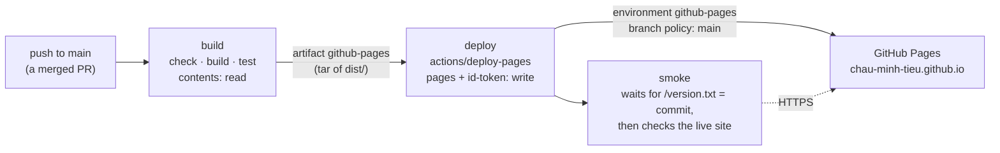

# F3 — Deploy to Pages

## Brief

**Purpose.** Put the site live at https://chau-minh-tieu.github.io. Every push to `main` builds the site once, checks it, uploads `dist/` as a Pages artifact and deploys exactly that artifact through the `github-pages` environment. Smoke checks then confirm that the live site serves the new commit and behaves as the build-output tests promise. Setup Guide B2 makes the environment strict.

**What you will learn**

- `[CI/CD]` Artifact deploys: build once, ship the bytes. The Pages artifact is a container image built from a larger build context: the deploy job never rebuilds, it promotes the tested `dist/`.
- `[GitHub]` Environments as deployment gates: a branch policy, the OIDC token (`id-token: write`) that proves to Pages which branch is deploying, and the deployment history.
- `[CI/CD]` Least privilege by splitting jobs: the only job that can write to Pages runs none of our code.
- `[CI/CD]` Concurrency groups: one run in progress, one waiting, the newest push replaces the waiting run.
- `[GitHub]` What Pages adds when it serves files: the `https://` redirect, trailing-slash redirects, a default 404 page, CDN caching, and no custom headers (which is why the CSP stays in a `<meta>` tag).

**Decisions** (defaults in bold)

1. **`.github/workflows/deploy.yml`, run on a push to `main` and on `workflow_dispatch`, with three jobs: `build` → `deploy` → `smoke`.** No path filter: a deploy takes about a minute, and a filter can skip a change that matters (a config file, a dependency).
2. **Permissions per job.** `build` and `smoke`: `contents: read`. `deploy`: `pages: write` and `id-token: write` only, and it runs nothing but `actions/deploy-pages`, so no repository code or dependency ever holds write access. `deploy` also checks `github.ref == 'refs/heads/main'`, on top of the environment's branch policy.
3. **Concurrency on the whole workflow: `group: pages`, `cancel-in-progress: false`** (GitHub's starter workflow). A deploy in progress is never cut off, and the last merge always deploys last. If only the deploy job were grouped, an older build that finished late could overwrite a newer deploy.
4. **`build` runs the same gate as `verify` (check, build, tests including the `dist/` tests) before `upload-pages-artifact`.** A squash merge of a branch that was behind `main` produces a commit no PR has tested; the site only receives a commit that passes the tests on its own.
5. **Shared setup as a local composite action, `.github/actions/setup/action.yml`:** Node from `.nvmrc`, corepack, the pnpm store cache and a frozen install, used by `verify` and `build`. One place to bump Node or an action SHA. Job names stay `verify` and `privacy`. The repository's Actions policy allows local actions, and they need no SHA pin (they run from the same commit).
6. **No `actions/configure-pages`.** It adapts the configs of Next, Nuxt, Gatsby and SvelteKit and reports the Pages URL; Astro's `site` is fixed in `astro.config.mjs`, and the smoke checks test the real URL. One action fewer and no `pages: read` in `build`.
7. **Pinned by SHA:** `upload-pages-artifact` v5.0.0 (`fc324d3…`, which pins its own `upload-artifact` v7.0.0 by SHA) and `deploy-pages` v5.0.1 (`368f825…`). `checkout` v7.0.1, `setup-node` v7.1.0 and `cache` v6.1.0 are still the latest releases. GitHub's Pages guide still shows older majors; the releases win. `upload-pages-artifact` leaves out dotfiles; Astro writes `_astro/`, so nothing is lost.
8. **A build marker at `/version.txt`:** the commit SHA (`GITHUB_SHA`; `local` outside CI), like the git info of a service's `/actuator/info`. The smoke checks first wait until the live site serves the commit just built, so they never pass against the previous deploy.
9. **Smoke checks in `scripts/smoke.ts`**, Node built-ins only like `privacy-check`, run by the `smoke` job against the deploy's `page_url` and locally with `pnpm smoke [url]`. Checks: version matches; `/` returns 200 with the CSP `<meta>`; every script, stylesheet, preload and image on `/` and `/posts/kitchen-sink/` is same-origin and returns 200; `/rss.xml`, `/sitemap.xml` and `/robots.txt` return 200 and the sitemap has no kitchen-sink; kitchen-sink returns 200 with `noindex`; `/posts/draft-fixture/` returns 404; on the live host only, `http://` redirects to `https://` and `/posts/kitchen-sink` to `/posts/kitchen-sink/`. Each check retries for up to three minutes; results go to the run's summary page. Pure functions unit-tested. A failed smoke check turns the run red but does not roll back (rollback: the runbook in F7).
10. **Setup Guide B2 is mostly verification.** Read on 2026-10-25: Pages source GitHub Actions, HTTPS enforced, `github-pages` with the branch policy `main` only. One change: turn off **Allow administrators to bypass configured protection rules** (`can_admins_bypass` is `true` today), so no one, the owner included, can deploy another branch. The REST API documents no field for it, so this is a UI step, verified with a read-only `GET`. After the merge: watch the run, then verify.

**Acceptance criteria**

- `pnpm check`, `build`, `test`, `privacy` green locally; `pnpm smoke http://localhost:4321` green against `pnpm preview` (the checks that do not depend on Pages).
- `verify` and `privacy` green on the PR, running through the shared setup.
- Guide B2 applied; read-only `gh api -X GET` shows `can_admins_bypass: false` and the branch policy `main`.
- After the merge: the Deploy run on `main` is green through `github-pages`; `smoke` is green with `/version.txt` equal to the squash commit; https://chau-minh-tieu.github.io serves home, kitchen-sink (`noindex`), RSS and sitemap, with no CSP errors in the browser console.

**Timebox.** 30 minutes of the owner's time; it may run over, and nothing here is cut (owner decision, 2026-10-25). Risk: `deploy.yml` first runs after the merge (manual runs need the workflow on `main`), so its first run is watched; the PR proves the shared setup it depends on.

**Docs.** [Custom workflows for Pages](https://docs.github.com/en/pages/getting-started-with-github-pages/using-custom-workflows-with-github-pages) · [`deploy-pages`](https://github.com/actions/deploy-pages) · [`upload-pages-artifact`](https://github.com/actions/upload-pages-artifact) · [Deployments and environments](https://docs.github.com/en/actions/reference/workflows-and-actions/deployments-and-environments) · [OpenID Connect](https://docs.github.com/en/actions/concepts/security/openid-connect) · [Concurrency](https://docs.github.com/en/actions/concepts/workflows-and-actions/concurrency) · [Composite actions](https://docs.github.com/en/actions/tutorials/create-actions/create-a-composite-action) · [Actions settings (local actions, SHA pinning)](https://docs.github.com/en/repositories/managing-your-repositorys-settings-and-features/enabling-features-for-your-repository/managing-github-actions-settings-for-a-repository) · [Pages limits](https://docs.github.com/en/pages/getting-started-with-github-pages/github-pages-limits) · [Astro on GitHub Pages](https://docs.astro.build/en/guides/deploy/github/)

---

## Debrief

### 1. What was built

Every push to `main` now builds the site once, tests it, and publishes exactly the tested `dist/` to GitHub Pages. Then it checks the live site.



| Area | Result |
|---|---|
| Workflow | `deploy.yml`: `build` → `deploy` → `smoke` on every push to `main`, and manually from the Actions tab |
| Privileges | Only `deploy` can publish, and it runs nothing but GitHub's deploy action. `build` and `smoke` read the code |
| Ordering | One run at a time, never cancelled mid-deploy; the newest push replaces a waiting run |
| Gate | `build` runs the same typecheck, build and tests as `verify` before it uploads anything |
| Shared setup | `.github/actions/setup`: Node, pnpm, store cache, install; used by `verify` and `build` |
| Build marker | `/version.txt` holds the commit the site was built from |
| Smoke checks | `pnpm smoke [url]`: 6 checks anywhere, 8 on the live host; results on the run's summary page |
| Checks | 101 tests (19 new), `verify` and `privacy` green on PR #4 |

**Setup Guide B2: the `github-pages` environment.** Already in place, read on 2026-10-25 with `gh api -X GET`: Pages source **GitHub Actions** (`build_type: workflow`), **Enforce HTTPS** on, and `github-pages` deployable from `main` only. One change, in the UI:

1. Repository → **Settings** → **Environments** → **github-pages**.
2. Under **Deployment protection rules**, untick **Allow administrators to bypass configured protection rules**, then **Save protection rules**.
3. Leave **Deployment branches and tags** as it is: **Selected branches and tags**, with the rule `main`.

Expected end state: `can_admins_bypass` is `false`, and the branch policy lists only `main`. There is no equivalent `gh` command: GitHub's REST API returns `can_admins_bypass` but documents no field to set it. Read-only check, which I run after you confirm:

```sh
gh api -X GET repos/chau-minh-tieu/chau-minh-tieu.github.io/environments/github-pages --jq '{can_admins_bypass, deployment_branch_policy}'
gh api -X GET repos/chau-minh-tieu/chau-minh-tieu.github.io/environments/github-pages/deployment-branch-policies --jq '.branch_policies[].name'
```

**Steps 1–3 verified at 18:15 on 2026-10-25, read-only.** `GET /environments/github-pages`: `can_admins_bypass: false`, `custom_branch_policies: true`, `protected_branches: false`, one protection rule (`branch_policy`). `GET …/deployment-branch-policies`: one policy, `main` (type `branch`). `GET /pages`: `build_type: workflow`, `https_enforced: true`. The `main` ruleset is unchanged (`deletion`, `non_fast_forward`, `pull_request`, `required_status_checks`), and PR #4 is `CLEAN`.

After the merge:

4. **Actions** → **Deploy** → the run for the squash commit: `build`, `deploy` and `smoke` green. The run's summary page shows the smoke table, and the `deploy` box links to the site.
5. Open https://chau-minh-tieu.github.io. I verify the same things read-only (part 4).

### 2. File tour

| File | Single responsibility | Depends on |
|---|---|---|
| `.github/workflows/deploy.yml` | Build, publish and smoke-check the site on every push to `main` | `setup` action, `scripts/smoke.ts` |
| `.github/actions/setup/action.yml` | Node from `.nvmrc`, pnpm through corepack, the pnpm store cache, a frozen install | `.nvmrc`, `package.json`, `pnpm-lock.yaml` |
| `.github/workflows/pr.yml` | Unchanged checks; `verify` now calls the `setup` action instead of repeating its steps | `setup` action |
| `src/pages/version.txt.ts` | `/version.txt`: the commit the site was built from (`GITHUB_SHA`, or `local`) | — |
| `scripts/lib/smoke.ts` | The checks: what to fetch and what counts as correct; HTML and CSS URL extraction | — |
| `scripts/smoke.ts` | CLI around the checks: arguments, retries until a deadline, console and summary report | `scripts/lib/smoke.ts` |
| `scripts/lib/smoke.test.ts` | Unit tests of the extraction and of every check against a fake site | `smoke.ts` (lib) |
| `tests/build-output.test.ts` | Adds: `/version.txt` holds the build's commit | `pnpm build` |
| `package.json` | Adds the `smoke` script | — |

### 3. Concepts

**Artifact deploys: build once, ship the bytes** `[CI/CD]`
- Mental model: the Pages artifact is a container image built from a larger build context. The build context is the repository with `node_modules/`; the image is the 284 KB `dist/`. `build` produces it once, tests it, and uploads it; `deploy` promotes those exact bytes. Nothing is rebuilt between test and release, so what was tested is what ships.
- Here: `actions/upload-pages-artifact` in `deploy.yml` packs `dist/` into a tar file and uploads it as the run's artifact `github-pages`, kept for one day. `actions/deploy-pages` hands that artifact to Pages and waits until Pages reports the deployment live.
- Mistakes: building again in the deploy job (two builds, one tested and one shipped); symbolic links in the artifact, or a site over 1 GB (refused); dotfiles, which the upload leaves out unless `include-hidden-files` is set (Astro writes `_astro/`, so nothing is lost).
- Docs: [Custom workflows for Pages](https://docs.github.com/en/pages/getting-started-with-github-pages/using-custom-workflows-with-github-pages), [`upload-pages-artifact`](https://github.com/actions/upload-pages-artifact)

**Environments and the OIDC token** `[GitHub]`
- Mental model: an environment is a named deployment target with a gate in front of it, like a production profile that only a release pipeline may activate. Its branch policy says which refs may deploy. A job that names the environment is checked against the gate before it starts, and every deployment is recorded in the repository's deployment history.
- Here: `deploy` names `github-pages`. `id-token: write` lets it ask GitHub for an OIDC token, a signed JWT whose claims say which repository, workflow and branch is running. `deploy-pages` sends it to the Pages API, which checks it against the environment. `pages: write` lets the job's token create the deployment. Guide B2 turns off the administrators' bypass, so the gate applies to everyone.
- Mistakes: `id-token: write` on a job that runs third-party code (the token can authenticate to any cloud that trusts it); expecting `if: github.ref == …` to be the protection (it only skips the job; the environment is the control); environment secrets in a job that does not name the environment (they are not available).
- Docs: [Deployments and environments](https://docs.github.com/en/actions/reference/workflows-and-actions/deployments-and-environments), [OpenID Connect](https://docs.github.com/en/actions/concepts/security/openid-connect)

**Least privilege by splitting jobs** `[CI/CD]`
- Mental model: each job is its own VM with its own token, so permissions are per job, like separate service accounts for the build server and the release tool. The question for each job is "what code runs here, and what can that code do?"
- Here: `build` runs our code and every dependency's install and build steps, with a read-only token. `deploy` holds the only write permissions and runs no checkout, no install, only `actions/deploy-pages` pinned by SHA. `smoke` reads the code and runs a script with Node built-ins only. The artifact is the only thing that crosses from `build` to `deploy`, and it is data.
- Mistakes: `permissions:` with write access at the workflow level, which every job inherits; a "deploy" step at the end of the build job; a composite action that hides a privileged step from a reader of the workflow.
- Docs: [Workflow syntax: `permissions`](https://docs.github.com/en/actions/writing-workflows/workflow-syntax-for-github-actions)

**Concurrency groups** `[CI/CD]`
- Mental model: a named lock with a waiting slot. A group holds at most one running and one pending run. A new run takes the waiting slot and the run that waited there is cancelled; `cancel-in-progress: true` would also stop the running one.
- Here: `concurrency: pages` on the whole of `deploy.yml`, with `cancel-in-progress: false`: a deploy is never cut off half way, and after a burst of merges the last one deploys last. Grouping the whole workflow, not only `deploy`, keeps the builds in order too: otherwise an older build that finished late could deploy over a newer one.
- Mistakes: `cancel-in-progress: true` on a deploy (GitHub's starter workflow warns against it: production deployments should be allowed to complete); expecting a queue of every push (only the newest waiting run survives, which is what a site needs); sharing a group name between unrelated workflows.
- Docs: [Concurrency](https://docs.github.com/en/actions/concepts/workflows-and-actions/concurrency), [Control concurrency](https://docs.github.com/actions/writing-workflows/choosing-what-your-workflow-does/control-the-concurrency-of-workflows-and-jobs)

**What Pages adds when it serves files** `[GitHub]`
- Mental model: Pages is a static file server behind a CDN (Fastly). It maps URLs to files in `dist/` and adds a few behaviours of its own; it runs no code of ours and sets no headers we choose.
- Here: `http://` redirects to `https://` (Enforce HTTPS); `/posts/kitchen-sink` redirects to `/posts/kitchen-sink/`; a missing path gets GitHub's own 404 page until F5 adds `src/pages/404.astro` (Pages serves a root `404.html` automatically); responses, 404s included, are cached at the edge. Without our own headers, the CSP stays a `<meta>` tag and `frame-ancestors` stays unavailable (F1). The two redirects are smoke-checked on the live host only, because `pnpm preview` does not imitate them.
- Mistakes: setting Astro's `base` for a user site (`<user>.github.io` is served at the root; `base` is for project sites); expecting `_headers` or `_redirects` files to work (Netlify features, not Pages); trusting a page you just loaded right after a deploy without checking which version it is.
- Docs: [Pages limits](https://docs.github.com/en/pages/getting-started-with-github-pages/github-pages-limits), [Custom 404 page](https://docs.github.com/en/pages/getting-started-with-github-pages/creating-a-custom-404-page-for-your-github-pages-site), [Astro on GitHub Pages](https://docs.astro.build/en/guides/deploy/github/)

### 4. Verify it yourself

| Do this | Correct result |
|---|---|
| `pnpm check` | `0 errors`, `0 warnings` |
| `pnpm build && pnpm test` | `/version.txt` among the built files; `Tests 101 passed` |
| `pnpm privacy` | `privacy: clean (…)` |
| `pnpm preview`, then `pnpm smoke http://localhost:4321` | `ok` for version (`local`), home, assets (8 files), feeds, unlisted, draft; `all 6 checks passed` |
| `pnpm smoke http://localhost:4321 --version deadbeef --timeout 0` | `FAIL version: /version.txt serves local, expected deadbeef`, exit code 1 |
| `gh pr checks 4` | `verify pass`, `privacy pass`; the `verify` log shows `Run ./.github/actions/setup` |
| After the merge: **Actions** → **Deploy** | `build`, `deploy`, `smoke` green; the summary page has the smoke table with 8 passes |
| After the merge: `curl -s https://chau-minh-tieu.github.io/version.txt` | The squash commit's SHA (compare `git rev-parse origin/main`) |
| After the merge: `pnpm smoke` | `all 8 checks passed` against the live site |
| After the merge: https://chau-minh-tieu.github.io, DevTools console | The home page in both themes, no CSP errors |
| After the merge: **Code** tab → **Deployments** (right sidebar) | `github-pages`, active, at the squash commit |

### 5. Check your understanding

1. Why does the `deploy` job have no `actions/checkout` step, and what would change if it ran `pnpm install` before deploying?
   <details><summary>Answer</summary>It needs nothing from the repository: the artifact from <code>build</code> is all it publishes. Leaving the code out means the only job holding <code>pages: write</code> and <code>id-token: write</code> runs nothing but GitHub's pinned deploy action. With an install, every dependency's install scripts would run with those permissions, so one compromised package could publish its own site or use the OIDC token.</details>
2. You merge three PRs within a minute. Which commits get deployed, and in what order?
   <details><summary>Answer</summary>The first merge starts a run. The second waits in the <code>pages</code> group; the third replaces it, and the second run is cancelled before it starts. The first run finishes (it is never cancelled), then the third runs. The site ends at the third commit, which contains the second one's changes as well, because <code>main</code> is cumulative.</details>
3. The `deploy` job is green but `smoke` fails on `version` after three minutes. What do you know, and what do you check first?
   <details><summary>Answer</summary>Pages accepted the deployment, but within three minutes the live <code>/version.txt</code> never served the new commit. Either readers are still getting the previous deploy from the CDN, or the deploy published something other than expected. Check first: <code>curl -sI https://chau-minh-tieu.github.io/version.txt</code> for the <code>age</code> and <code>x-cache</code> headers, and the deployments list for which commit is active. Re-running only the <code>smoke</code> job tells caching apart from a broken deploy.</details>

### 6. Deviations and gotchas

- **The smoke retries share one deadline.** The brief said each check retries for up to three minutes. The checks now share one three-minute deadline and each runs at least once, so a site that is down fails in about three minutes, not eight times three.
- **`deploy.yml` has not run yet.** GitHub runs `workflow_dispatch` only for workflows that are on the default branch, and the push trigger only fires on `main`. PR #4 proves the shared setup `build` depends on; the first real run is right after the merge.
- **Pages caches 404s.** Before this deploy, `https://chau-minh-tieu.github.io/` came back as a 404 served from the cache (`x-cache: HIT`, `age: 371`). This is why `/version.txt` gates the checks: a green smoke run means the new commit is what readers get, not only what Pages stored.
- **The PR's install had no cache.** `verify` logged `Cache not found`: caches are scoped to branches, so a PR can read caches made on `main` but not those of other PRs, and nothing has run on `main` yet. The first deploy run writes one on `main`; later PRs restore it.
- **The privacy hook caught a retina-style image name** (a name, an at sign, then `2x.webp`) in a test fixture as an email-like string, so the fixture uses `chart-2x.webp`. Image names in that style would fail the privacy check in a post too; `STYLE.md` (F6) should say so.
- **Admin bypass is a UI-only setting.** The REST API returns `can_admins_bypass` but its update endpoint has no such field (checked in GitHub's API description), so Guide B2 has no equivalent command. GitHub's docs do not say whether the bypass covers branch policies; turning it off removes the question.
- **An older deployment exists.** At 13:13 today Pages built the first commit from the branch, before the source was switched to GitHub Actions; that commit had no `index.html`. The first Actions deploy replaces it.
- **Local actions and SHA pinning.** The repository's policy allows local actions (`./…`), which need no pin because they come from the same commit. The actions inside one are still pinned, and the run log shows them downloaded by SHA.
- **`version.txt` on PR runs** holds the PR's test merge commit, which never lands on `main`. Only deploys read it.
- **Not in the sitemap.** `/version.txt` is an endpoint (`.ts`); the sitemap lists `.astro` pages, tag pages and posts only.
- **New folder.** HANDOFF.md 4.4 lists no `.github/actions/`; the shared setup adds `.github/actions/setup/`.
- **Ubuntu 26.** `ubuntu-latest` moves to Ubuntu 26 from 19 October; nothing here depends on the release, and `vars.RUNNER` can pin a label if one ever breaks.
- **No screenshots in the PR.** No page changes; the live site is shown after the deploy.

### 7. Time used

| | Time |
|---|---|
| F3, brief | 16:32 to 16:39 by the clock: reading, settings checks, docs and SHA checks, the brief |
| Waiting for "go" | 16:39 to 18:02, with the owner |
| F3, build | 18:02 to 18:12: workflows, smoke checks, tests, PR #4 with both checks green, this debrief |
| F3 so far | about 17 minutes of work, before Guide B2, review, merge and the first deploy; 1 h 40 min by the clock including the wait |
| Cumulative | about 3 h 24 min of the planned 4–6 hours without the wait, 4 h 47 min with it |

### 8. Q&A log

- **What do the files in `.github/` do, and how do they flow?** `.github/` is configuration that GitHub reads, not code the site ships. A workflow is a pipeline definition (a Jenkinsfile, roughly): `on:` names the repository event that starts it, each job runs on a fresh VM with its own token, and steps run in order. An action is a reusable step, like a shared library function. There are three files:

  | File | Kind | Started by | Purpose |
  |---|---|---|---|
  | `workflows/pr.yml` | Workflow | A pull request into `main` (open, push, reopen) | The merge gate: `verify` and `privacy`, required by the `main` ruleset |
  | `workflows/deploy.yml` | Workflow | A push to `main` (a merge), or manually | `build` → `deploy` → `smoke`: publish the site and check it live |
  | `actions/setup/action.yml` | Composite action | Called as a step by `verify` and `build` | Node, pnpm, the store cache and the install, in one place |

  | Job | Token | Runs our code | Does |
  |---|---|---|---|
  | `pr.yml` `verify` | `contents: read` | Yes | Setup, typecheck, build, tests |
  | `pr.yml` `privacy` | `contents: read`, plus the `PRIVACY_TERMS` secret | Our script only (Node built-ins) | Terms, email-like strings and image metadata in tracked files and the PR's commit messages |
  | `deploy.yml` `build` | `contents: read` | Yes | Setup, typecheck, build, tests, upload `dist/` as the artifact |
  | `deploy.yml` `deploy` | `pages: write`, `id-token: write` | No | `actions/deploy-pages` publishes the artifact through `github-pages` |
  | `deploy.yml` `smoke` | `contents: read` | Our script only | `scripts/smoke.ts` against the live site |

  ```mermaid
  flowchart TB
    subgraph Local["Your machine"]
      C["git commit"] --> H[".githooks: pre-commit, commit-msg<br/>privacy check"]
    end
    H --> PUSH["push feat/* branch, open PR"]
    subgraph PRW["pr.yml: on pull_request"]
      V["verify<br/>setup action · check · build · test"]
      PV["privacy<br/>files + commit messages"]
    end
    PUSH --> V
    PUSH --> PV
    V --> RS{"ruleset on main<br/>needs both green"}
    PV --> RS
    RS -->|"owner merges (squash)"| MAIN["push to main"]
    subgraph DW["deploy.yml: on push to main"]
      B["build<br/>setup action · check · build · test"] -->|"artifact: tar of dist/"| D["deploy<br/>environment github-pages"]
      D -->|"output: page_url"| S["smoke<br/>/version.txt = commit, then checks"]
    end
    MAIN --> B
    D --> P["GitHub Pages"]
    S -.-> P
  ```

  How the pieces connect: a job's `name:` becomes the check name the ruleset waits for (rename one and PRs wait forever); `needs:` orders jobs, and data crosses between them only as an artifact (`build` → `deploy`) or a job output (`page_url` → `smoke`), because each job is a fresh VM; `concurrency` cancels a stale PR run when you push again (`pr-<number>`, cancel in progress) but never a deploy (`pages`). What is not in files: the ruleset, the `github-pages` environment and the Actions policy live in the repository's settings (Setup Guides A, B1, B2); the local hooks live in `.githooks/`. Gotchas: a `pull_request` run uses the workflow files as changed by the PR, which is how PR #4 tested the new setup action, while `deploy.yml` runs from `main` only, so its changes take effect after the merge; a local action can only be used after `actions/checkout`, because it is read from the checked-out files. F6 adds `ISSUE_TEMPLATE/`, a PR template and `lock-briefs.yml`. Docs: [Workflow syntax](https://docs.github.com/en/actions/writing-workflows/workflow-syntax-for-github-actions), [Composite actions](https://docs.github.com/en/actions/tutorials/create-actions/create-a-composite-action).

### 9. Next

F4, diagrams.
