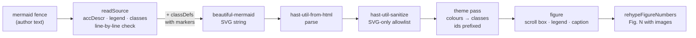

# F4 — Diagrams

## Brief

**Purpose.** Turn ```` ```mermaid ```` fences in a post into numbered figures with build-time SVG: flowcharts, sequence diagrams and C4-style container views in the figure palette of HANDOFF.md 5.1, one SVG for both themes, no diagram JavaScript in the browser. Add a legend helper, wide break-out figures, and scaling for small screens. Done when the kitchen-sink page reproduces the mockup's Fig. 1 and Fig. 2 from Mermaid source. Today a mermaid fence ships as plain text: `rehype-code.ts` skips it.

**What you will learn**

- `[Astro]` A rendering pipeline inside a compiler pass: diagram text → layout engine → SVG string → HTML tree. Why Mermaid itself needs a browser (it measures text in a DOM) and this renderer does not.
- `[TS]` Defence in depth for generated markup: the SVG contains author text, so it gets its own, narrower sanitiser (an SVG allowlist with value patterns) before it joins the page.
- `[CSS]` Theming SVG: presentation attributes versus CSS rules, classes coloured by `light-dark()` tokens, and why one SVG can serve both themes.
- `[CSS]` Responsive SVG: `viewBox` and natural size, `max-width: 100%; height: auto`, a figure that breaks out of the reading column, and a size floor below which it scrolls.
- `[Content]` Conventions that read well in GitHub's preview too: a `Figure:` line, palette classes, `accDescr`, a `%% legend` comment.

**Decisions** (defaults in bold)

1. **Renderer: `beautiful-mermaid` 1.1.3 (MIT, pure TypeScript; dependencies `elkjs` 0.11.1 and `entities` 7.0.1).** Spike in a scratch folder, 18:33–18:37 (kickoff Q3): Fig. 1 came out with the mockup's structure and colours, Fig. 2 as a flowchart with a boundary subgraph, a sequence diagram also worked, 1–63 ms per diagram, no browser. Maintenance: last release 2026-02-26, last commit 2026-05-06, 96 open issues; it is pinned exactly and tests pin our output, so an upgrade is a reviewed diff. Fallback not taken: `rehype-mermaid` 3.0.0 still renders with Mermaid 11 through `mermaid-isomorphic` 3.1.0 (Mermaid is at 12.2.0) and needs Playwright Chromium in both CI jobs. Mermaid's own C4 is experimental with a fixed style, so C4 is a flowchart convention with either renderer.
2. **New pass `src/plugins/rehype-diagrams.ts`, after `rehype-sanitize`, like `rehype-code`.** It reads the fence as plain text, renders it, parses the SVG with `hast-util-from-html` 2.0.3 and sanitises the result at once with `hast-util-sanitize` 5.0.2 and an SVG-only schema: drawing and text elements only; no `<style>`, `<script>`, `<foreignObject>`, `<a>`, `<image>`, event handlers or `style`; markers and references only as `url(#local-id)`; numbers where numbers belong. The renderer already escapes labels, so the schema is the second layer. Both packages are in the tree today through `rehype-raw` and `rehype-sanitize`; they become direct pins. This keeps the F2 rule: nothing reaches the page that a sanitiser has not checked after the last parse.
3. **Theme pass: one SVG, classes instead of colours.** It removes the renderer's `<style>` (which `@import`s Google Fonts) and the root `style` attribute (CSP), maps each palette colour to a class (`fig-violet`) and the neutral colours to roles (`fig-line`, `fig-label`), as F2 did for Shiki tokens. `src/styles/figures.css` colours them with `light-dark()` tokens for all seven categories; connectors `#8A857B`; external systems dashed slate on the page background. A test keeps the TypeScript map and the CSS in step.
4. **Authoring.** A `Figure: …` line right above the fence becomes the "Fig. N" caption, sharing the counter with images in document order (the `Table:` convention of F2). `accDescr: …` is required, as alt text is for images, and becomes the SVG's accessible name. Colours by class: `A:::violet` or `class A,B violet`, with `slate`, `teal`, `violet`, `blue`, `amber`, `green`, `rose` and `external`; the pass adds the `classDef`s itself, so posts carry no colour values and GitHub's preview shows Mermaid's default colours. `%% legend` (a Mermaid comment, invisible on GitHub) adds a legend of the categories the diagram uses, in palette order, labelled Person, Web app, AI component, Data store, Worker, Data, Risk, External system; `%% legend violet=Model` renames one. C4 container views: person `([…])`, container `[…]`, database `[(…)]`, `:::external`, system boundary as `subgraph`.
5. **The build fails, naming the post, on** a Mermaid syntax error, a diagram type other than `flowchart`/`graph` and `sequenceDiagram` (adding one later is one line, a kitchen-sink sample and a check in both themes), a missing `accDescr`, or an unknown palette class.
6. **Sizes.** The renderer draws 13 px labels; the SVG is scaled by 15/13 so node labels are 15 px like the mockup. A diagram wider than the 680 px column becomes a wide figure across the 956 px grid; images opt in with a `wide-` file-name prefix, like `screenshot-`. Figures scale down with the screen like images, to no less than 75% of their natural size; below that they scroll sideways, as the mockup's Fig. 2 does. The CSP forbids `style` attributes, so the floor is a class from a fixed 40 px scale (`diagram-min-520`). Every `id` inside an SVG is prefixed per figure: the renderer names its marker `arrowhead` in every SVG, which would collide on a page with two diagrams.
7. **Kitchen sink: a "Diagrams" section** with Fig. 1 (flowchart), Fig. 2 (container view: boundary, two external systems, legend) and a sequence diagram, with generic labels (Model, Database, Model API, Code host API, Example system). Image figure numbers shift, since the counter is shared.
8. **Fidelity means structure, not coordinates.** The layout engine places nodes; direction, order and subgraphs steer it, but nothing pins pixels. Fig. 2 will have the mockup's nodes, edges, labels, colours, boundary and legend, not its exact positions.
9. **CI: no change.** No browser, no new job, no workflow edit. Versions go into `docs/00-plan.md`, and the kickoff diagram row records the spike's outcome.

**Acceptance criteria**

- `/posts/kitchen-sink/` shows Fig. 1 and Fig. 2 rebuilt from Mermaid and a sequence diagram, in the palette, in light and dark from the same SVG; screenshots (light, dark, 375 px) in the PR.
- Images and diagrams share one "Fig. N" sequence; the legend lists exactly the categories used.
- `dist/` has no `style=` attribute, no new inline `<style>`, nothing from another origin, no `<script>` or handler inside an SVG, and no duplicate `id` on a page; CSP unchanged; still only the theme and copy scripts.
- Unit tests: hostile labels (`<script>`, ``, `javascript:`) render as text; each failure of decision 5 fails with the post named.
- The same fences render on GitHub in the PR's file view.
- `pnpm check`, `build`, `test`, `privacy` green locally; `verify` and `privacy` green on the PR.

**Timebox.** 40 minutes of the owner's time; it may run over, and nothing here is cut (owner decision, 2026-10-25). Risks: Fig. 2's automatic layout (decision 8), and label widths in Inter versus the renderer's text metrics.

**Docs.** [beautiful-mermaid](https://github.com/lukilabs/beautiful-mermaid) · [Mermaid flowchart syntax](https://mermaid.js.org/syntax/flowchart.html) · [Mermaid accessibility (`accTitle`, `accDescr`)](https://mermaid.js.org/config/accessibility.html) · [Mermaid C4 (experimental)](https://mermaid.js.org/syntax/c4.html) · [rehype-mermaid](https://github.com/remcohaszing/rehype-mermaid) · [`hast-util-sanitize`](https://github.com/syntax-tree/hast-util-sanitize) · [GitHub: creating diagrams](https://docs.github.com/en/get-started/writing-on-github/working-with-advanced-formatting/creating-diagrams) · [MDN: SVG `viewBox`](https://developer.mozilla.org/en-US/docs/Web/SVG/Reference/Attribute/viewBox) · [MDN: SVG presentation attributes](https://developer.mozilla.org/en-US/docs/Web/SVG/Reference/Attribute#presentation_attributes)

---

## Debrief

### 1. What was built

A ```` ```mermaid ```` fence in a post now becomes a numbered figure with an inline SVG, drawn during the build. The browser gets plain SVG and CSS, with no diagram JavaScript.



| Area | Result |
|---|---|
| Rendering | `beautiful-mermaid` 1.1.3 at build time: flowcharts (C4 views included) and sequence diagrams. The kitchen sink's three diagrams take under 0.2 s, line-by-line check included |
| Safety | The SVG is parsed and sanitised again with an SVG-only allowlist; no `<style>`, script, link, `foreignObject`, handler or `style`; references only to `#ids` in the same SVG |
| Theme | One SVG for both themes: every colour is a class (`fig-fill-violet`), and `figures.css` colours the classes with `light-dark()` tokens from HANDOFF.md 5.1 |
| Figures | "Fig. N" shared with images in page order; a legend helper; wide figures across the 956px grid for diagrams wider than the column and for images named `wide-*` |
| Sizes | 15px node labels as in the mockup; figures shrink like images down to 75% of their size, then scroll sideways |
| Errors | The build fails, naming the post, on an unsupported type, a missing `accDescr`, an unknown palette class, a colour statement, an empty diagram, or a line the renderer did not understand |
| Checks | 133 tests (32 new); the kitchen-sink diagrams also render in GitHub's file view |

On the kitchen sink, the mockup's Fig. 1 is Fig. 4, its Fig. 2 is Fig. 5, and the sequence diagram is Fig. 6 (three images come first). Screenshots of light, dark and 375px are in the PR and in [`img/`](img/): `04-diagrams-light.png`, `04-diagrams-dark.png`, `04-diagrams-mobile.png`.

**Writing a diagram: the conventions**

| You write | You get | GitHub's preview shows |
|---|---|---|
| ```` ```mermaid ```` with `flowchart LR`/`TB` or `sequenceDiagram` | An SVG figure | The same diagram, drawn by Mermaid |
| `Figure: Caption` on the line right above the fence | "Fig. N Caption", counted with images | A line above the diagram |
| `accDescr: What the diagram shows.` (required) | The SVG's accessible name for screen readers | Nothing visible (Mermaid adds it to its SVG) |
| `A["<b>Name</b><br>detail"]` | A bold first line, a second line | The same; Mermaid shows `**bold**` literally in quoted labels, so use `<b>` |
| `A:::violet`, or `class A,B violet` | The palette category: `slate`, `teal`, `violet`, `blue`, `amber`, `green`, `rose`, `external` | Mermaid's default colours |
| `%% legend`, and `%% legend violet=Model` to rename | A legend of the categories used, in palette order | Nothing (a comment) |
| Person `([…])`, container `[…]`, database `[(…)]`, external `:::external`, boundary `subgraph S ["Name"] … end` | A C4 container view | The same shapes |
| `A <--- B` | Arrow at A, and the layout puts A above (or before) B | The same |

Not allowed: `classDef`, `style` and `linkStyle` (colours come only from the palette), `click` (links), and other diagram types. Each fails the build with a message.

### 2. File tour

| File | Single responsibility | Depends on |
|---|---|---|
| `src/plugins/rehype-diagrams.ts` | Mermaid fences → figures: source rules and line check, rendering, the SVG allowlist, the theme pass, sizes, legend, caption | `beautiful-mermaid`, `hast-util-from-html`, `hast-util-sanitize`, `diagram-theme.ts`, `hast.ts` |
| `src/plugins/diagram-theme.ts` | The palette as diagrams use it: categories, legend labels, the `classDef`s with markers, paint value → role | — |
| `src/plugins/rehype-figures.ts` | Images → figures (now with `wide-`); `rehypeFigureNumbers` numbers every captioned figure, images and diagrams | `hast.ts` |
| `src/plugins/markdown.ts` | Pipeline order: … figures, diagrams, figure numbers, code, sidenotes | the plugins |
| `src/plugins/rehype-code.ts` | No longer skips `mermaid`: no mermaid fence reaches it | — |
| `src/styles/figures.css` | Figures, the screenshot frame, wide figures, diagram sizes and floors, paint classes, boundary, legend (figure rules moved here from `prose.css`) | `tokens.css` |
| `src/styles/tokens.css` | All 21 figure palette tokens and `--fig-line` | — |
| `src/layouts/PostLayout.astro` | Imports `figures.css` | — |
| `src/plugins/rehype-diagrams.test.ts` | Figures, numbering, classes, hostile labels, ids, start arrows, legend, sizes, sequence, every build failure, the allowlist on its own, palette against the handoff, CSS for every class | the pipeline |
| `tests/build-output.test.ts` | Adds: the kitchen sink's diagrams and numbering; unique ids and inert SVG on every page | `pnpm build` |
| `src/content/posts/kitchen-sink/` | A "Diagrams" section (Fig. 1 and Fig. 2 of the mockup, a sequence diagram) and `wide-figure-sample.png` | — |
| `docs/00-plan.md` · `CLAUDE.md` | Versions, deviation 9, the conventions pointer | — |

### 3. Concepts

**Build-time rendering: text → layout → SVG** `[Astro]`
- Mental model: a diagram renderer is a small compiler. It parses the Mermaid text into a graph, a layout engine (ELK, a layered graph layout) assigns coordinates, and a writer emits SVG. Mermaid itself measures label text in a real DOM, which is why rendering it at build time needs a headless browser. beautiful-mermaid estimates text widths from character classes in pure TypeScript, so it runs inside the build like any other function, in milliseconds.
- Here: `renderDiagram()` in `rehype-diagrams.ts` calls `renderMermaidSVG()` during the Markdown pass, after the sanitiser, like `rehype-code` calls Shiki. Astro caches the result with the rest of the post in its content store.
- Mistakes: expecting Mermaid-level validation (this renderer silently skips what it cannot parse, hence the line-by-line check); assuming every Mermaid feature exists (only flowchart, state, sequence, class, ER and XY charts, and we allow two); expecting pixel control (direction, order and edge direction steer the layout; nothing pins coordinates).
- Docs: [beautiful-mermaid](https://github.com/lukilabs/beautiful-mermaid), [Mermaid flowchart syntax](https://mermaid.js.org/syntax/flowchart.html)

**Sanitising generated markup** `[TS]`
- Mental model: anything that turns author text into markup and then parses it is a second input boundary, like a service that builds a SQL string from a validated request and must still parameterise the query. The renderer escapes labels, but the build should not depend on a third-party library getting that right.
- Here: the SVG string is parsed with `hast-util-from-html` and immediately sanitised with `svgSchema`: a list of drawing elements, and for each one the attributes it may carry, with value patterns (numbers, `url(#id)`, known paint values). Everything else is dropped; `<style>`, `<script>`, `<title>` and `foreignObject` are dropped with their content. The F2 rule still holds: nothing reaches the page that a sanitiser has not checked after the last parse.
- Mistakes: widening the post schema with SVG elements (authors could then write raw SVG); allowing `href` or `url(…)` to any target (external loads, script URLs); keeping `id`s as rendered (two diagrams on a page would share `arrowhead`).
- Docs: [`hast-util-sanitize`](https://github.com/syntax-tree/hast-util-sanitize), [OWASP XSS prevention](https://cheatsheetseries.owasp.org/cheatsheets/Cross_Site_Scripting_Prevention_Cheat_Sheet.html)

**Theming SVG: classes over presentation attributes** `[CSS]`
- Mental model: `fill="#ECE4F3"` on a shape is a presentation attribute, the weakest style source; any CSS rule beats it. If the SVG carries roles (classes) instead of values, CSS supplies the values, and `light-dark()` picks them per theme. It is the same move as F2's Shiki classes: configuration injected at runtime instead of values baked into markup.
- Here: the pass adds `classDef violet fill:fig-violet,stroke:fig-violet,color:fig-violet-text` for every category. These are markers, not colours; the renderer copies them into attributes, and `themeSvg()` turns each one into a class (`fig-fill-violet`, `fig-stroke-violet`, `fig-fill-violet-text`) and deletes the attribute. The renderer's own neutral colours (`var(--_line)` and friends) map to roles too. `figures.css` has one rule per class; `tokens.css` holds the 5.1 hex values once.
- Mistakes: an inline `style` or a `<style>` block (the CSP blocks both, unless hashed); real colours in the `classDef` (they would pass through, and the dark theme would keep the light colours, as the spike's dark screenshot showed); a new paint value from a renderer upgrade (the pass refuses unknown values, so an upgrade fails loudly).
- Docs: [MDN: presentation attributes](https://developer.mozilla.org/en-US/docs/Web/SVG/Reference/Attribute#presentation_attributes), [MDN: `light-dark()`](https://developer.mozilla.org/en-US/docs/Web/CSS/color_value/light-dark)

**Responsive SVG and the size floor** `[CSS]`
- Mental model: an SVG has its own coordinate system (`viewBox`) and a natural size (`width`/`height`). Like an image, `max-width: 100%; height: auto` shrinks it to fit while keeping its proportions; everything inside, text included, scales with it. Below some scale the labels become unreadable, so the shrinking needs a floor, and past the floor the figure scrolls in its own box.
- Here: the pass writes the natural size (viewBox × 15/13) as `width`/`height`. A figure wider than 680px gets `figure-wide` (`grid-column: 1 / -1` spans the text and margin columns, 956px). The floor is 75% of the natural width, rounded up to a 40px step, written as a class (`diagram-min-480`) because the CSP allows no per-element `style`; `figures.css` has the 17 steps from 280 to 920. A figure that can scroll gets `tabindex="0"` so keyboard users can scroll it.
- Mistakes: `width: 100%` on the SVG (small diagrams would be blown up); a fixed floor for all diagrams (it would enlarge small ones); a floor above 956 (wide figures would scroll on desktops).
- Docs: [MDN: `viewBox`](https://developer.mozilla.org/en-US/docs/Web/SVG/Reference/Attribute/viewBox), [MDN: `min-width`](https://developer.mozilla.org/en-US/docs/Web/CSS/min-width)

**Checking a lenient parser** `[TS]`
- Mental model: some parsers are tolerant by design (like a browser with broken HTML): they skip what they do not understand. For a build that is the wrong default, because a typo silently drops a box. If the parser cannot tell you, compare outputs: a line that changes nothing was not understood.
- Here: `checkEveryLine()` renders the diagram after each line. A line that leaves the SVG unchanged fails the build; block lines (`subgraph`, `end`, `class`, `loop`…) are exempt. In flowcharts a line must also add as many edges as it has arrows, and a line without arrows must look like one node; this catches `A[unclosed --> B`, which the renderer half-reads.
- Mistakes: trusting a successful render as valid syntax; checking only that the SVG is non-empty (a dropped edge still renders); forgetting that GitHub's preview uses real Mermaid, so it is the second opinion in a post PR.
- Docs: [Mermaid syntax reference](https://mermaid.js.org/intro/syntax-reference.html)

### 4. Verify it yourself

| Do this | Correct result |
|---|---|
| `pnpm check` | `0 errors`, `0 warnings` |
| `pnpm build && pnpm test` | `5 page(s) built`; `Tests 133 passed` |
| `pnpm privacy` | `privacy: clean (…, 13 image(s), …)` |
| `pnpm preview`, open http://localhost:4321/posts/kitchen-sink/#diagrams | The page in the screenshots; toggle the theme: every box changes colour, the SVG does not change |
| DevTools console on that page | No CSP errors |
| View source, search `<svg viewBox` | `role="img" aria-label="…"`, classes such as `fig-fill-violet`; no `style=`, no `#` colours, no `googleapis` |
| Narrow the window to a phone's width (375px) | Fig. 4, 5 and 6 stop shrinking at about 75% and scroll sideways inside their figure; the page itself never scrolls sideways |
| Change `:::violet` to `:::violett` in the kitchen sink, `pnpm build` | Fails: `Unknown palette class "violett" (slate, teal, …)`, naming the post; undo |
| Change `W -->|writes| DB` to `W -->|writes|` and build | Fails: `Diagram line "W -->|writes|" was not understood`; undo |
| Open the kitchen sink's `index.md` in the PR's **Files changed** tab, "Display the rich diff" | The same three diagrams, drawn by GitHub's Mermaid in its default colours |
| `gh pr checks 5` | `verify pass`, `privacy pass` |

### 5. Check your understanding

1. The post body already went through `rehype-sanitize`. Why does the diagram SVG get a second sanitiser, and why not simply add SVG elements to the first one?
   <details><summary>Answer</summary>The fence is text when the first sanitiser runs: it becomes markup only after the renderer turns it into an SVG string, which we then parse. Parsing author-derived text after the sanitiser would break the F2 rule, so that parse gets its own check. Adding SVG to the post schema would let authors write raw SVG anywhere in a post, a far wider door than the renderer's output, which a narrow, renderer-shaped allowlist covers.</details>
2. A future version of beautiful-mermaid starts writing `fill="var(--_accent-fill)"` on some shape. What happens in the build, and why is that the right outcome?
   <details><summary>Answer</summary>The sanitiser's paint pattern accepts <code>var(--_…)</code>, so the attribute reaches the theme pass, which has no role for it and fails the build with <code>Unexpected fill "var(--_accent-fill)"</code>. Silently keeping it would show a colour from a variable nobody defines, likely black, and in neither theme's palette. The failure points at the one line to add in <code>diagram-theme.ts</code> and the CSS rule to go with it.</details>
3. On a phone, Fig. 5 (the container view) scrolls sideways instead of shrinking to fit the screen. Which two values decide that, and where?
   <details><summary>Answer</summary>The natural width the pass writes (viewBox width × 15/13, 618px for Fig. 5) and the floor class it derives from it: 75% rounded up to 40px, <code>diagram-min-480</code>. <code>figures.css</code> turns the class into <code>min-width: 480px</code>, which wins over <code>max-width: 100%</code>, so on a 335px column the SVG stays 480px wide and <code>.diagram-scroll</code> scrolls. Both constants, <code>FLOOR</code> and <code>FLOOR_STEP</code>, are at the top of <code>rehype-diagrams.ts</code>.</details>

### 6. Deviations and gotchas

- **The renderer has no syntax errors.** beautiful-mermaid skips lines it cannot parse and stops reading a line at the first token it does not understand: `A -->`, `A[unclosed --> B`, a sequence message without a colon and `click` lines all rendered something. The brief promised a failing build on a syntax error, so `checkEveryLine()` renders line by line (part 3). It does not replace Mermaid's grammar; GitHub's preview of a post PR is the second check. Recorded as deviation 9 in `docs/00-plan.md`.
- **Colour statements fail the build** (`classDef`, `style`, `linkStyle`), not listed in the brief's decision 5: they are the only way an author could put a colour value into a post, which decision 4 rules out.
- **Start arrowheads were drawn backwards.** In 1.1.3 the start marker is drawn already flipped and then flipped again by `orient="auto-start-reverse"`, so `A <--- B` and `A <--> B` pointed into their own line, hidden under the node. `fixStartArrows()` draws it like the end marker; a test pins it.
- **Fig. 2's layout.** Top to bottom, with the model API placed on top by writing its edge from the API's side (`API <---|schema + question| AST`): the engineer and the model API on top, the boundary with the dashboard, assistant, worker and database, the code host below. At 618px it is column width, not the mockup's 956px, and taller (965px against 800px). Left-to-right layouts came out 1,600px wide and would have shrunk the text to 57%. Same nodes, edges, labels, colours, boundary and legend, as decision 8 set out.
- **`<b>` instead of `**bold**` in labels.** Both work in beautiful-mermaid, but Mermaid (and so GitHub's preview) shows `**` literally inside quoted labels; it formats Markdown only in backtick strings.
- **Floors round up**, so a figure never shrinks below 75%; the steps go to 920, under the 956px of a wide figure. The brief's example class (`diagram-min-520`) is one of them.
- **Figure CSS moved** from `prose.css` to a new `figures.css`, the file HANDOFF.md 4.4 lists; a wide figure's caption keeps the 680px measure, as in the mockup.
- **A wide image sample** (`wide-figure-sample.png`, a 33 KB copy of the chart) puts the `wide-` convention on the regression page.
- **`accTitle`** is accepted and put in front of `accDescr` in the accessible name; the caption is the visible title.
- **Keyboard access:** only figures with a floor, the ones that can scroll, get `tabindex="0"`. There is no visible hint that a figure scrolls on a phone, as in the mockup.
- **Fig. 1 on phones** scrolls; the mockup's HTML version wraps its boxes onto two rows, which an SVG cannot do.
- **New dependencies:** `beautiful-mermaid` (with `elkjs` and `entities`, both new to the tree); `hast-util-from-html` and `hast-util-sanitize` were already installed through `rehype-raw` and `rehype-sanitize`, `hast-util-to-html` (dev, for one test) through Astro.
- **Screenshots and checks.** The in-app browser pane was hidden for most of the build and returned blank screenshots, so the PR screenshots come from headless Chrome against `pnpm preview`; the CSP check (no console messages), the 375px layout (no page-level sideways scroll; figures at 76–78%) and GitHub's rendering were checked in the in-app browser. Headless Chrome cannot run GitHub's Mermaid frame at all: even the plan's existing diagram shows "Unable to render rich display" there.
- **Lockfile: the `@pnpm/exe` entry has a clear cause now.** The standalone pnpm in `~/Library/pnpm/bin` (the `@pnpm/exe` build of 12.15.0) writes it whenever it runs inside the repository, even for `pnpm -v`; the nvm pnpm does not. One `pnpm privacy` in this build ran before the nvm path was set, and the entry reached the debrief commit; the next commit removes it, so the branch, and the squash commit, change the lockfile only for the new packages. On the machine side, putting `~/.nvm/versions/node/v26.12.1/bin` ahead of `~/Library/pnpm/bin` in `~/.zshrc`, or removing the standalone install, would stop it; that is your call.

### 7. Time used

| | Time |
|---|---|
| F4, brief | 18:30 to 18:39 by the clock: reading, docs and versions, the 4-minute spike, the brief |
| Waiting for "go" | 18:39 to about 18:41 |
| F4, build | 18:42 to 19:05: plugin, styles, tests, kitchen sink, screenshots, GitHub preview check, this debrief, PR |
| F4 so far | about 33 minutes of work against the 40-minute timebox, before review and merge |
| Cumulative | about 4 h 12 min of active time (5 h 35 min by the clock) of the planned 4–6 hours |

### 8. Q&A log

No questions were asked during the review (PR #5, 2026-10-25).

### 9. Next

F5, pages and brand.
