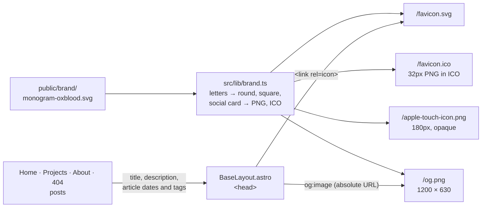

# F5 — Pages and brand

## Brief

**Purpose.** Finish the site's own pages with the final copy of HANDOFF.md 5.3: Home gains "Selected projects", and Projects, About and a custom 404 page appear. Today `/projects/`, `/about/`, the footer's `/about/#colophon` and every missing path lead to GitHub's 404. Add the brand around the pages: a monogram component at 28, 32 and 96 px, favicons derived from the oxblood monogram, and Open Graph and X card defaults on every page.

**What you will learn**

- `[Astro]` Layouts and components with typed props: one `BaseLayout` builds every `<head>` from what each page passes in; small components (`Monogram`, project rows) are reused across pages.
- `[Astro]` Static file endpoints: `favicon.ico.ts` is a route that returns bytes instead of HTML, run once at build time, so every icon and the default social image are derived from one SVG.
- `[Content]` Open Graph: the tags crawlers read to draw a link preview, why they must be absolute URLs in the HTML, and how X falls back to them.
- `[Content]` A small data collection: the `file()` loader and a Zod schema for the "Now" list.
- `[CSS]` A content grid with a sidebar that stacks at 960 px, and rows that stack at 640 px.

**Decisions** (defaults in bold)

1. **Copy from HANDOFF.md 5.3 only.** About is verbatim. Where 5.3 is in note form, the sentences use only its facts. delivery-metrics reads: "Self-hosted engineering metrics. The model writes SQL, Postgres computes every number under a read-only role, and local embeddings power semantic search." The site project reads: "This site: Astro on GitHub Pages, with no server and no trackers. Posts start as issue briefs, are drafted by AI, and ship only through a reviewed pull request." The mockup's longer project texts are not used. The same text appears on Home and on Projects.
2. **Projects in a typed module, `src/lib/projects.ts`; Home shows the first two.** Links: delivery-metrics "Source" (public repository, checked) and "Write-up"; this site "Source" (this repository); Reign Edge "Website". The write-up is a post slug and the link appears only when that post is published, so F7 sets the slug and nothing links to a missing post. Project names in mono, except Reign Edge (not a repository), as in the mockup.
3. **"Now" in `src/data/now.yaml`** (month and exactly three items), loaded by a `now` data collection with a Zod schema. It changes monthly and can be edited by hand, even in GitHub's web editor. It ships with the mockup's three placeholders and "Updated October 2026"; send me your three items during the review and I commit them.
4. **About layout from the mockup:** 680 px text and 280 px sidebar, stacked under 960 px. "What I write about" reuses the tag descriptions the tag pages already show. Elsewhere lists GitHub, LinkedIn and RSS; no email. The Colophon section carries `id="colophon"` for the footer link.
5. **404 page** `src/pages/404.astro` → `dist/404.html`, which Pages serves with status 404 for any missing path. Copy: label "404", heading "Page not found", lede "Nothing lives at this address. The link may be old or mistyped.", links to Writing, Projects and About. `noindex`, and no canonical URL or `og:url`, because it answers at every address.
6. **`Monogram.astro`** (28, 32, 96 px; the oxblood SVG as an image, round by CSS) replaces the nav mark and the byline image and adds the About mark. The ivory and ink monograms are copied to `public/brand/` with their C2PA block stripped (kickoff Q9); the mockup copies stay as reference.
7. **Favicons generated at build time from `public/brand/monogram-oxblood.svg`** by endpoints using `sharp` 0.35.5, already in the tree through Astro, now pinned directly: `/favicon.svg` (the round mark), `/favicon.ico` (a 32 px PNG in an ICO container, written by a few lines of our own code), `/apple-touch-icon.png` (180 px, square and opaque, because iOS rounds the corners and fills transparency with black). SVG favicons reached Safari only in version 26, and crawlers and feed readers still ask for `/favicon.ico`. No web manifest: the site is not an installable app.
8. **Open Graph and X defaults in `BaseLayout`:** `og:type` (`website`; `article` with published and modified times and tags on posts), `og:title`, `og:description`, `og:url` (the canonical URL), `og:site_name`, `og:image` with width, height, type and alt, and `twitter:card` `summary_large_image`. X reads the `og:` tags for the rest. The default image is `/og.png`, 1200 × 630, generated at build time: the round oxblood monogram centred on the page ivory, with no text. Rasterising text would need fonts in the image renderer; F8 generates per-post images with titles.
9. **Tests and smoke checks.** Build output: every internal link and `#anchor` on every page resolves to a built file and id, which catches today's dead links for good; Open Graph tags on every page with a same-origin absolute image; icon sizes and types; no metadata in any served image, `.ico` included; 404 has `noindex` and no canonical URL; only allowlisted external links. Smoke: `/projects/` and `/about/` return 200 with the CSP; a random path returns 404 with our page; the favicons and the home page's `og:image` return 200 as images. The sitemap picks up the new pages by itself; 404 stays out.

**Acceptance criteria**

- Home, Projects, About and 404 match HANDOFF.md 5.3 and the mockup in light, dark and at 375 px; screenshots in the PR.
- No internal link or anchor on the site leads to a 404, proven by a test; the footer's Colophon link lands on About's colophon.
- The favicon shows in the browser tab; every page carries the Open Graph and X tags with an absolute image URL; served icons and images carry no metadata.
- No email address, only allowlisted links; CSP unchanged; still only the theme and copy scripts; no `style=` attribute.
- `pnpm check`, `build`, `test`, `privacy` green locally, `pnpm smoke http://localhost:4321` green against `pnpm preview`; `verify` and `privacy` green on the PR.
- After the merge: Deploy green including the new smoke checks; the live 404 page appears for a missing path; all four pages render in both themes without CSP errors.

**Timebox.** 25 minutes of the owner's time; it may run over, and nothing here is cut (owner decision, 2026-10-25). Risk: link previews can only be seen once the site is live, since crawlers cannot reach `localhost`; the tags and the image are checked locally and on the live site.

**Versions** (checked 2026-10-25): Astro 7.4.2 is still the latest release; `sharp` 0.35.5 is the latest and the version Astro already installs. TypeScript stays on 6.0.3 (deviation 3).

**Docs.** [Astro pages: custom 404](https://docs.astro.build/en/basics/astro-pages/) · [Endpoints: static files](https://docs.astro.build/en/guides/endpoints/) · [Layouts](https://docs.astro.build/en/basics/layouts/) · [Content collections: `file()` loader](https://docs.astro.build/en/guides/content-collections/) · [Pages: custom 404](https://docs.github.com/en/pages/getting-started-with-github-pages/creating-a-custom-404-page-for-your-github-pages-site) · [The Open Graph protocol](https://ogp.me/) · [X cards markup](https://developer.x.com/cards/markup) · [Can I use: SVG favicons](https://caniuse.com/link-icon-svg) · [MDN: `rel="icon"`](https://developer.mozilla.org/en-US/docs/Web/HTML/Reference/Attributes/rel#icon) · [sharp: input options](https://sharp.pixelplumbing.com/api-constructor)

---

## Debrief

### 1. What was built

The site's own pages are complete, and every page now has a favicon and a link preview. All the brand files come from one source, the oxblood monogram SVG.

| Area | Result |
|---|---|
| Pages | Home gains "Selected projects"; `/projects/`, `/about/` (with `#colophon`) and `/404.html` exist with the HANDOFF.md 5.3 copy |
| Data | Projects in `src/lib/projects.ts`; "Now" in `src/data/now.yaml`, validated by a Zod schema at build time |
| Brand | `Monogram` component at 28, 32 and 96px; ivory and ink monograms in `public/brand/` without their C2PA block |
| Icons | `favicon.svg`, `favicon.ico`, `apple-touch-icon.png`, all rendered at build time by `sharp` from the oxblood SVG |
| Link previews | Open Graph and X card tags on every page; posts are `article`s with dates and tags; default image `/og.png` |
| Checks | 190 tests (57 new); smoke checks 9 locally, 11 on the live host (3 new: `pages`, `brand`, `not found`) |

Screenshots in the PR and in [`img/`](img/): `05-home-*`, `05-projects-*`, `05-about-*`, `05-404-*` (light and dark, 1280px) and `05-mobile.png` (the four pages at 375px).

**Editing the pages: where things live**

| To change | Edit | Checked by |
|---|---|---|
| "Now" (monthly) | `src/data/now.yaml`: `updated: 'YYYY-MM'` and exactly three `items`; GitHub's web editor is enough | The build (Zod schema); a build-output test counts the items |
| A project, or the home page's two | `src/lib/projects.ts`; the first two are "Selected projects" | `projects.test.ts`: links only to allowlisted sites |
| A write-up link | `writeUp: '<post slug>'` on the project; the link appears once that post is `published` (F7) | `projects.test.ts` |
| About copy | `src/pages/about.astro`; it must stay HANDOFF.md 5.3 verbatim | A build-output test compares it with HANDOFF.md |
| The monogram | `public/brand/monogram-oxblood.svg` (one `<path>`, 1024 × 1024); every icon and the social image follow | `brand.test.ts`, the build-output icon test |

### 2. File tour

| File | Single responsibility | Depends on |
|---|---|---|
| `src/pages/projects.astro` | `/projects/`: lede and one row per project | `ProjectRow`, `projects.ts`, `collection.ts` |
| `src/pages/about.astro` | `/about/`: copy, topics, Now, process, sidebar with Elsewhere and `#colophon` | `Monogram`, `collection.ts`, `posts.ts` |
| `src/pages/404.astro` | `/404.html`: Pages serves it for every missing path; `noindex`, no canonical URL | `BaseLayout` |
| `src/pages/index.astro` | Home: adds "Selected projects" under the Writing list | `projects.ts` |
| `src/pages/favicon.svg.ts` · `favicon.ico.ts` · `apple-touch-icon.png.ts` · `og.png.ts` | Static file endpoints: each renders one brand file at build time | `brand.ts` |
| `src/lib/brand.ts` | Reads the monogram's letters; draws the round mark, square mark and social card; PNG through `sharp`; the ICO container | `sharp` |
| `src/lib/projects.ts` | The three projects and the rule for the write-up link | `posts.ts` |
| `src/components/Monogram.astro` | The mark at 28, 32 or 96px | — |
| `src/components/ProjectRow.astro` | One row on `/projects/`; stacks under 640px | `projects.ts` types |
| `src/layouts/BaseLayout.astro` | Adds icon links, Open Graph and X tags; `canonical={false}` and `article` props | `brand.ts` constants |
| `src/layouts/PostLayout.astro` | Passes the post's dates and tags as `article`; byline uses `Monogram` | — |
| `src/components/SiteNav.astro` | Nav mark is now `Monogram` | — |
| `src/data/now.yaml` · `src/content.config.ts` · `src/lib/schema.ts` | The "Now" entry, its `file()` collection and `nowSchema` | `astro/loaders`, `astro/zod` |
| `src/lib/collection.ts` · `posts.ts` | `nowEntry()`; `formatMonth()` | — |
| `public/brand/monogram-ivory.svg` · `monogram-ink.svg` | The other two marks, served, metadata stripped | — |
| `scripts/lib/image-metadata.ts` | Also opens ICO files and walks each PNG inside; `.ico` counts as an image | — |
| `scripts/lib/smoke.ts` | Adds the `pages`, `brand` and `not found` checks | — |
| `tests/build-output.test.ts` | Adds: internal links and anchors resolve, allowlisted links, meta tags, icons and sizes, 404 rules, About verbatim, home projects, Now items | `pnpm build`, `HANDOFF.md` |
| `src/lib/brand.test.ts` · `projects.test.ts` | Unit tests for the brand files and the projects | — |

### 3. Concepts

**Layouts and components with typed props** `[Astro]`
- Mental model: a layout is a base template, like a Thymeleaf layout or a Jinja `base.html`, and props are its typed parameters. Every page renders through `BaseLayout`, so anything in `<head>` is decided in one place from what each page passes in. `interface Props` in the frontmatter is the contract, and `astro check` enforces it at each call site.
- Here: pages pass `title`, `description`, `noindex`, and now `canonical` and `article`. `PostLayout` passes `article={{ published, modified, tags }}` and gets `og:type="article"` with dates; `404.astro` passes `canonical={false}`. `Monogram.astro` takes `size: 28 | 32 | 96`, so a typo such as `size={23}` fails the typecheck.
- Mistakes: reading `Astro.url` for something only some pages need, instead of a prop; copying `<head>` tags into one page (they drift); a prop typed `number` when only three values are valid.
- Docs: [Layouts](https://docs.astro.build/en/basics/layouts/), [Component props](https://docs.astro.build/en/basics/astro-components/#component-props)

**Static file endpoints: routes that return bytes** `[Astro]`
- Mental model: a `GET` handler, like a Spring controller method returning `ResponseEntity<byte[]>`, except it runs once during `astro build`, and its response is written to a file. `src/pages/og.png.ts` becomes `dist/og.png`: the `.ts` is dropped and the rest of the name is the path.
- Here: the four endpoints call `brand.ts`, which reads the monogram's `<path>`, wraps it in a new SVG (circle, square or 1200 × 630 card) and has `sharp` rasterise it. The ICO is our own 6-byte header plus one 16-byte entry in front of a PNG, a form every browser has read since Windows Vista made it standard. Nothing is committed but the source SVG.
- Mistakes: a `Response` body of type `Buffer` (TypeScript wants a `Uint8Array` with its own `ArrayBuffer`); forgetting `Content-Type`, which `astro preview` and some hosts use to label the file; expecting an endpoint to run per request on Pages (it ran once, at build time).
- Docs: [Endpoints: static files](https://docs.astro.build/en/guides/endpoints/), [sharp](https://sharp.pixelplumbing.com/api-constructor)

**Open Graph and X cards** `[Content]`
- Mental model: when someone pastes a link, the platform's crawler fetches the page once, reads a few `<meta property="og:…">` tags and draws a card: title, description, image. The crawler runs no JavaScript and has no idea which page it came from, so every URL in those tags is absolute. X reads its own `twitter:` tags first and falls back to `og:` ones; only the card size (`twitter:card`) has no fallback.
- Here: `BaseLayout.astro` writes `og:type`, `og:site_name`, `og:title`, `og:description`, `og:url` (the canonical URL), `og:image` with width, height, type and alt, and `twitter:card` `summary_large_image`. Posts add `article:published_time`, `article:modified_time` and `article:tag`. `/og.png` is the default image; F8 generates one per post. A build-output test checks every page.
- Mistakes: a relative `og:image` (most crawlers drop it); expecting a changed image to appear at once (platforms cache cards; their inspectors can refresh them); setting tags with client-side JavaScript.
- Docs: [The Open Graph protocol](https://ogp.me/), [X cards markup](https://developer.x.com/cards/markup)

**A small data collection** `[Content]`
- Mental model: the same typed table as posts, but loaded from one structured file instead of a folder of Markdown files. The `file()` loader is the reader, `nowSchema` is the table definition, and a bad edit fails the build with the file and the field.
- Here: `src/data/now.yaml` has one entry, `now`, with `updated: '2026-10'` and three `items`. `src/content.config.ts` declares the `now` collection; `nowEntry()` in `collection.ts` reads it, and `about.astro` renders the items as text. Projects stay in TypeScript: they change rarely, their order matters, and tests check their links.
- Mistakes: a full date such as `'2026-10-01'` (the schema wants a month); dropping the quotes, which leaves the type to the YAML parser's date rules; a fourth item (the schema says three); Markdown in an item, which renders literally.
- Docs: [Content collections: `file()` loader](https://docs.astro.build/en/guides/content-collections/)

**A content grid with a sidebar, and rows that stack** `[CSS]`
- Mental model: a grid is a table you declare in CSS, not in markup. `grid-template-columns: minmax(0, 680px) 280px` makes a text column that may shrink and a fixed sidebar; a media query swaps it for one column. The markup order stays the reading order, which is also what a screen reader follows.
- Here: About's `.grid` stacks under 960px, so the sidebar (Elsewhere, Colophon) moves below the text. Project rows (`ProjectRow.astro`) and About's topic rows are two-column grids that become one column under 640px; Home's two projects are `repeat(2, minmax(0, 1fr))`.
- Mistakes: `1fr` instead of `minmax(0, 1fr)`, which lets long text stretch a column; a fixed column narrower than its content (a 288px repository name in a 280px column wrapped at its hyphen, hence 300px); reordering visually with `order`, which no longer matches the reading order.
- Docs: [MDN: `grid-template-columns`](https://developer.mozilla.org/en-US/docs/Web/CSS/grid-template-columns), [MDN: `minmax()`](https://developer.mozilla.org/en-US/docs/Web/CSS/minmax)

### 4. Verify it yourself

| Do this | Correct result |
|---|---|
| `pnpm check` | `0 errors`, `0 warnings` |
| `pnpm build` | `8 page(s) built`; `/favicon.ico`, `/favicon.svg`, `/apple-touch-icon.png` and `/og.png` among the routes |
| `pnpm test` | `Tests 190 passed` |
| `pnpm privacy` | `privacy: clean (…)` |
| `pnpm preview`, then `pnpm smoke http://localhost:4321` | `all 9 checks passed`, including `pages`, `brand` and `not found` |
| Open http://localhost:4321/, `/projects/`, `/about/` | The pages in the screenshots; the favicon in the tab |
| Footer → **Colophon** | Jumps to About's colophon |
| http://localhost:4321/anything/at/all | "Page not found", status 404 (DevTools → Network) |
| View source of any page, search `og:` | The tags of part 3, `og:image` = `https://chau-minh-tieu.github.io/og.png` |
| Open http://localhost:4321/og.png | The monogram on ivory, 1200 × 630 |
| Change `updated: '2026-10'` to `'2026-13'` in `src/data/now.yaml`, `pnpm build` | Fails: `now → now data does not match collection schema. updated: updated must be a month as YYYY-MM, quoted`; undo |
| Add `{ label: 'Blog', href: 'https://example.com' }` to a project's links, `pnpm test` | `projects > links only to allowlisted addresses` fails; undo |
| After the merge: `pnpm smoke` | `all 11 checks passed` against the live site |
| After the merge: https://chau-minh-tieu.github.io/nope | The site's 404 page instead of GitHub's |

### 5. Check your understanding

1. Why is `og:image` written as `https://chau-minh-tieu.github.io/og.png` when every other link on the site is a path such as `/about/`?
   

Answer
A browser resolves <code>/about/</code> against the page it is on. A link-preview crawler reads the tag's value as data, with no page to resolve against, and most crawlers ignore a relative URL. <code>BaseLayout.astro</code> builds it with <code>new URL('/og.png', Astro.site)</code>, so it follows <code>site</code> in <code>astro.config.mjs</code>. The smoke check fetches the same path from whatever host it tests.

2. The 404 page has no `<link rel="canonical">`, while every other page has one. Why?
   

Answer
A canonical URL says "this content lives at this one address". Pages serves <code>404.html</code> at every address that has no file, so any single canonical would be wrong for almost all of them, and <code>/404.html</code> itself is not a page anyone should land on. The page is also <code>noindex</code>, and a 404 status keeps it out of search results anyway.

3. You replace `public/brand/monogram-oxblood.svg` with a redrawn monogram. Which files change, and what would make the build fail?
   

Answer
The nav, byline and About marks (they show the file itself), and, at the next build, <code>/favicon.svg</code>, <code>/favicon.ico</code>, <code>/apple-touch-icon.png</code> and <code>/og.png</code>, which <code>brand.ts</code> derives from its <code>&lt;path&gt;</code>. <code>lettersOf()</code> throws if the new file has more or fewer than one <code>&lt;path&gt;</code> or a different viewBox, and the build-output tests fail if it carries metadata. Platforms that cached the old card keep showing it until they fetch the page again.

### 6. Deviations and gotchas

- **Project names: a 300px column, not the mockup's 280.** `chau-minh-tieu.github.io` in 20px JetBrains Mono is 288px wide and wrapped at its hyphen. The descriptions keep a 684px measure.
- **Favicons are generated, not files in `public/brand/`** (HANDOFF.md 4.4 puts the favicon there). Endpoints render them from the oxblood SVG at build time, so there is one source and nothing generated is committed.
- **Copy choices.** The mockup's longer project texts ("for your own GitHub repositories", "Claude-powered", "privacy and link checks") are not used: they go beyond HANDOFF.md 5.3. The site project's stack line ("Astro · TypeScript · GitHub Actions") comes from the mockup, as do the About paragraph on how posts are written and the Now placeholders. The Leadership topic keeps 5.3's dash ("as a team — lessons"), where the mockup had a full stop; the tag page uses the same sentence.
- **Links.** The site project's "Source" points at this repository (the mockup pointed at the profile). No "Write-up" link exists yet: delivery-metrics gets one when F7 sets `writeUp`. About's topic labels are text, as in the mockup, not links to the tag pages.
- **"Now" ships with placeholders** and "Updated October 2026" until you send the three items.
- **The favicon in a real tab is not verified yet.** The icon files are served with the right types and sizes and every page links them, but headless Chrome has no tab bar and the in-app browser did not request favicons. Check it in your browser.
- **Link previews can only be tested live.** Crawlers cannot reach `localhost`; the tags and the image are tested locally, and after the merge the live page can be pasted into a platform's preview inspector.
- **`og:title` on Home is "Chau Tieu"**; the other pages use their own title without the site name, which `og:site_name` carries.
- **`sharp` was an optional dependency of Astro**; as a direct dependency it is required, so the lockfile marks it and `@img/colour` non-optional. Same version, nothing new downloaded. The lockfile has no `@pnpm/exe` entry.
- **`brand.ts` reads the monogram from `process.cwd()`.** pnpm runs `astro build` and `vitest` from the repository root; a build started elsewhere fails with a clear "no such file". Importing the file from `public/` through Vite is not supported.
- **One 32px image in the ICO.** Browsers scale it for 16px tabs; a second size would double the file for no visible gain.
- **`now.yaml` is validated by the build, not by a unit test**: reading YAML in a test would need the `yaml` package as a direct dependency. A build-output test counts the rendered items.
- **The internal-link test covers `<a>` and `<link>` on every page, anchors included.** Mutation check: renaming the RSS link and changing one word of the About copy each failed the matching test.
- **`astro preview` serves `404.html` with status 404 for unknown paths**, like Pages, so the `not found` smoke check runs locally too.
- **Screenshots.** Headless Chrome against `pnpm preview`; the 375px image puts the four pages side by side in iframes. Layout at 375px (no sideways scroll on any page) and the absence of CSP errors were checked in the in-app browser.

### 7. Time used

| | Time |
|---|---|
| F5, brief | 19:28 to 19:34 by the clock: reading, docs and versions, the brief |
| Waiting for "go" | 19:34 to about 19:37 |
| F5, build | 19:37 to 19:50: pages, brand files, tests, smoke checks, screenshots, this debrief, PR |
| F5 so far | about 22 minutes of work against the 25-minute timebox, before review and merge |
| Cumulative | about 4 h 58 min of active time (about 6 h 22 min by the clock) of the planned 4–6 hours |

### 8. Q&A log

No questions yet.

### 9. Next

F6, content workflow.
