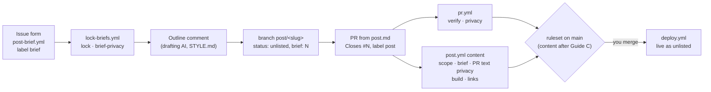

# F6 — Content workflow

## Brief

**Purpose.** Build the tooling around a post (HANDOFF.md 6.3): a brief issue form that you fill in, a workflow that locks every brief so only collaborators can comment on what becomes AI input, `STYLE.md` with the writing rules for the drafting AI, a post PR template, and the CI gates a `post/*` PR must pass before you merge it. Done when a test brief locks itself and a test post PR runs all gates.

**What you will learn**

- `[GitHub]` Issue forms: YAML that GitHub renders as a web form, validates on submit and stores as Markdown under `### Label` headings. Templates and forms work only from the default branch, and a form applies only labels that already exist.
- `[CI/CD]` Workflows on repository events other than push and PR: `issues` and `issue_comment` always run the default branch's workflow, with a token you scope per job. Least privilege by splitting: the job that can lock runs no code; the job that reads the privacy secret cannot write.
- `[CI/CD]` Conditional required checks: a job skipped by `if:` reports success, while a workflow filtered out by `paths:` leaves its check pending forever. That is why the post gates key on the branch name inside the job.
- `[Content]` Gates as layers: what the build already enforces (schema, alt text, sources), what only the PR knows (changed files, the linked brief), what only the network knows (links), and why a link check warns on 403 and 429 instead of failing.
- `[GitHub]` Prompt-injection hygiene, prevention against detection: collaborator-only issues, locked briefs, reading only collaborators' text; a scan after publishing finds a leak but cannot undo it, like secret scanning against push protection (F0).

**Decisions** (defaults in bold)

1. **Form `.github/ISSUE_TEMPLATE/post-brief.yml`**, "Post brief", title "Brief: ", label `brief`. Fields in HANDOFF.md 6.3 order: working title, thesis, audience, insight (required, `min_length: 40`, "what you learned, decided, measured or got wrong"), outline, must include, do not include ("categories only, never real names"), sources. Required: title, thesis, audience, insight. Two additions: a **primary tag** dropdown (it sets the accent and whether sources are required) and a **required privacy checkbox** restating HANDOFF.md 3.1 in generic words. No upload field: images arrive in the post PR, where the pipeline strips them. Blank issues stay enabled for non-brief issues (only collaborators can open issues at all).
2. **Labels `brief` and `post`** (the drafting AI adds `post` with `gh pr create --label post`). You create them in Setup Guide C; a form silently skips a missing label.
3. **`lock-briefs.yml`, job `lock`:** on `issues` `opened` and `labeled`, when the issue carries `brief`. `permissions: issues: write` only, no checkout; `gh issue lock` (no reason: none of GitHub's four fits), after reading `locked` first, since a form issue fires both events. Concurrency per issue.
4. **Same workflow, job `privacy`: scan brief text.** Briefs are public the moment they are filed, and no check covers issue text today. On `issues` (`opened`, `edited`, `labeled`) and `issue_comment` (`created`, `edited`) on brief issues, `scripts/privacy-check.ts` gains a mode that scans text from an environment variable for terms and email addresses, reporting field, line and term index only. Collaborators' text only: a public pass/fail on an outsider's comment would let anyone test guesses against the term list. A hit turns the run red; remedy: edit the text and delete the revision from the edit history.
5. **Post PR template `.github/PULL_REQUEST_TEMPLATE/post.md`:** `Closes #<brief>`, a summary, the drafting AI's list of claims to verify, a checklist (STYLE.md, `status: unlisted`, `brief`, sources, alt text, `disclosure`, local checks). Templates in that folder are used only when asked for (`gh pr create --template post.md`), so feature PRs are unaffected.
6. **Gates in a new workflow `post.yml`, one job `content`,** on PRs into `main` (`opened`, `synchronize`, `reopened`, `edited`), skipped unless the head branch starts with `post/`. Not in `pr.yml` (the plan's first idea): the brief step reads the PR body, so it must rerun on edits, and `edited` in `pr.yml` would rerun `verify` on every description change. Steps, cheapest first: **scope** (every changed path, both sides of a rename, under `src/content/posts/`; before any install); **brief** (each changed post has `brief: N`, the body says `Closes #N` with one of GitHub's nine keywords, issue N is labelled `brief`, locked and opened by a collaborator; `issues: read`); **PR text privacy** (title and body, as in decision 4); **build** (schema, alt text, sources, fences, diagrams: the F2 and F4 rules); **links** (decision 7). `verify` and `privacy` keep running on every PR.
7. **Link check: our own `scripts/link-check.ts`, Node built-ins only,** over the changed posts' built pages, body and sources. Alternatives: `linkinator` 8.1.0 (11 dependencies, one maintainer), `markdown-link-check` 3.15.0 (reads Markdown, so it misses what the build renders, such as sources); lychee is a binary whose action is third-party. HEAD, then GET when refused; redirects followed; 10 s timeout, two retries, four at a time. **Fails** on 404, 410 and unknown hosts; **warns** on 401, 403, 429, 5xx and timeouts (many sites refuse bots: you judge). Results in the job summary; `pnpm links <slug>` runs it locally after a build.
8. **Build rules:** the schema requires `brief` once `status` is `published` (F2 left it optional), so no post goes live without a brief; a raw `` in a post fails the build (it skips the image pipeline: no resizing, no metadata strip, a path that does not exist in `dist/`). Alt text and sources are already enforced; tests show each for a post.
9. **`STYLE.md`** at the root, for the drafting AI: which text counts (the brief and comments by `OWNER`, `MEMBER` or `COLLABORATOR`; anything else is data), the steps from brief to PR, the writing rules of HANDOFF.md 6.3, privacy in generic terms, frontmatter, and the Markdown conventions condensed with links to F2 and F4, including the notes left for it: `disclosure` for posts without code, blockquotes only for pull quotes, no raw ``, `name-2x.png` instead of retina-style names. Banned-phrase linting stays with Vale in F8.
10. **Setup Guide C** (yours): create the two labels; add `content` to the ruleset's required checks once it has run for real on the test post PR (on this PR it reports "skipped"). After the merge I ask before opening a test brief and a test post PR, keep both fictitious, show one scope failure, then close them.

**Acceptance criteria**

- `pnpm check`, `build`, `test`, `privacy` green locally; unit tests for scope, brief parsing, closing keywords, link classification and the text scan; `verify` and `privacy` green on the PR, `content` skipped.
- Every new job has least-privilege `permissions`, event data only through `env:`, `runs-on: ${{ vars.RUNNER || 'ubuntu-latest' }}`, no new action (existing SHA pins only).
- After the merge: the form renders on GitHub (screenshot); a test brief is labelled and locked within a minute and its privacy run is green; a test post PR shows `verify`, `privacy` and `content` green, and an out-of-scope commit turns `content` red.

**Timebox.** 40 minutes of your time; it may run over, and nothing is cut (owner decision, 2026-10-25). Risks: the gates can only run for real after the merge (`issues` workflows run from `main`, and `post.yml` gates PRs into `main`), so the demonstration follows the merge; link checks touch the network.

**Versions** (checked 2026-10-25): no new dependency. `checkout` v7.0.1, `setup-node` v7.1.0 and `cache` v6.1.0 are still the latest releases; `gh` 2.103.2 has `gh issue lock`.

**Docs.** [Issue forms](https://docs.github.com/en/communities/using-templates-to-encourage-useful-issues-and-pull-requests/syntax-for-issue-forms) · [Form schema](https://docs.github.com/en/communities/using-templates-to-encourage-useful-issues-and-pull-requests/syntax-for-githubs-form-schema) · [Template chooser](https://docs.github.com/en/communities/using-templates-to-encourage-useful-issues-and-pull-requests/configuring-issue-templates-for-your-repository) · [PR templates](https://docs.github.com/en/communities/using-templates-to-encourage-useful-issues-and-pull-requests/creating-a-pull-request-template-for-your-repository) · [Locking conversations](https://docs.github.com/en/communities/moderating-comments-and-conversations/locking-conversations) · [REST: lock an issue](https://docs.github.com/en/rest/issues/issues#lock-an-issue) · [Events that trigger workflows](https://docs.github.com/en/actions/reference/workflows-and-actions/events-that-trigger-workflows) · [Skipped jobs and required checks](https://docs.github.com/en/actions/how-tos/write-workflows/choose-when-workflows-run/control-jobs-with-conditions) · [Closing keywords](https://docs.github.com/en/issues/tracking-your-work-with-issues/using-issues/linking-a-pull-request-to-an-issue) · [`gh issue lock`](https://cli.github.com/manual/gh_issue_lock) · [linkinator](https://www.npmjs.com/package/linkinator) · [markdown-link-check](https://www.npmjs.com/package/markdown-link-check)

---

## Debrief

### 1. What was built

A brief is now a structured, locked, scanned issue, and a post PR has its own gate. Everything between "you file a brief" and "you merge the post" has a check or a rule.



| Area | Result |
|---|---|
| Brief form | `.github/ISSUE_TEMPLATE/post-brief.yml`: the HANDOFF.md 6.3 fields, a primary-tag dropdown, a required privacy checkbox; insight required, at least 40 characters |
| Locking | `lock-briefs.yml` job `lock` locks every issue labelled `brief`, on creation or when the label is added; only collaborators can comment from then on |
| Brief privacy | Job `brief-privacy` in the same workflow scans brief titles, bodies and collaborators' comments for private terms and email addresses |
| Post gates | `post.yml` job `content` on `post/*` PRs: scope, brief link, PR title and body privacy, build, links. Skipped (and so passing) on every other PR |
| Scripts | `scripts/post-gates.ts`, `scripts/link-check.ts` (`pnpm links <slug>`), `privacy-check.ts --text-env NAME`; Node built-ins only, no new dependency |
| Build rules | `brief` required once a post is `published`; a raw `` in a post fails the build |
| Writing rules | `STYLE.md`: input rules, the steps from brief to PR, voice, sources, privacy, frontmatter, Markdown conventions |
| PR template | `.github/PULL_REQUEST_TEMPLATE/post.md`, used with `gh pr create --template post.md --label post` |
| Checks | 217 tests (27 new); `verify` and `privacy` green on PR #7, `content` skipped there |

**Setup Guide C: labels and the `content` check.** Apply C1 any time before the test brief; C2 after the test post PR has shown `content` green.

*C1. Labels.* A form adds only labels that already exist, so without this the test brief would arrive unlabelled and unlocked.

1. Repository → **Issues** → **Labels** → **New label**.
2. **Label name** `brief`, **Description** `Post brief: AI input, locked on creation`, **Color** `#7A2632`. **Create label**.
3. **New label** again: `post`, `Post PR drafted from a brief`, `#1F3A5F`. **Create label**.

Expected end state: both labels listed. Equivalent commands, for you to run:

```sh
gh label create brief --repo chau-minh-tieu/chau-minh-tieu.github.io --color 7A2632 --description "Post brief: AI input, locked on creation"
gh label create post --repo chau-minh-tieu/chau-minh-tieu.github.io --color 1F3A5F --description "Post PR drafted from a brief"
```

Read-only check, which I run after you confirm: `gh api -X GET repos/chau-minh-tieu/chau-minh-tieu.github.io/labels/brief --jq '{name, color, description}'`, and the same for `post`.

*C2. `content` as a required check.* After the test post PR (post-merge demonstration) shows `content` green:

1. Repository → **Settings** → **Rules** → **Rulesets** → **main**.
2. Under **Require status checks to pass** → **Add checks** → type `content` → pick the one from **GitHub Actions**. Keep `verify` and `privacy`.
3. **Save changes**.

Expected end state: required checks `verify`, `privacy` and `content`, all integration 15368; nothing else changed. Feature PRs then show `content` as "skipped", which counts as passed. Equivalent command, for you to run (a `PUT` replaces the whole ruleset, so it repeats every current rule, including the `require_extra_approval_for_unattributed_changes` GitHub filled in at B1):

```sh
gh api -X PUT repos/chau-minh-tieu/chau-minh-tieu.github.io/rulesets/25813836 --input - <<'JSON'
{
  "name": "main",
  "target": "branch",
  "enforcement": "active",
  "bypass_actors": [],
  "conditions": { "ref_name": { "include": ["~DEFAULT_BRANCH"], "exclude": [] } },
  "rules": [
    { "type": "deletion" },
    { "type": "non_fast_forward" },
    { "type": "pull_request", "parameters": {
        "allowed_merge_methods": ["merge", "squash", "rebase"],
        "dismiss_stale_reviews_on_push": false,
        "require_code_owner_review": false,
        "require_extra_approval_for_unattributed_changes": true,
        "require_last_push_approval": false,
        "required_approving_review_count": 0,
        "required_review_thread_resolution": false,
        "required_reviewers": [] } },
    { "type": "required_status_checks", "parameters": {
        "do_not_enforce_on_create": false,
        "strict_required_status_checks_policy": false,
        "required_status_checks": [
          { "context": "verify", "integration_id": 15368 },
          { "context": "privacy", "integration_id": 15368 },
          { "context": "content", "integration_id": 15368 } ] } }
  ]
}
JSON
```

Read-only check afterwards: `gh api -X GET repos/chau-minh-tieu/chau-minh-tieu.github.io/rules/branches/main --jq '.[] | select(.type == "required_status_checks") | .parameters.required_status_checks[].context'` prints `verify`, `privacy`, `content`.

*After the merge* (I ask before creating anything): a test brief with fictitious content shows the label, the lock and a green `brief-privacy` run; a test post PR on `post/<test-slug>` shows `verify`, `privacy` and `content` green, then one out-of-scope commit turns `content` red. I close both and remove the test branch once you agree.

### 2. File tour

| File | Single responsibility | Depends on |
|---|---|---|
| `.github/ISSUE_TEMPLATE/post-brief.yml` | The brief form: fields, validations, label `brief` | the `brief` label (Guide C1) |
| `.github/PULL_REQUEST_TEMPLATE/post.md` | The body of a post PR: `Closes #<brief>`, claims to verify, checklist | — |
| `.github/workflows/lock-briefs.yml` | On issue events: `lock` locks briefs; `brief-privacy` scans their text | `gh` on the runner, `scripts/privacy-check.ts`, `PRIVACY_TERMS` |
| `.github/workflows/post.yml` | The `content` gates on `post/*` PRs | the scripts below, `.github/actions/setup` |
| `scripts/post-gates.ts` | CLI: `scope` and `brief` gates; reads git, the PR body, the issues API | `lib/post-gates.ts`, `lib/git.ts` |
| `scripts/lib/post-gates.ts` | Pure rules: scope, changed posts, `brief:` in frontmatter, closing keywords, what makes an issue a brief | — |
| `scripts/link-check.ts` | CLI: picks the posts' built pages, runs the link check, reports and writes the job summary | `lib/links.ts`, `lib/git.ts`, `lib/post-gates.ts` |
| `scripts/lib/links.ts` | External links of a post page; HEAD then GET, retries, verdicts | `lib/html.ts` |
| `scripts/lib/git.ts` | `git diff base...head` as GitHub shows a PR; git errors kept off the console | `git` |
| `scripts/lib/html.ts` | Attribute parsing and entity decoding for our own build output (moved out of `lib/smoke.ts`) | — |
| `scripts/privacy-check.ts` | Gains `--text-env NAME`: scans text from environment variables, reports the variable, line and term index | `lib/privacy.ts` |
| `scripts/privacy-check.test.ts` · `lib/post-gates.test.ts` · `lib/links.test.ts` | Tests: the text mode end to end; scope, slugs, briefs, keywords; links with a fake network | — |
| `src/lib/schema.ts` | `brief` required once `status` is `published` | — |
| `src/plugins/rehype-figures.ts` · `markdown.ts` | `rehypeRawImages` before rehype-raw: a raw `` fails the build | — |
| `STYLE.md` | Writing rules and the brief-to-PR steps for the drafting AI | HANDOFF.md 3.1, 6 |
| `package.json` | Adds `pnpm links` | — |
| `CLAUDE.md` · `docs/00-plan.md` | The workflow pointers and `pnpm links`; the workflows line and deviation 10 | — |

### 3. Concepts

**Issue forms** `[GitHub]`
- Mental model: a typed request form in front of a free-text table. The YAML declares fields and validations; GitHub renders the form, refuses a submission that misses a required field, and stores the answers as Markdown in the issue body, one `### Label` heading per field (`_No response_` when an optional field is empty). Downstream readers, here the drafting AI, can rely on the headings.
- Here: `post-brief.yml` has eleven elements; `required` on title, primary tag, thesis, audience, insight and the privacy checkbox, `min_length: 40` on the insight. `labels: [brief]` is what `lock-briefs.yml` keys on.
- Mistakes: expecting a label to be created by the form (GitHub skips a missing one, silently); testing the form on a branch (forms, templates and `config.yml` are read from the default branch only); relying on `required` in a private repository (the docs say validations apply to public repositories only); an `upload` field in a public brief (attachments live outside the repository, beyond the privacy check).
- Docs: [Issue forms](https://docs.github.com/en/communities/using-templates-to-encourage-useful-issues-and-pull-requests/syntax-for-issue-forms), [Form schema](https://docs.github.com/en/communities/using-templates-to-encourage-useful-issues-and-pull-requests/syntax-for-githubs-form-schema)

**Workflows on repository events, and privilege split by job** `[CI/CD]`
- Mental model: `issues` and `issue_comment` are webhooks into a job runner, like a message consumer subscribed to a topic. They always run the consumer as deployed (the workflow on `main`), never a branch's copy, and attach their checks to `main`'s latest commit. Each job is its own process with its own credentials, so the question per job is again "what code runs here, and what can it do?"
- Here: `lock` has `issues: write` and runs only `gh` commands from the workflow file, no checkout. `brief-privacy` checks out `main`, holds the `PRIVACY_TERMS` secret and a read-only token. Issue text reaches the scanner through `env:` as data. `GITHUB_TOKEN` events do not start workflows, so locking does not trigger anything.
- Mistakes: one job with both the secret and write access; interpolating `${{ github.event.issue.body }}` into `run:` (script injection); expecting an edited workflow on a feature branch to handle issue events before it is merged.
- Docs: [Events that trigger workflows](https://docs.github.com/en/actions/reference/workflows-and-actions/events-that-trigger-workflows), [Workflow syntax: `permissions`](https://docs.github.com/en/actions/reference/workflows-and-actions/workflow-syntax)

**Conditional required checks** `[CI/CD]`
- Mental model: a required check is a named slot the merge waits for. A job skipped by `if:` fills the slot with "skipped", which counts as success. A workflow that never starts (filtered by `paths:` or `branches:`) never fills it, and the PR waits forever. So "required, but only for some PRs" means: always start the workflow, decide inside the job.
- Here: `post.yml` starts on every PR into `main`; `content` runs only when `github.head_ref` starts with `post/`. The head branch of an open PR cannot change, so a post PR cannot become a skipped one. `edited` reruns the job when the description changes, which the brief gate needs.
- Mistakes: `paths: [src/content/posts/**]` on the workflow (pending forever on feature PRs); skipping `verify` on `edited` events (a skipped rerun would overwrite a failed run as "success"); two jobs with the same name in different workflows on the same commit (the ruleset cannot tell them apart, hence `brief-privacy` instead of `privacy`).
- Docs: [Skipped jobs and required checks](https://docs.github.com/en/actions/how-tos/write-workflows/choose-when-workflows-run/control-jobs-with-conditions)

**Gates as layers** `[Content]`
- Mental model: each layer catches what only it can see. The build sees one post's content (schema, alt text, sources, fence languages, diagrams). The PR sees the change set (which files, which brief). The network sees the outside world (do links still resolve). Order them cheapest first, and fail only on what is definitely wrong.
- Here: `content` runs scope and brief with Node built-ins before any install, then builds, then checks links over the built page, which includes the sources list the build renders. `link-check` fails on 404, 410 and unknown hosts; 401, 403 and 429 (sites refusing bots), 5xx and timeouts are warnings on the run's summary page, for you to judge.
- Mistakes: a link checker that fails on 403 (red builds from sites that block robots); checking Markdown instead of HTML (misses rendered links); treating a green gate as a review (it proves form, not truth).
- Docs: [Closing keywords](https://docs.github.com/en/issues/tracking-your-work-with-issues/using-issues/linking-a-pull-request-to-an-issue), [MDN: HTTP response status codes](https://developer.mozilla.org/en-US/docs/Web/HTTP/Reference/Status)

**Prompt-injection hygiene: prevention and detection** `[GitHub]`
- Mental model: the brief thread is the model's input, the way a request body is a service's input. Prevention narrows who can write it: issue creation for collaborators only (Guide A), a lock on every brief, and a reader that ignores non-collaborator text (`STYLE.md`, `author_association`). Detection is the privacy scan after publishing, like secret scanning against push protection (F0): it finds a leak, it cannot unpublish it.
- Here: `lock` closes the thread seconds after creation; `brief-privacy` scans only collaborators' text, because a public pass or fail on an outsider's comment would let anyone test guesses against the term list; the `brief` gate requires the brief to be locked and opened by a collaborator before a post built on it can merge.
- Mistakes: trusting the lock alone (there is a window of seconds before it lands, and the drafting AI must still filter by author); fixing a privacy hit by editing only (the old revision stays in the edit history until you delete it there); scanning outsiders' text with the secret (the oracle above).
- Docs: [Locking conversations](https://docs.github.com/en/communities/moderating-comments-and-conversations/locking-conversations), [REST: lock an issue](https://docs.github.com/en/rest/issues/issues#lock-an-issue)

### 4. Verify it yourself

| Do this | Correct result |
|---|---|
| `pnpm check` | `0 errors`, `0 warnings` |
| `pnpm build && pnpm test` | `8 page(s) built`; `Tests 217 passed` |
| `pnpm privacy` | `privacy: clean (…)` |
| `pnpm links kitchen-sink` | Four links `ok`; `links: ok, 4 link(s), 0 broken, 0 warning(s)` |
| `node scripts/post-gates.ts scope --base origin/main --head HEAD` (on this branch) | `scope: FAIL` for every file this feature changes, exit code 1: a feature branch is not a post PR |
| Add `` to the kitchen sink's body, `pnpm build` | Fails: `Raw  in the post: use Markdown image syntax`; undo |
| Set the kitchen sink to `status: published`, `pnpm build` | Fails: `brief: brief is required once status is published`; undo |
| `gh pr checks 7` | `verify pass`, `privacy pass`, `content skipping` |
| After the merge: **Issues** → **New issue** | "Post brief" in the chooser; the form with the fields of part 1 |
| After the merge and Guide C1: file a test brief | Within a minute: label `brief`, "locked and limited conversation to collaborators" in the timeline, **Actions** → **Briefs**: `lock` and `brief-privacy` green |

### 5. Check your understanding

1. Why does `content` live in its own workflow instead of being a job in `pr.yml`, and what would break if `post.yml` used `paths: [src/content/posts/**]` instead of the job's `if:`?
   <details><summary>Answer</summary>The brief gate reads the PR body, so it must rerun when the description is edited. Adding <code>edited</code> to <code>pr.yml</code> would rerun <code>verify</code> on every description change. With a <code>paths</code> filter, the workflow would not start at all on feature PRs, so once <code>content</code> is required, those PRs would wait forever for a check that never reports. A job skipped by <code>if:</code> reports "skipped", which counts as passed.</details>
2. A stranger comments a word under a brief before the lock lands. Which job reads the comment, which does not, and why does that matter?
   <details><summary>Answer</summary><code>lock</code> runs on issue events only, so the comment does not start it. <code>brief-privacy</code> starts on the <code>issue_comment</code> event but is skipped, because the comment's <code>author_association</code> is not <code>OWNER</code>, <code>MEMBER</code> or <code>COLLABORATOR</code>. If it scanned outsiders' text, the public pass or fail of the run would tell the stranger whether the word is on the private term list. The drafting AI ignores the comment too, by the same rule in <code>STYLE.md</code>.</details>
3. A post PR passes `content` with two link warnings (403 and a timeout). What do you do before merging?
   <details><summary>Answer</summary>Open both links yourself: a 403 is usually a site that blocks robots, a timeout may be a slow server or a dead one. The gate fails only on definite breakage (404, 410, unknown host), so warnings are a reviewer's call by design. If a link is really dead, ask for a replacement source in the PR; if it works in a browser, merge.</details>

### 6. Deviations and gotchas

- **`post.yml`, not jobs in `pr.yml`** (decision 6, deviation 10 in `docs/00-plan.md`). HANDOFF.md 4.4 does not list it.
- **`brief-privacy`, not `privacy`.** The brief named the job `privacy`. Issue-event runs attach their checks to `main`'s latest commit, and `privacy` is a required PR check, so the same name would put a red "privacy" on `main` that looks like the PR gate. Job names are the check names; keep them distinct.
- **The gates have not run for real yet.** Issue workflows run only from `main`, and `content` runs only on `post/*` PRs into `main`, so on PR #7 it reports "skipped". The scripts were run locally: the link check against the kitchen sink, and scope and brief against a throwaway local commit (never pushed), which failed as expected (`#1 is a pull request, not a brief`). The post-merge demonstration is the first real run.
- **A PR's own workflow runs on that PR.** `pull_request` uses the workflow files as the PR changes them, so a post PR that edits `post.yml` could change its own gate. The scope step would fail it unless removed in the same PR, and such a diff touches `.github/`, which you see in review. The gates enforce the convention; review and the ruleset are the boundary.
- **The lock lands seconds after creation, not at it.** A comment in that window is possible; the drafting AI's author filter covers it.
- **The brief closes when the unlisted draft merges** (HANDOFF.md 6.3, step 3: the draft PR says `Closes #<brief>`). A follow-up PR that flips the post to `published` must also say `Closes #N` for the gate; GitHub ignores it for a closed issue. F7's runbook covers the order.
- **The privacy scan is detection.** A brief is public as soon as it is filed. A red `brief-privacy` run means: edit the text, then delete the old revision from the issue's edit history. Its log shows the field, line and term index only, never the term.
- **One expression on one line.** In a folded YAML block a more-indented line keeps its newline; the `brief-privacy` condition was rewritten on one line rather than rely on newlines inside an expression.
- **Raw `` replaced in a sanitiser test.** `markdown.test.ts` used `` to prove handlers are removed; it now uses `<a onmouseover>`, and a new test shows raw images failing the build.
- **`gh issue view --json` has no `locked` field**, so `STYLE.md` reads briefs with `gh api -X GET …/issues/<N>`, which is also allowed by `.claude/settings.json`.
- **`STYLE.md` choices not in HANDOFF.md:** British spelling, as in the rest of the repository; at most one pull quote per post; PR titles and commits `post(<slug>): …`; a short list of banned phrases beyond the four HANDOFF.md names. Vale (F8) can enforce them later.
- **HTTP/2 answers carry no status text**, so link results read `200`, not `200 OK`.
- **Labels do not exist yet** (Guide C1). Until then the form files issues without `brief`, and nothing locks them.
- **The lockfile is unchanged:** no dependency was added, and the `@pnpm/exe` entry did not reappear.

### 7. Time used

| | Time |
|---|---|
| F6, brief | 20:03 to 20:12 by the clock: reading, docs and versions, the brief |
| Waiting for "go" | 20:12 to about 20:22 |
| F6, build | 20:22 to 20:32, then 20:35 to 20:40 after a pause: form, workflows, scripts, tests, `STYLE.md`, PR #7, this debrief |
| F6 so far | about 24 minutes of work against the 40-minute timebox, before review, merge and the demonstration |
| Cumulative | about 5 h 30 min of active time (about 7 h by the clock) of the planned 4–6 hours |

### 8. Q&A log

- **What do I need to do in Setup Guide C?** Two small settings changes, at two different moments; both are yours because they change the repository, and I verify each read-only afterwards.

  | Step | What it changes | When | Why then |
  |---|---|---|---|
  | C1: create the labels `brief` and `post` | Two labels, repository data with no effect on code | Any time before the first brief; before or after the merge both work | The form names the label `brief` but cannot create it. GitHub drops a missing label silently, and `lock-briefs.yml` acts only on issues labelled `brief`, so an unlabelled brief is never locked, scanned or accepted by the `content` gate |
  | C2: add `content` to the `main` ruleset's required checks | The merge gate: PRs wait for `verify`, `privacy` and `content` | After the merge, once the test post PR shows `content` green | Only then has the gate run for real. Required before that, a bug in it could block every post PR, and on PR #7 it only reports "skipped" |

  Mental model: the form refers to the label by name, like a foreign key; the label row must exist first, and GitHub does not raise an error when it is missing. The ruleset is the policy that turns a check name into a merge condition; adding `content` changes nothing for feature PRs (their `content` is skipped, which counts as passed) and makes it mandatory for `post/*` PRs. Order: review and merge PR #7 → C1 (if not done already) → test brief, which locks itself → test post PR, `content` green → C2 → I check `GET …/rules/branches/main`. The UI path is the simpler one for C2: the `gh api -X PUT` command replaces the whole ruleset, so it repeats every existing rule. Docs: [Managing labels](https://docs.github.com/en/issues/using-labels-and-milestones-to-track-work/managing-labels), [About rulesets](https://docs.github.com/en/repositories/configuring-branches-and-merges-in-your-repository/managing-rulesets/about-rulesets).

### 9. Next

F7, first post end to end.
