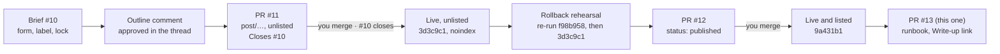

# F7 — First post end to end

## Brief

**Purpose.** Run the whole publishing loop of HANDOFF.md 6.3 once, for real, on the delivery-metrics write-up: you file the brief with the insight, I propose an outline, draft the post, and you review and merge it, first as `unlisted`, then `published`. Around the post, write `docs/runbook.md` (publishing end to end, unpublishing, rolling back a deploy) and point the Projects page's "Write-up" link at the post. Done when the post is live and listed: home, its tag page, RSS and the sitemap show it, and Projects links to it.

**What you will learn**

- `[Content]` The loop as a state machine: each state lives in one place. The brief is an issue (open, locked); the draft is a merged file with `status: unlisted` (live URL, `noindex`, listed nowhere); publishing is one changed line in a second PR. The brief closes at the first merge, not the second.
- `[CI/CD]` A deploy is an immutable build of one commit. Rolling back means deploying an older commit's build again: re-running an old Deploy run keeps its commit (`GITHUB_SHA`), while a manual `workflow_dispatch` run builds a branch's latest commit. A re-run is temporary until `main` itself is reverted.
- `[GitHub]` Undo at three depths: unpublish (a post PR changes `status`), revert (GitHub's **Revert** opens a PR that undoes a merge), remove (history rewrite and GitHub Support). Only the last removes text from the public repository; Pages caches pages for 10 minutes (`cache-control: max-age=600`), and feed readers and search engines keep their own copies.
- `[GitHub]` Closing keywords: `Closes #N` closes the issue when the PR merges into the default branch, and is a no-op on an issue that is already closed, which is why the publish PR can repeat it for the `content` gate.
- `[Content]` Facts with provenance: the post cites the delivery-metrics repository by permalinks to one commit, so every number stays checkable after the project moves on.

**Decisions** (defaults in bold)

1. **Order.** You file the brief (Post brief form) → I read only collaborators' text (`STYLE.md` 1) and check the label and lock → I show you the outline in chat, and post it as a comment on the brief only after your OK (it is public) → you approve in the thread → I draft on `post/<slug>` and open the PR → you review and merge → I check the unlisted page live → publish PR → you merge → feat/07 PR. I write the runbook while you write the brief; the feat/07 PR opens once the slug is approved, and gets the debrief and screenshots once the post is live.
2. **Facts only from HANDOFF.md 5.3 and the public repository at `df58ba6`** (2026-10-08, the latest commit), cited by permalinks to that commit. Checked so far: the README says "about 730 tests" (a static count finds 515 test functions, 44 of them parametrised, consistent with it), and the 53 graded questions are 48 cases in `evals/cases/`, five of them two-turn conversations. Further numbers (eval cost per run, the three full runs, the one known breach) come from the README and `docs/features.md` at the same commit. I count tests by reading the files, **without running the project's code**. Technical claims about Postgres roles, pgvector or the model API cite the official docs.
3. **One diagram, no screenshots.** A Mermaid figure in the F4 conventions (palette classes, `accDescr`, legend), for example how a question becomes a labelled answer. The README's screenshots show your synced repositories and their numbers, so they stay out unless the brief asks for them; if it does, I crop and check them, and the pipeline strips metadata.
4. **Frontmatter.** Tags from the brief's primary tag (a second only if the brief names one); `status: unlisted`, `brief: <N>`, `sources`; `aiAssisted: true` with the default disclosure, which mentions "the project's code" and is true here. `pubDate` is the day the publish PR merges.
5. **Publish PR on `post/<slug>-publish`** (the draft branch is deleted at merge): only `status: published` and, if the date moved, `pubDate`. Title `post(<slug>): publish`, the `post.md` template, label `post`, `Closes #<N>`.
6. **`writeUp: '<slug>'` in `src/lib/projects.ts` on the feat/07 branch.** A post PR may change only `src/content/posts/**`. The link appears only once the post is `published`, so the two PRs can merge in either order.
7. **`docs/runbook.md`, three procedures**, each with commands and the read-only checks that prove it worked: *publish* (the order above, why the brief closes at the draft merge); *unpublish* (back to `unlisted`: URL stays, out of every list; `draft` or deleting the folder: the URL returns 404; and what unpublishing cannot undo); *roll back* (fast: re-run all jobs of the last good Deploy run, within 30 days; durable: revert the bad PR; never `workflow_dispatch` for this). Not "re-run failed jobs" on an old run: the Pages artifact expires after a day.
8. **Rehearse the rollback once, live,** between the unlisted merge and the publish PR: you re-run the F6 Deploy run (`gh run rerun 40199463381`, commit `f98b958`), the post's URL returns 404 and `pnpm smoke --version f98b958` passes; then you re-run the draft's Deploy run and the post is back. About 6 minutes of waiting. Deploys stay yours, like merges; I give the commands and verify.
9. **F6 debrief note,** as you listed it: test brief #8 locked 8 seconds after creation; test post PR #9 green on `verify`, `privacy` and `content`, then red on scope after one out-of-scope commit and blocked by the ruleset; #9 closed unmerged, #8 closed as not planned; `content` added to the ruleset before the test PR (Guide C2 said after); F6 final time 20:03 to 21:10 by the clock, about 55 minutes active.
10. **Lighthouse once, on the live Home and post page** (HANDOFF.md 9: desktop ≥ 95 for performance and accessibility), with `pnpm dlx lighthouse@13.5.0 --preset=desktop` and the local Chrome; nothing added to the repository. Scores in the debrief; a score under 95 is reported at the top with its cause.
11. **"Now" stays as it is** unless you send three items during the review; then they go into the feat/07 PR (a post PR cannot touch `src/data/`).

**Acceptance criteria**

- The brief is labelled `brief`, locked, `brief-privacy` green; the outline is posted after your OK and approved in the thread.
- Draft PR: `post/<slug>`, label `post`, `Closes #<N>`; `verify`, `privacy` and `content` green, with no failing link; merged by you; the brief closed by that merge; the page live with `noindex` and absent from home, tags, RSS and sitemap.
- Rollback rehearsal: smoke green for `f98b958` with the post at 404, then green again for the draft's commit with the post back.
- Publish PR green and merged; Deploy green (build, deploy, smoke); `pnpm smoke --version <sha>` green against the live site; the post on home, its tag page, `/rss.xml` and `/sitemap.xml`, without `noindex`; Projects shows "Write-up" after the feat/07 merge.
- feat/07 PR: runbook, `writeUp`, F6 note, F7 debrief with screenshots of the live post (light, dark, 375px); `pnpm check`, `build`, `test`, `privacy` green locally; `verify` and `privacy` green, `content` skipped.
- Every number in the post traces to a permalink at `df58ba6` or to a source in `sources`.

**Timebox.** 60–90 minutes of your time, including writing the brief; it may run over, and nothing is cut (owner decision, 2026-10-25). Risks: three PRs and five deploys of 2–3 minutes each; the link check depends on outside sites.

**Versions** (checked 2026-10-25): no new dependency. Lighthouse 13.5.0 (released 2026-09-18) runs once through `pnpm dlx`. `gh` 2.103.2.

**Docs.** [Re-running workflows and jobs](https://docs.github.com/en/actions/how-tos/manage-workflow-runs/re-run-workflows-and-jobs) · [Manually running a workflow](https://docs.github.com/en/actions/how-tos/manage-workflow-runs/manually-run-a-workflow) · [Reverting a pull request](https://docs.github.com/en/pull-requests/collaborating-with-pull-requests/incorporating-changes-from-a-pull-request/reverting-a-pull-request) · [Linking a pull request to an issue](https://docs.github.com/en/issues/tracking-your-work-with-issues/using-issues/linking-a-pull-request-to-an-issue) · [Pages: custom workflows](https://docs.github.com/en/pages/getting-started-with-github-pages/using-custom-workflows-with-github-pages) · [Viewing deployment history](https://docs.github.com/en/actions/how-tos/deploy/configure-and-manage-deployments/view-deployment-history) · [Removing sensitive data](https://docs.github.com/en/authentication/keeping-your-account-and-data-secure/removing-sensitive-data-from-a-repository) · [Lighthouse](https://github.com/GoogleChrome/lighthouse)

---

## Debrief

### 1. What was built

The publishing loop ran once, for real, from your brief to a listed post. Every step left a record: an issue, an outline comment, two merged post PRs, two deploys, and a rehearsed rollback.

| Area | Result |
|---|---|
| The post | [The model picks the query, Postgres computes the number](https://chau-minh-tieu.github.io/posts/model-picks-postgres-computes/): about 2,200 words, seven sections, two diagrams, four screenshots, 21 sources, every repository fact linked to delivery-metrics at `df58ba6` |
| Brief and outline | #10, filed through the form, labelled 1 second and locked 7 seconds after creation; the outline posted after your OK, approved in the thread |
| Draft | #11 on `post/model-picks-postgres-computes`: `verify`, `privacy`, `content` green; merged as `3d3c9c1`, which closed #10 |
| Rollback rehearsal | Re-running the F6 Deploy run served `f98b958` (post 404, smoke 11/11); re-running the draft's run restored `3d3c9c1` (post back, smoke 11/11). About a minute each |
| Publish | #12 on `post/model-picks-postgres-computes-publish`, one line; merged as `9a431b1`; Deploy green; the post on home, `/tags/ai/`, RSS and sitemap, without `noindex` |
| Runbook | `docs/runbook.md`: publish, unpublish at three depths, roll back (re-run, then revert) |
| Write-up link | `writeUp` on delivery-metrics; it appears on Projects once this PR merges |
| Lighthouse 13.5.0, desktop, live | Home: performance 100, accessibility 100. Post: performance 100, accessibility 100. CLS 0 and TBT 0 ms on both |
| Checks | 225 tests (1 new); `pnpm smoke --version` green after every deploy |

Screenshots of the live site in [`img/`](img/): `07-post-light.png`, `07-post-dark.png` (section 3 with Fig. 2), `07-home-light.png` (the post listed), `07-mobile.png` (the post's top, section 4 and home at 375px) and `07-projects-light.png` (the Write-up link, from this branch's build under `pnpm preview`).

### 2. File tour

| File | Single responsibility | Depends on |
|---|---|---|
| `src/content/posts/model-picks-postgres-computes/index.md` | The post (merged in #11 and #12, not in this PR) | `STYLE.md`, brief #10 |
| `src/content/posts/model-picks-postgres-computes/screenshot-*.jpg` | The four README screenshots, re-encoded without their EXIF and IPTC blocks | — |
| `docs/runbook.md` | Publish, unpublish, roll back: who acts, the command, the check that proves it | `deploy.yml`, `post.yml`, `scripts/smoke.ts` |
| `src/lib/projects.ts` | `writeUp: 'model-picks-postgres-computes'` on delivery-metrics | `posts.ts` |
| `src/lib/projects.test.ts` | New: every `writeUp` names a post folder that exists | `node:fs` |
| `docs/features/06-content-workflow.md` | The F6 post-merge demonstration and F6's final time | — |
| `docs/features/07-first-post.md` | This brief and debrief | — |
| `docs/features/img/07-*.png` | Screenshots of the live post, home, Projects and 375px | — |

### 3. Concepts

**The publishing loop as a state machine** `[Content]`
- Mental model: a workflow engine where each state lives in exactly one store, like an order that is a row in one table at a time. The brief is an issue; the draft is an open PR; "unlisted" and "published" are one frontmatter field on `main`; what readers see is whatever the last deploy built.
- Here: #10 (brief) → #11 (`status: unlisted`, closes the brief) → `3d3c9c1` live with `noindex` → #12 (`status: published`) → `9a431b1` listed. `docs/runbook.md` opens with the state table.
- Mistakes: expecting the brief to close at publication (it closes when the draft merges); reviewing only GitHub's Markdown preview (the unlisted page is the full-fidelity review: diagrams, figure numbers, sidenotes); treating `unlisted` as private (the URL is public, only unadvertised).
- Docs: `HANDOFF.md` 6.3, [`docs/runbook.md`](../runbook.md)

**A deploy is an immutable build of one commit; a rollback deploys an older one** `[CI/CD]`
- Mental model: Pages serves the most recent deployment, like a load balancer pointing at the latest image tag. Re-running an old Deploy run rebuilds that run's commit (`GITHUB_SHA` stays the same) and points Pages at it. It is a temporary pin: `main` has not moved, so the next merge deploys `main` again, bad commit included. The durable fix is a revert on `main`.
- Here: `gh run rerun 40199463381` (attempt 2) built and deployed `f98b958`, and `deploy.yml`'s smoke job checked `/version.txt` against that SHA. The deployment history (`GET …/deployments?environment=github-pages`) lists `3d3c9c1`, `f98b958`, `3d3c9c1` in that order.
- Mistakes: "Re-run failed jobs" or only the deploy job on an old run (the Pages artifact expired after a day; re-run all jobs); `workflow_dispatch` as a rollback (it builds a branch's latest commit); merging anything else before the revert.
- Docs: [Re-running workflows and jobs](https://docs.github.com/en/actions/how-tos/manage-workflow-runs/re-run-workflows-and-jobs), [Viewing deployment history](https://docs.github.com/en/actions/how-tos/deploy/configure-and-manage-deployments/view-deployment-history)

**Undo at three depths** `[GitHub]`
- Mental model: soft delete, hard delete, and purge. Unpublishing (`status: unlisted` or `draft`) changes what the next build contains; reverting undoes a merge on `main`; only a history rewrite removes text from the public repository, and even that leaves forks, clones and cached views.
- Here: the runbook's section 2 table; each depth is a post PR with `Closes #<N>` (the gate), or GitHub's **Revert** for the whole merge. A post deleted in a PR passes the brief gate ("deleted in this PR: nothing to check").
- Mistakes: treating unpublish as removal after a privacy leak; forgetting caches (Pages sends `cache-control: max-age=600`; feed readers keep items); force-pushing to "fix" history (denied for the AI, blocked by the ruleset).
- Docs: [Reverting a pull request](https://docs.github.com/en/pull-requests/collaborating-with-pull-requests/incorporating-changes-from-a-pull-request/reverting-a-pull-request), [Removing sensitive data](https://docs.github.com/en/authentication/keeping-your-account-and-data-secure/removing-sensitive-data-from-a-repository)

**Closing keywords** `[GitHub]`
- Mental model: a trigger on merge. `Closes #N` in a PR body links the PR to the issue, and GitHub closes the issue when that PR merges into the default branch; on a closed issue the trigger has nothing to do.
- Here: #11 closed #10 at 15:26 UTC, the second its merge landed. #12 repeated `Closes #10` because the `content` gate requires it for every changed post; #10 stayed closed, with no reopen and no second event.
- Mistakes: a keyword in a PR into a non-default branch (ignored); expecting a comment saying "Closes #N" to close anything (only PR bodies and commit messages count); removing the link by unchecking it (keyword links are removed by editing the body).
- Docs: [Linking a pull request to an issue](https://docs.github.com/en/issues/tracking-your-work-with-issues/using-issues/linking-a-pull-request-to-an-issue)

**Facts with provenance** `[Content]`
- Mental model: a citation pinned to a version, like a dependency pinned to a hash. A link to `blob/main/README.md` points at whatever the file says tomorrow; a link to `blob/df58ba6…/README.md#L162-L167` points at the lines that supported the sentence when it was written.
- Here: every repository fact in the post links to delivery-metrics at `df58ba6`; #11's body lists each number with its file and lines. Where the README rounded ($1.10–1.20 a run), the post uses the logged runs ($1.08, $1.17, $1.18). The test count stayed out: a static count could not confirm the README's "about 730" exactly.
- Mistakes: citing a moving branch; trusting a summary (README) over the measurement it summarises (`docs/features.md`); stating a number no source in `sources` supports.
- Docs: [GitHub: getting permanent links to files](https://docs.github.com/en/repositories/working-with-files/using-files/getting-permanent-links-to-files)

### 4. Verify it yourself

| Do this | Correct result |
|---|---|
| Open https://chau-minh-tieu.github.io/posts/model-picks-postgres-computes/ | The post, both themes; Fig. 1 to 6; no console errors |
| https://chau-minh-tieu.github.io/, `/tags/ai/`, `/rss.xml`, `/sitemap.xml` | Each lists the post |
| `curl -s https://chau-minh-tieu.github.io/posts/model-picks-postgres-computes/ \| grep -c noindex` | `0` |
| `pnpm smoke --version 9a431b132b21f18fa4d4a8a54fa2f675bb54473e` | `all 11 checks passed` (after this PR merges, its own SHA) |
| `gh api -X GET 'repos/chau-minh-tieu/chau-minh-tieu.github.io/deployments?environment=github-pages&per_page=4' --jq '.[] \| .sha[0:7]'` | `9a431b1`, `3d3c9c1`, `f98b958`, `3d3c9c1`: publish, restore, rollback, draft |
| `gh api -X GET repos/chau-minh-tieu/chau-minh-tieu.github.io/issues/10 --jq '{state, state_reason, closed_at}'` | `closed`, `completed`, `2026-10-25T15:26:02Z` (the #11 merge) |
| After this PR merges: https://chau-minh-tieu.github.io/projects/ | "Write-up →" next to delivery-metrics' "Source →" |
| Change `writeUp` to a wrong slug, `pnpm test` | `names an existing post for every write-up` fails; undo |

### 5. Check your understanding

1. You find a typo in the published post. Which branch, which gate checks, and does the brief need anything?
   

Answer
A post PR on a branch such as <code>post/model-picks-postgres-computes-typo</code>, changing only the post's <code>index.md</code>. <code>verify</code>, <code>privacy</code> and <code>content</code> run; <code>content</code>'s brief gate needs <code>Closes #10</code> in the body, because the post's frontmatter says <code>brief: 10</code>. The brief stays closed: GitHub ignores the keyword for a closed issue. Set <code>updatedDate</code> if the change matters to readers.

2. A deploy breaks the live site. You re-run the last good Deploy run and the site recovers. Then a teammate merges an unrelated PR. What does the site serve, and what should have happened first?
   

Answer
The new merge's commit, built from <code>main</code>, which still contains the bad change: the re-run moved Pages, not <code>main</code>. The revert PR should have merged first (runbook, section 3: until it merges, merge nothing else). A re-run is the fast path; the revert is the fix.

3. Why did the draft PR close the brief, when the post was not public yet?
   

Answer
HANDOFF.md 6.3 puts <code>Closes #&lt;brief&gt;</code> in the draft PR, and GitHub closes the issue as soon as that PR merges into <code>main</code>. The brief's job, being the AI's input, ends when the draft is accepted; publishing is a one-line follow-up that does not need the thread. The gate still asks the publish PR for <code>Closes #N</code>, so every post PR names its brief.

### 6. Deviations and gotchas

- **Approval in chat first, then in the thread.** You said "approved" in chat at 22:05 and I started drafting; your "Approved" on #10 followed at 22:08. `STYLE.md` asks for it in the thread; the record is there.
- **The test count is not in the post** (brief decision 2). The README says about 730; a static count of the test files finds 633 plus 14 parametrisations over data that only expands at collection time. Consistent, not exact, and an exact count means running the project. The Projects page keeps HANDOFF.md 5.3's "≈730 tests".
- **Eval cost from the log.** The README rounds the three runs to $1.10–1.20; the post uses the logged $1.08, $1.17 and $1.18 (outline question 4).
- **The README screenshots carried EXIF and IPTC blocks.** Re-encoded with `sharp` (quality 85, mozjpeg) before committing; `pnpm privacy` and the build-output tests found no metadata.
- **One extra test, not in the brief:** `projects.test.ts` fails when a `writeUp` names no post folder. Without it a typo hides the link silently, since `linksOf` finds no published post. Mutation-checked with a one-letter typo. The existing test now builds a project without `writeUp` explicitly.
- **The first re-run never reached GitHub.** The reply "I re-ran the F6 Deploy run" arrived, but the run was still on attempt 1 and the command was not in the terminal. The second time it ran (attempt 2). A button reply reports; it does not run anything.
- **`gh pr merge` on another branch does not update local `main`.** #12 was merged while this checkout was on `feat/07-first-post`; `main` was pulled afterwards.
- **`main` merged into this branch twice** (after #11 and after #12), so the new test sees the post folder and the local build shows the Write-up link. The squash merge flattens them.
- **The revert path is documented, not rehearsed.** The rehearsal covered re-runs only. The revert branch's name prefix (`revert-`) is as GitHub creates it today; the runbook's claim that `content` is skipped there follows from `post.yml`'s branch condition.
- **Headless Chrome and URL fragments.** A dark screenshot of `…/#the-model-never-does-the-maths` came out blank; loading the same URL inside an iframe wrapper worked, as for the 375px set.
- **YAML and colons.** The description contains ": ", so it is quoted; unquoted, YAML reads it as a mapping.
- **Lockfile.** At the start, `pnpm-lock.yaml` carried the `@pnpm/exe` entry from the standalone pnpm; restored, never committed. Lighthouse ran through `pnpm dlx` from the scratch directory, outside the repository.
- **A 26-minute gap** (22:40 to 23:06) after the #12 merge was an interrupted turn, not work; it is left out of the active time.

### 7. Time used

| | Time |
|---|---|
| F7, brief | 21:11 to 21:16 by the clock: reading, docs, delivery-metrics facts, the brief; "go" at 21:20 |
| Runbook and F6 note | 21:20 to 21:22 |
| Your brief #10 | 21:22 to 21:57 |
| Outline | 21:57 to 22:05: read the brief and the repository, drafted, posted after your OK |
| Draft | 22:05 to 22:13: sources checked, screenshots re-encoded, post written, checks, PR #11 |
| Review and merge #11 | 22:13 to 22:26 |
| Unlisted check and rollback rehearsal | 22:26 to 22:37 |
| Publish PR #12, PR #13, merge #12 | 22:37 to 22:40 |
| Interrupted turn | 22:40 to 23:06, not counted |
| Live checks, Lighthouse, screenshots, debrief | 23:06 to 23:11 |
| F7 so far | about 2 h 00 min by the clock, about 1 h 34 min active (including your 35 minutes on the brief) against the 60–90-minute timebox, before this PR's review and merge |
| Cumulative | about 7 h 35 min of active time (about 9 h 37 min by the clock) of the planned 4–6 hours |

### 8. Q&A log

No questions yet.

### 9. Next

F8, stretch.
