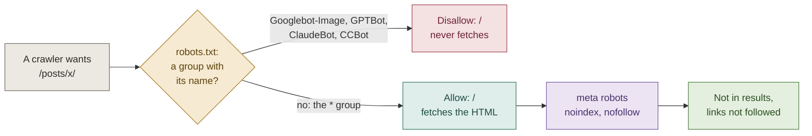

# F9 — Not indexed by search engines

## Brief

**Purpose.** A requirement change from the owner on 2026-11-05: search engines must not index the site. Every page asks them not to, and robots.txt still lets them crawl, so they can read that request. Image search and AI-training crawlers are refused at the door. The sitemap goes. RSS and link previews stay. "Unlisted" now means only "kept out of the lists and RSS", because every page is `noindex` anyway.

**What you will learn**

- `[Content]` Crawling and indexing are separate controls. robots.txt decides whether a bot may fetch a URL, like a firewall rule. `<meta name="robots">` decides whether a fetched page may appear in results, like a `Cache-Control: no-store` on the response. A URL blocked by robots.txt is never fetched, so its `noindex` is never read, and Google can still list the bare address when other sites link to it ([Google](https://developers.google.com/search/docs/crawling-indexing/block-indexing)). That is why a global `Disallow: /` would defeat the goal.
- `[Content]` robots.txt groups ([RFC 9309](https://www.rfc-editor.org/rfc/rfc9309.html)): a crawler obeys only the groups that name it and falls back to `*` when none does. So `Googlebot-Image` obeys its own `Disallow: /`, while `Googlebot` obeys `*`. `Google-Extended` and `Applebot-Extended` are not crawlers. They are permission flags that Googlebot and Applebot read for AI training, and they do not affect search ([Google](https://developers.google.com/search/docs/crawling-indexing/google-common-crawlers), [Apple](https://support.apple.com/en-us/119829)).
- `[GitHub]` GitHub Pages serves files and cannot add response headers, so `X-Robots-Tag` is not available. `noindex` can only live inside HTML. XML, TXT and SVG files are indexable too ([Google](https://developers.google.com/search/docs/crawling-indexing/indexable-file-types)) and cannot carry the tag (question 2).
- `[Astro]` One layout, one rule. `BaseLayout.astro` writes every page's `<head>`, so one line covers the site. A build-output test over every HTML file in `dist/` guards it like a contract test, including pages added later.

**Decisions** (defaults in bold)

1. **`<meta name="robots" content="noindex, nofollow">`, unconditional, in `BaseLayout.astro`.** Spelled out as the requirement says, not Google's shorthand `none`. The `noindex` prop and its two callers (`PostLayout` for non-published posts, `404.astro`) go: one rule, no switch.
2. **`public/robots.txt` becomes:**
   ```
   # Crawling stays allowed so search engines can read each page's noindex tag.
   User-agent: *
   Allow: /

   User-agent: Googlebot-Image
   User-agent: GPTBot
   User-agent: ClaudeBot
   User-agent: CCBot
   User-agent: Google-Extended
   User-agent: Applebot-Extended
   Disallow: /
   ```
   One group with six `User-agent` lines, as RFC 9309 allows. No `Sitemap:` line. Tokens are checked against each vendor's page ([OpenAI](https://developers.openai.com/api/docs/bots), [Anthropic](https://support.claude.com/en/articles/8896518-does-anthropic-crawl-content-from-the-web-and-how-can-site-owners-block-the-crawler), [Common Crawl](https://commoncrawl.org/ccbot)).
3. **The sitemap goes.** There is no `@astrojs/sitemap` integration to remove: F2 wrote its own endpoint (plan, deviation 8). `src/pages/sitemap.xml.ts`, its test, its smoke check and every live mention go. Closed feature docs (F2, F3, F7) stay as the record of what was built then.
4. **Unchanged:** RSS, canonical URLs (self-referencing, and `og:url` uses the same URL), Open Graph and Twitter tags, and unlisted posts staying out of home, tag pages, next/previous and RSS.
5. **Tests.** Build output: every `.html` in `dist/` carries the tag exactly once; `dist/robots.txt` allows `*` with no `Disallow` and disallows `/` for the six tokens; no `sitemap.xml` and no "sitemap" text anywhere in `dist/`. A small parser in `scripts/lib/robots.ts`, unit-tested, serves the test and the smoke check. The unlisted and 404 tests move to the new tag. **Mutation check:** dropping the tag, or adding `Disallow: /` under `*`, turns the suite red.
6. **Smoke checks after every deploy:** home, Projects, About, the unlisted post and the 404 page carry the tag; live robots.txt passes the same parser; `/sitemap.xml` answers 404.
7. **Docs:** HANDOFF.md 4.2 and 6.2 (old text struck through, an owner-decision note, as before); one Frontend rule in CLAUDE.md; the plan's "Later decisions", deviation 8 marked superseded, the versions row; the runbook's publish and unpublish checks (a published page now carries `noindex` too, and the lists and RSS tell the states apart); the README's two sitemap mentions and one sentence on why the site is not indexed; the kitchen-sink description, which names the sitemap and ships in `dist/`; code comments.
8. **Not in scope:** Google Search Console, which needs an account and a verification token. Pages Google already holds drop out when it recrawls them, which "may take months" for a page it rarely visits (Google). Lighthouse's SEO category will flag "blocked from indexing". That is expected, and HANDOFF.md 9 measures only performance and accessibility.

**Questions** (reply "defaults" to accept all)

1. **AI search crawlers. Default: block only the six tokens you named.** Reason: your list is explicit, and adding a token later is one line. Alternative: also block `OAI-SearchBot` and `Claude-SearchBot`, which build the search indexes behind ChatGPT and Claude search. Their vendors' pages describe robots.txt as the way to opt out.
2. **Non-HTML files** (`/rss.xml`, `/version.txt`, the SVG icons). **Default: accept and record the gap in the plan.** Reason: Pages cannot send `X-Robots-Tag`. A `Disallow` for these files would contradict "allow all" and would not stop a bare-URL listing. Images are covered by `Googlebot-Image`.

**Your answers** (2026-11-05): "Go, defaults". Both defaults stand.

**Acceptance criteria**

- Every HTML file in `dist/` carries `<meta name="robots" content="noindex, nofollow">` exactly once, and the mutation check proves the test bites.
- `dist/robots.txt` matches decision 2. `dist/` has no `sitemap.xml` and no "sitemap" text. RSS, canonical, Open Graph and unlisted tests stay green.
- HANDOFF.md 4.2 and 6.2, CLAUDE.md, the plan, the runbook and the README are updated. `grep -ri sitemap` outside closed feature docs finds only this feature's record.
- `pnpm check`, `build`, `test` and `privacy` are green locally. On the PR, `verify` and `privacy` are green and `content` is skipped. No visual change, so no screenshots.
- After the merge: Deploy is green, including smoke. Live `/sitemap.xml` answers 404. `curl` shows the tag on home and on a published post.

**Timebox.** About 20 minutes of yours: this brief, then the PR review. Mine: about 45 minutes of build.

## Debrief

### 1. What was built

The site now asks every search engine not to index any page or follow its links, and it still lets them fetch the pages, so they can read that request. Everything is in PR #20.



`Google-Extended` and `Applebot-Extended` are missing from the diagram on purpose. They never fetch anything. Googlebot and Applebot read them as "may this content train your models?", and the answer is no.

| Area | Result |
|---|---|
| Pages | All 10 built pages carry `<meta name="robots" content="noindex, nofollow">` exactly once, from `BaseLayout.astro`; the `noindex` prop is gone |
| robots.txt | `*` may crawl everything; the six named agents are refused `/`; no `Sitemap:` line |
| Sitemap | `src/pages/sitemap.xml.ts` deleted; `dist/` has no sitemap and no text mentions one; `/sitemap.xml` answers 404 under `pnpm preview` |
| Unchanged | RSS, canonical URLs, Open Graph and Twitter tags; unlisted posts still stay off home, tag pages, next/previous and RSS |
| Tests | 260: 23 new (12 build-output, 9 parser, 2 smoke) and 2 removed (the sitemap list and the old unlisted `noindex` test). Three mutation checks |
| Smoke | `home`, `pages`, `unlisted` and `not found` require the tag; new `robots` check (policy, `/sitemap.xml` is 404); `feeds` is RSS only. 10 checks locally, 12 live |
| Docs | HANDOFF.md 4.2 and 6.2, CLAUDE.md (Frontend), the plan (later decisions, deviation 8 superseded, versions), runbook (states and checks), README (at a glance, publishing diagram, layout) |

**Mutation check.** Each change was made on purpose, the suite was run, and the change was undone:

| Broken on purpose | Result |
|---|---|
| The tag deleted from `BaseLayout.astro` | 11 tests fail: each of the 10 pages by name, and the 404 test |
| `Allow: /` under `*` changed to `Disallow: /` | 4 fail: the build-output policy test, the parser test on `public/robots.txt`, and two smoke tests |
| `sitemap.xml.ts` restored | 1 fails: "has no sitemap, and nothing mentions one" |

### 2. File tour

| File | Single responsibility | Depends on |
|---|---|---|
| `src/layouts/BaseLayout.astro` | Writes the robots meta on every page | — |
| `src/layouts/PostLayout.astro` · `src/pages/404.astro` | No longer pass `noindex` | `BaseLayout.astro` |
| `public/robots.txt` | Who may crawl what; copied to `dist/` as is | — |
| `scripts/lib/robots.ts` | The policy (`ROBOTS_META`, `SEARCH_AGENTS`, `BLOCKED_AGENTS`), an RFC 9309 reader, `robotsProblems()`, `robotsMetaOf()` | — |
| `scripts/lib/robots.test.ts` | Parser and policy, including the real `public/robots.txt` | `robots.ts` |
| `scripts/lib/smoke.ts` | The tag on every page it fetches; the `robots` check | `robots.ts` |
| `scripts/lib/smoke.test.ts` | The fake site serves the real robots.txt; new failure cases | `smoke.ts` |
| `tests/build-output.test.ts` | "indexing (F9)": the tag once per page, the robots.txt policy, no sitemap anywhere | `robots.ts`, `dist/` |
| `src/lib/collection.ts` · `src/lib/posts.ts` · `kitchen-sink/index.md` | Comments and the kitchen-sink description without "sitemap" | — |
| `HANDOFF.md` · `CLAUDE.md` · `docs/00-plan.md` · `docs/runbook.md` · `README.md` | The decision, the standing rule, the accepted gap, the new checks | — |

### 3. Concepts

**Crawling and indexing are two different controls** `[Content]`
- Mental model: robots.txt is a firewall rule at the door ("may you fetch this URL?"). The robots meta tag is a header on the response ("you may read this, but don't publish it"). A firewall that drops the request also drops the header. So a page refused by robots.txt is never fetched, its `noindex` is never read, and Google can still list its bare URL when another site links to it.
- Here: `public/robots.txt` keeps `Allow: /` for `*`. `BaseLayout.astro` writes the tag. `robotsProblems()` fails if `*`, `Googlebot` or `Bingbot` loses access to any path.
- Mistakes: `Disallow: /` "to be safe", which can leave bare-URL listings that never go away; expecting a robots.txt change to remove pages that are already indexed (only a recrawl that reads `noindex` removes them); `noindex` in robots.txt (Google ignores it).
- Docs: [Block Search indexing with noindex](https://developers.google.com/search/docs/crawling-indexing/block-indexing), [Robots meta tag](https://developers.google.com/search/docs/crawling-indexing/robots-meta-tag)

**robots.txt groups, and tokens that are not crawlers** `[Content]`
- Mental model: like routing by the most specific match, except that groups are chosen by name, not by specificity. A crawler collects every group that names it and ignores `*`; only a crawler with no group of its own uses `*`. Several `User-agent` lines can share one group. Some names are not crawlers at all, only permission flags read by another crawler.
- Here: one group with six `User-agent` lines and `Disallow: /`. `Googlebot-Image` obeys it, while `Googlebot` obeys `*`. `parseRobots()` and `rulesFor()` follow the same rules, so the tests judge the file the way a crawler does.
- Mistakes: listing `Googlebot-Image` and expecting `Googlebot` to stop too (it does not, and should not here); a rule line before any `User-agent` (it belongs to no group); thinking `Google-Extended` hides the site from Google Search (it does not).
- Docs: [RFC 9309](https://www.rfc-editor.org/rfc/rfc9309.html), [Google's crawlers](https://developers.google.com/search/docs/crawling-indexing/google-common-crawlers), [OpenAI](https://developers.openai.com/api/docs/bots), [Anthropic](https://support.claude.com/en/articles/8896518-does-anthropic-crawl-content-from-the-web-and-how-can-site-owners-block-the-crawler), [Common Crawl](https://commoncrawl.org/ccbot), [Apple](https://support.apple.com/en-us/119829)

**No response headers on GitHub Pages** `[GitHub]`
- Mental model: Pages is a file server with fixed headers, like an object store without per-object metadata. Anything a server would say in a header, such as `X-Robots-Tag` or a CSP header, must live inside the file, so only HTML can carry it.
- Here: the robots rule, like the CSP since F1, is a `<meta>` tag. `/rss.xml`, `/version.txt` and the SVG icons cannot carry one. That is the gap you accepted (question 2), recorded in the plan. Images are covered by refusing `Googlebot-Image`.
- Mistakes: adding a `_headers` file (a Netlify and Cloudflare convention that Pages ignores); assuming Google indexes only HTML (it indexes XML, TXT and SVG too).
- Docs: [Indexable file types](https://developers.google.com/search/docs/crawling-indexing/indexable-file-types)

**One layout, one contract test** `[Astro]`
- Mental model: `BaseLayout.astro` is the single place a page's `<head>` is written, like one middleware that stamps every response. The build-output test is the contract test: it runs over every HTML file in `dist/`, so a page added next year, or one that skips the layout, fails CI by name.
- Here: `it.each(pages)` in `tests/build-output.test.ts`. The removed `noindex` prop was a switch that could only make the rule weaker, so it went.
- Mistakes: testing one sample page; matching `noindex` anywhere in the HTML (a post about robots tags would pass); checking only the source, not `dist/`.
- Docs: [Astro layouts](https://docs.astro.build/en/basics/layouts/)

### 4. Verify it yourself

| Do this | Correct result |
|---|---|
| `pnpm build`, then `grep -L 'content="noindex, nofollow"' $(find dist -name '*.html')` | Prints nothing: no page lacks the tag |
| `cat dist/robots.txt` · `ls dist/sitemap.xml` | The file from decision 2 · "No such file or directory" |
| `pnpm test` | 260 passed |
| `pnpm preview`, then `pnpm smoke http://localhost:4321` | 10 checks, including `robots: robots.txt lets search engines crawl and refuses the blocked agents; no sitemap` |
| After the merge: `curl -s https://chau-minh-tieu.github.io/posts/why-what-next-what-exactly/ \| grep -o '<meta name="robots"[^>]*>'` | `<meta name="robots" content="noindex, nofollow">` |
| After the merge: `curl -s -o /dev/null -w '%{http_code}\n' https://chau-minh-tieu.github.io/sitemap.xml` | `404` |

### 5. Check your understanding

1. Why not simply `Disallow: /` for everyone, which sounds stricter?
   <details><summary>Answer</summary>A refused crawler never fetches the page, so it never reads <code>noindex</code>. A page another site links to can then still appear as a bare URL, and a page indexed before the change stays indexed, because nothing tells Google to drop it.</details>
2. Next year someone adds a page that does not use `BaseLayout`. What happens?
   <details><summary>Answer</summary><code>verify</code> fails on the PR: the "indexing (F9)" test runs once per HTML file in <code>dist/</code> and names the page without the tag. The <code>main</code> ruleset requires <code>verify</code>, so it cannot merge.</details>
3. After this merges, what still tells an unlisted post from a published one?
   <details><summary>Answer</summary>Only the lists and RSS: home, the tag pages, next/previous, <code>/rss.xml</code> and the Projects "Write-up" link show published posts only. Both kinds carry <code>noindex, nofollow</code>, and both answer at their URL.</details>

### 6. Deviations and gotchas

- **There was no sitemap integration.** The requirement said "remove the sitemap integration", but F2 had chosen its own endpoint over `@astrojs/sitemap` (plan, deviation 8). Deleting that endpoint is the whole removal.
- **Push and PR identity.** git's keychain held no password for `chau-minh-tieu`, and the active `gh` account on this machine is a different login. Earlier PRs were opened as `chau-minh-tieu`, so I pushed and opened #20 with that account's `gh` token, used for one command each (a one-off credential helper, then `GH_TOKEN`). No git or `gh` config was changed. If you want plain `git push` and `gh` to work again, you could make `chau-minh-tieu` the active `gh` account and let `gh` serve git credentials. That is your call; I changed nothing. A `git push … && gh pr create` chain does not match the push allow-rule in `.claude/settings.json`, so the push runs on its own.
- **The lockfile's `@pnpm/exe` entry came back** before the branch was cut, from the standalone pnpm. It was restored, not committed.
- **README numbers.** "232 Vitest tests, plus 11 smoke checks" had already drifted, because each new post adds per-page tests. It now says 260 and 12 (10 everywhere, plus the two redirect checks that run only against the live site).
- **Astro template comments** (`{/* … */}`) are not written to the HTML; the built pages carry the tag and no comment.
- **Not measured:** Lighthouse. Its SEO category will now report "Page is blocked from indexing". That is expected, and HANDOFF.md 9 asks only for performance and accessibility, which this change does not touch.

### 7. Time used

| | Time |
|---|---|
| F9, brief | 22:20 to 22:30 by the clock: reading, finding every sitemap and robots reference, the docs check, the brief |
| Waiting for your answer | 22:30 to about 23:16 |
| F9, build | 23:16 to about 23:30: layout, robots.txt, parser, tests, smoke checks, docs, mutation checks, local smoke, PR #20, this debrief |
| F9 so far | about 24 minutes of work, before your review and the merge |
| Cumulative | about 9 h 00 min of active time: 8 h 36 min after F8 plus F9 so far. The second post's chat (#17 to #19) recorded no time here and is not counted |

### 8. Q&A log

None yet.

### 9. Next

No feature is left in HANDOFF.md 8: F0–F8 are done, and F9 was a requirement change. The deferred items (Vale rules, per-post Open Graph images, the Claude Code GitHub Action, search) are candidates when you want one.
