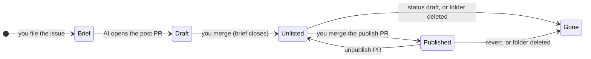

# Runbook

Three procedures: publishing a post end to end, unpublishing one, and rolling back a deploy. Each step says who acts (**you**, the owner, or **the AI**, the drafting assistant), the command, and the read-only check that proves it worked. Rules behind the steps: `HANDOFF.md` 6.3, `STYLE.md`, `CLAUDE.md`.

Commands below use these two values; replace `<…>` placeholders by hand.

```sh
REPO=chau-minh-tieu/chau-minh-tieu.github.io
SITE=https://chau-minh-tieu.github.io
```

## The model: where each state lives

A post moves through four states, and each state is recorded in exactly one place. The site is whatever the last deploy built from `main`.



| State | Recorded in | Visible on the site |
|---|---|---|
| Brief | An issue labelled `brief`, locked | Nothing |
| Draft | An open PR from `post/<slug>` with `status: unlisted` | Nothing |
| Unlisted | `src/content/posts/<slug>/index.md` on `main`, `status: unlisted` | `/posts/<slug>/` with `noindex`; absent from home, tag pages, RSS and sitemap |
| Published | The same file, `status: published` | Everywhere: home, `/tags/<tag>/`, `/rss.xml`, `/sitemap.xml`; the project's "Write-up" link if `src/lib/projects.ts` names the slug |
| Gone | `status: draft`, or no folder | `/posts/<slug>/` returns 404 |

## 1. Publish a post end to end

1. **Brief (you).** Repository → **Issues** → **New issue** → **Post brief**. Fill in every required field; the insight is the centre of the post. Generic terms only: the issue is public the moment it is filed.
   Check (seconds later): the issue carries `brief`, its timeline says "locked and limited conversation to collaborators", and **Actions** → **Briefs** shows `lock` and `brief-privacy` green.

   ```sh
   gh api -X GET repos/$REPO/issues/<N> --jq '{labels: [.labels[].name], locked, author_association}'
   gh run list --repo $REPO --workflow lock-briefs.yml --limit 3
   ```

   A red `brief-privacy` run: edit the text, then delete the old revision from the issue's edit history (**edited** → pick the revision → **Delete revision from history**). The log names the field, line and term index, never the term.

2. **Outline (the AI, then you).** The AI reads the brief and collaborators' comments only (`STYLE.md` 1), shows you the outline, and posts it as a comment after your OK. You approve or correct it in the thread.

3. **Draft PR (the AI).** On `post/<slug>` from an up-to-date `main`: `src/content/posts/<slug>/index.md` with `status: unlisted` and `brief: <N>`, images beside it. Local checks: `pnpm check && pnpm build && pnpm test && pnpm privacy && pnpm links <slug>`. Then `gh pr create --template post.md --label post`, title `post(<slug>): <title>`, body with `Closes #<N>` and the claims to verify.
   Check: `verify`, `privacy` and `content` green.

   ```sh
   gh pr checks <PR> --repo $REPO
   ```

   `content` warnings (403, 429, timeouts) are on the run's summary page: open those links yourself.

4. **Review and merge (you).** Read **Files changed** with the rich diff (the document icon), comment line by line; the AI answers with new commits. Then:

   ```sh
   gh pr merge <PR> --repo $REPO --squash --delete-branch
   ```

   **The brief closes now.** GitHub closes an issue named by a closing keyword (`Closes`, `Fixes`, `Resolves` and their forms) when the PR merges into the default branch. The draft PR carries `Closes #<N>` (`HANDOFF.md` 6.3 step 3), so the brief closes when the unlisted draft lands, not at publication.

5. **Deploy and check the unlisted page (the AI).** The merge starts **Deploy** (build → deploy → smoke). Then:

   ```sh
   gh run list --repo $REPO --workflow deploy.yml --branch main --limit 1
   pnpm smoke --version <squash SHA>
   curl -s $SITE/posts/<slug>/ | grep -c 'name="robots" content="noindex"'   # 1
   curl -s $SITE/rss.xml $SITE/sitemap.xml $SITE/ | grep -c '/posts/<slug>/'   # 0
   ```

   Read the page in a browser, both themes and on a phone: this is the full-fidelity review GitHub's preview cannot give.

6. **Publish PR (the AI).** On `post/<slug>-publish`: `status: published`, and `pubDate` set to the day it goes live. Same template and label, title `post(<slug>): publish`, and again `Closes #<N>`: the `content` gate requires it, and GitHub ignores the keyword for an issue that is already closed.

7. **Merge (you)** with the same `gh pr merge` command. Check (the AI): Deploy green, `pnpm smoke --version <squash SHA>`, and the post listed:

   ```sh
   for path in / /tags/<tag>/ /rss.xml /sitemap.xml; do printf '%s ' "$path"; curl -s "$SITE$path" | grep -c '/posts/<slug>/'; done   # each ≥ 1
   curl -s $SITE/posts/<slug>/ | grep -c 'name="robots" content="noindex"'   # 0
   ```

   A project write-up: `writeUp: '<slug>'` in `src/lib/projects.ts`, in a `feat/*` PR (a post PR may change only `src/content/posts/**`). The link appears once the post is published, whichever PR merges first.

## 2. Unpublish a post

Choose the depth. Each is a post PR on `post/<slug>-unpublish` with `Closes #<N>` in the body (the gate), merged by you like any other.

| Goal | Change | Result after the deploy |
|---|---|---|
| Take it off the lists, keep the URL | `status: unlisted` | Page answers with `noindex`; gone from home, tags, RSS, sitemap and the Projects link |
| Take the page down, keep the file | `status: draft` | `/posts/<slug>/` returns 404; the file stays for later |
| Remove it | Delete the folder (`git rm -r src/content/posts/<slug>`) | 404; the text lives on in git history |

GitHub's **Revert** button on the merged PR does the third in one click; see section 3.

Check: Deploy green, then `curl -s -o /dev/null -w '%{http_code}\n' $SITE/posts/<slug>/` prints `200` (unlisted) or `404`.

**What unpublishing cannot undo.** Pages lets browsers cache a page for 10 minutes (`cache-control: max-age=600`). Feed readers keep the items they fetched, and search engines drop a page only after they recrawl it. Above all, the repository is public: the text stays in the commit history, the merged PR's diff and anyone's clone. If a post leaked something private, unpublish first (fast), then follow GitHub's [Removing sensitive data from a repository](https://docs.github.com/en/authentication/keeping-your-account-and-data-secure/removing-sensitive-data-from-a-repository): rewriting history needs a force push to `main`, which the ruleset blocks and only you can lift, and GitHub Support removes cached views and PR references afterwards. The AI never force-pushes.

## 3. Roll back a deploy

**Model.** Every deploy is an immutable build of one commit, and Pages serves the most recent deployment, whichever commit it came from. Rolling back means deploying an older commit's build again. `/version.txt` on the live site says which commit is serving.

| Path | What it does | Lasts until | Use when |
|---|---|---|---|
| **Re-run an old Deploy run** | Rebuilds, deploys and smoke-checks that run's commit: a re-run keeps the original `GITHUB_SHA` and ref | The next merge to `main` redeploys `main` | The live site is broken now; minutes count |
| **Revert the PR** | A new PR that undoes the merge; merging it deploys a `main` without the change | For good | Always, after or instead of the re-run |
| ~~Run Deploy manually~~ | `workflow_dispatch` builds the latest commit of a branch, not an older one | | Never for a rollback |

**Fast: re-run the last good Deploy run (you).**

```sh
gh run list --repo $REPO --workflow deploy.yml --branch main --limit 10   # pick the last good run; note its SHA
gh run rerun <run-id> --repo $REPO                                        # all jobs, not --failed
gh run watch <run-id> --repo $REPO
```

UI: **Actions** → **Deploy** → the run → **Re-run all jobs**. Re-run all jobs, never only the deploy job: the Pages artifact of the original run expired a day after it was built. GitHub allows re-runs up to 30 days after the original run; older than that, revert. Check (the AI): `pnpm smoke --version <that SHA>`, and **Deployments** → **github-pages** lists the new deployment at the old commit:

```sh
gh api -X GET "repos/$REPO/deployments?environment=github-pages&per_page=3" --jq '.[] | {sha, created_at}'
```

**Durable: revert the PR (you).** Open the merged PR → **Revert** → **Create pull request**, or from a terminal:

```sh
gh pr revert <PR> --repo $REPO      # add --draft to look before anyone can merge it
```

GitHub creates a branch whose name starts with `revert-` and opens the PR; `verify` and `privacy` run, and `content` is skipped (the branch does not start with `post/`). Merge it with `gh pr merge <revert PR> --squash --delete-branch`. Until it merges, do not merge anything else: the next deploy would bring the bad commit back. If **Revert** reports a conflict, the AI reverts the squash commit on `feat/revert-<PR>` (`git revert <SHA>`; Claude Code may push only `feat/*` and `post/*` branches) and opens the PR instead.

## Sources

[Linking a pull request to an issue](https://docs.github.com/en/issues/tracking-your-work-with-issues/using-issues/linking-a-pull-request-to-an-issue) · [Re-running workflows and jobs](https://docs.github.com/en/actions/how-tos/manage-workflow-runs/re-run-workflows-and-jobs) · [Manually running a workflow](https://docs.github.com/en/actions/how-tos/manage-workflow-runs/manually-run-a-workflow) · [Reverting a pull request](https://docs.github.com/en/pull-requests/collaborating-with-pull-requests/incorporating-changes-from-a-pull-request/reverting-a-pull-request) · [`gh pr revert`](https://cli.github.com/manual/gh_pr_revert) · [Viewing deployment history](https://docs.github.com/en/actions/how-tos/deploy/configure-and-manage-deployments/view-deployment-history) · [Pages: custom workflows](https://docs.github.com/en/pages/getting-started-with-github-pages/using-custom-workflows-with-github-pages) · [Removing sensitive data](https://docs.github.com/en/authentication/keeping-your-account-and-data-secure/removing-sensitive-data-from-a-repository)
