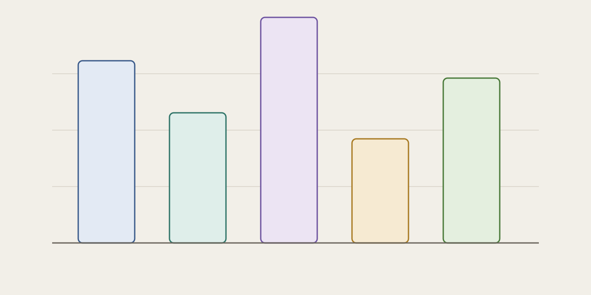
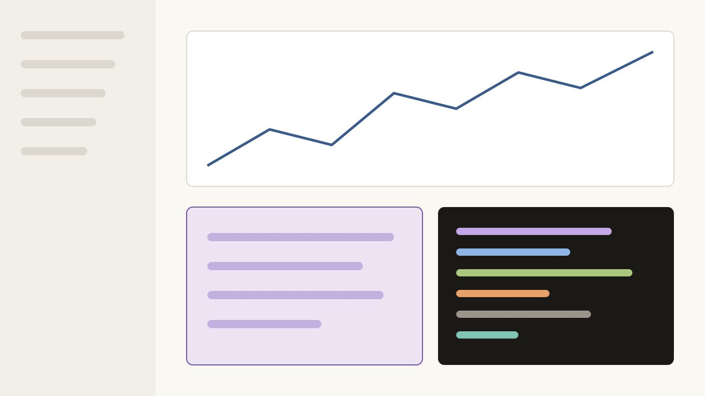
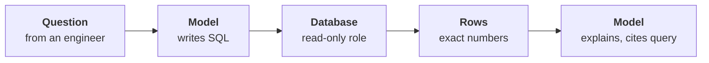
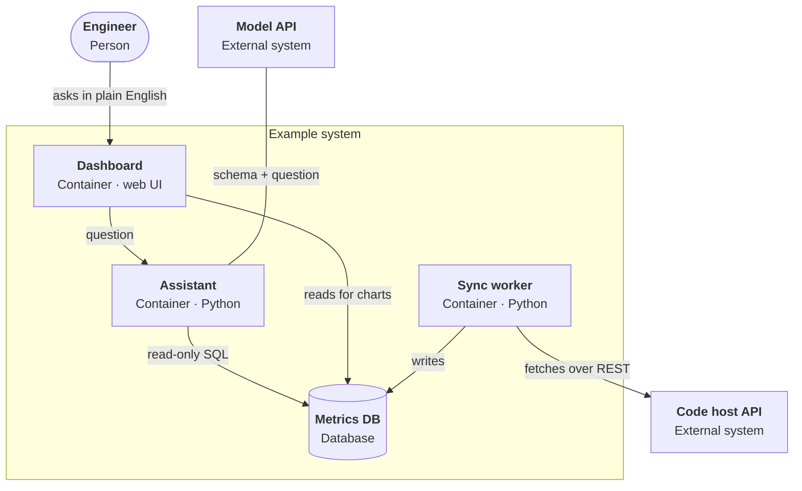
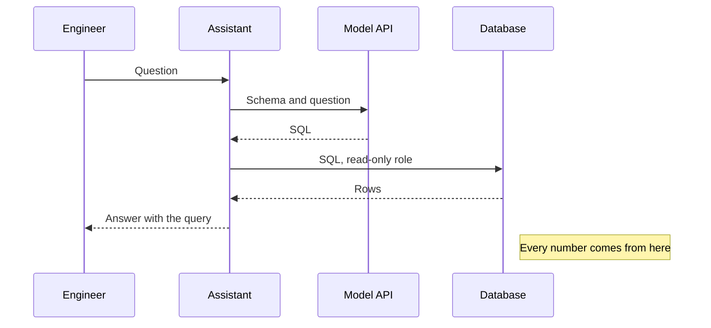

This page exists to be looked at, not read. It uses every component a post can contain, so a change to the layout shows up here first. The content is invented: the numbers, the example project and the code are placeholders. Links such as [the content collections guide](https://docs.astro.build/en/guides/content-collections/) take the accent of the post's primary tag.

## Text and sidenotes

A sidenote sits in the margin next to the paragraph that cites it, and moves below that paragraph on a narrow screen.[^margin] Inline code such as `getCollection()` and keys such as <kbd>Esc</kbd> keep their own styles. Emphasis looks *like this*, and strong text **like this**.

A second paragraph can cite more than one note.[^first] The notes stack in the margin in the order they are cited.[^second]

- Lists keep the reading column.
- They carry the body text size.
  1. Nested lists indent once more.
  2. Ordered ones count.

## Code

The query below runs as a role that can only read.

```sql title="roles.sql" {7}
CREATE ROLE report_reader NOLOGIN;
GRANT USAGE ON SCHEMA reports TO report_reader;
GRANT SELECT ON ALL TABLES IN SCHEMA reports TO report_reader;
ALTER ROLE report_reader SET statement_timeout = '5s';

-- every generated statement runs as this role
SET ROLE report_reader;
```

A Python block with a decorator, a docstring and a highlighted range:

```python title="checks/grade.py" {9-10}
from dataclasses import dataclass

@dataclass(frozen=True)
class Case:
    question: str
    expected: float
    tolerance: float = 0.01

def grade(case: Case, answer: float) -> bool:
    """Pass only when the answer matches the stored result."""
    return abs(answer - case.expected) <= case.tolerance
```

A long line scrolls sideways instead of wrapping:

```ts
export const extremelyLongIdentifierForTestingHorizontalScroll = ['one', 'two', 'three', 'four', 'five', 'six', 'seven', 'eight'];
```

```sh
pnpm install && pnpm build
```

## Tables and figures

Table: Who computes the number?

|              | Model computes          | Database computes                 |
| ------------ | ----------------------- | --------------------------------- |
| Accuracy     | Approximate             | Exact                             |
| Audit trail  | None                    | The query, attached to the answer |
| Failure mode | Silent arithmetic error | A wrong query: visible, testable  |
| Verdict      | Avoid                   | **Use this**                      |

Table: The example project at a glance

| Measure                | Value |
| ---------------------- | ----: |
| Automated tests        |  ≈700 |
| Graded questions       |    50 |
| First full sync        | 30 min |
| Median time, sample data | 2.1 h |






## Diagrams

Diagrams are Mermaid fences, rendered to SVG when the site is built. A flowchart, with the figure palette by category. It is wider than the reading column, so it uses the full width of the page:

Figure: The model writes queries; the database does the arithmetic. Every answer carries its query.



A container view in the C4 style, with a system boundary, external systems and a legend. The edge to the model API is written from the API's side with a start arrow (`API <--- AST`), so the layout puts the API on top:

Figure: Simplified container view (C4, level 2). Only the assistant talks to the model, and it holds the narrowest database grant.



A sequence diagram:

Figure: One question, end to end. Only the assistant talks to the model.



## Notes and quotes

> [!NOTE]
> Notes come from GitHub's alert syntax, so the pull request preview shows them as alerts too.

> [!WARNING]
> Every alert type uses the same quiet style; only the label changes.

> If a number cannot be traced to a query, it does not belong on the dashboard.

Raw HTML is sanitised. <details><summary>Allowed: details and summary</summary>GitHub's allowlist keeps elements like these.</details>

Removed: <script>alert('script')</script><span onclick="alert('handler')" style="color: red">an event handler and an inline style</span>, <a href="javascript:alert('link')">a script link</a>, <iframe src="https://example.com/"></iframe>and a frame.

[^margin]: Sidenotes are footnotes in the Markdown source. GitHub's preview shows them as ordinary footnotes.
[^first]: The first of two notes on one paragraph.
[^second]: The second note. Notes can hold `code` and [links](https://developer.mozilla.org/).
