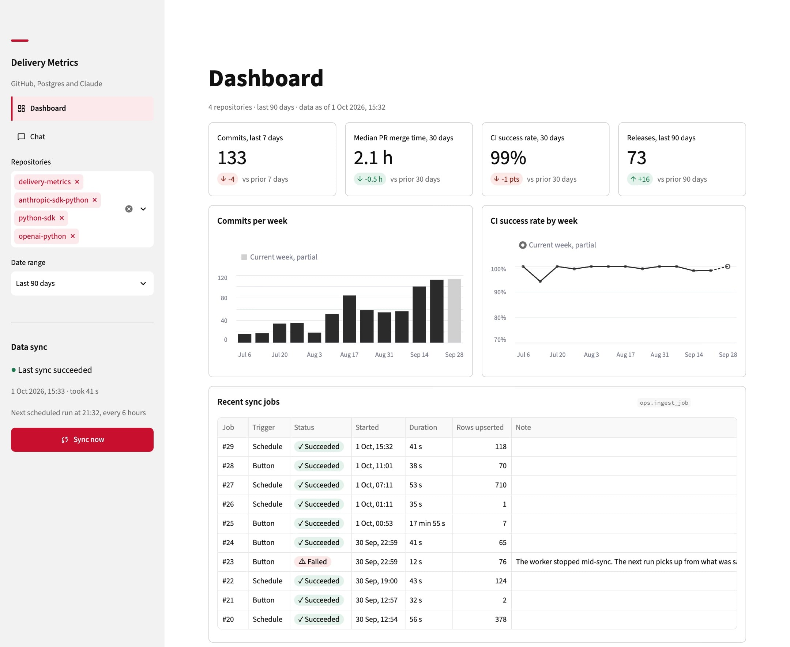
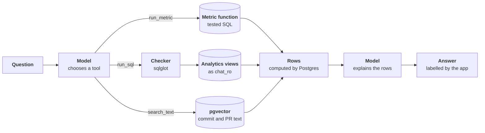
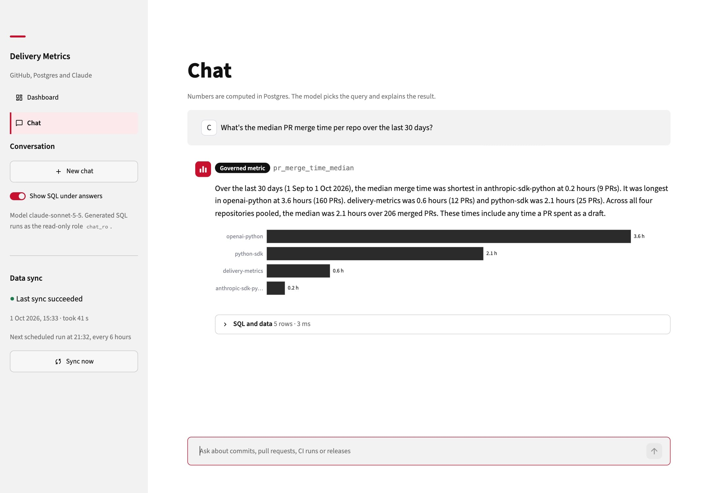
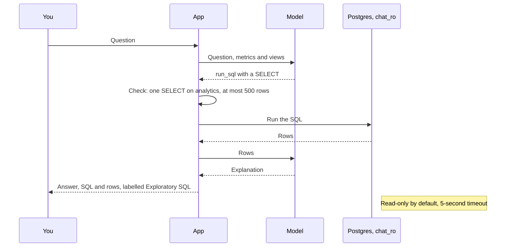
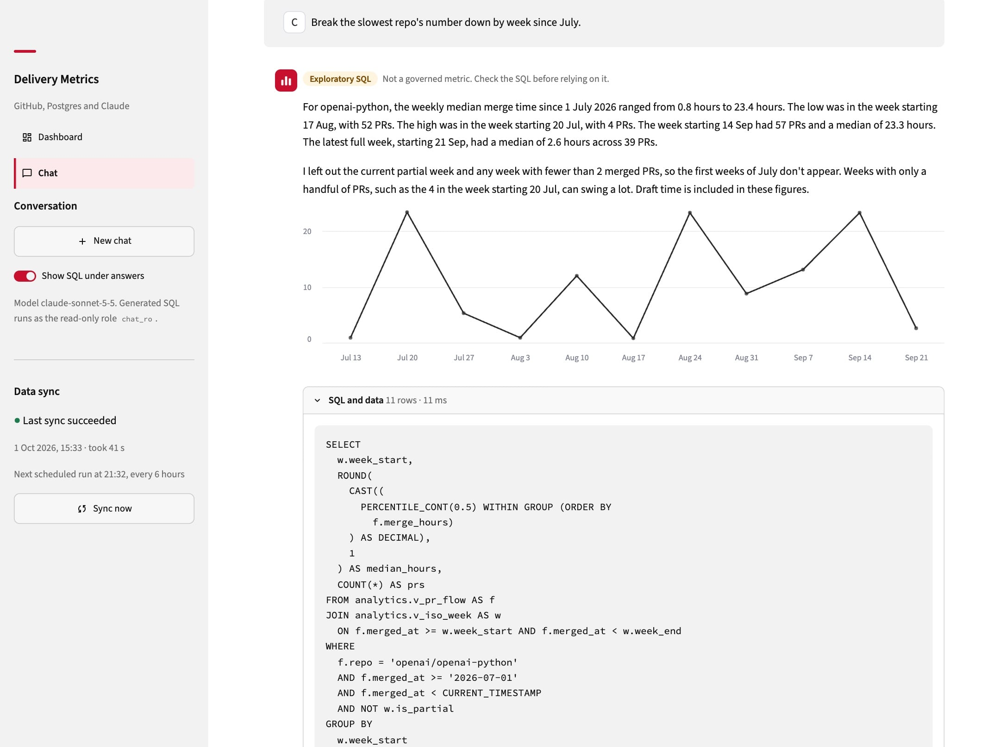
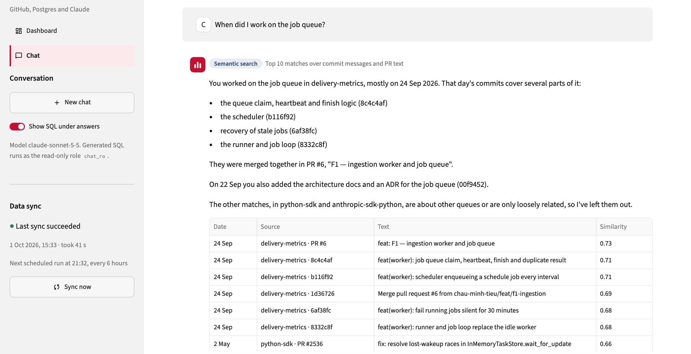

Ask an LLM how long pull requests take to merge, and it will give you a number. Whether you can trust that number depends on where it was computed.

I built [delivery-metrics](https://github.com/chau-minh-tieu/delivery-metrics) to find out how LLM apps that answer questions about data should be put together. It turns a few repositories' commits, pull requests, CI runs and releases into a dashboard and a chat assistant, on my own machine. One rule held the design together: the model chooses the query and explains the result, and Postgres computes every number.

## Two goals, one small app

I started the project with two goals. The first was to practise building software with Claude from spec to tests. The second was to learn the platform underneath: the Messages API with tool use, vector databases, and the techniques most LLM apps rely on today.

So I picked a use case that needed all of them at once: a chat assistant, a translator from plain English to SQL, and a vector index for searching text by meaning.

The app syncs four repositories into Postgres: the project itself and three public SDKs, `anthropic-sdk-python`, `openai-python` and `python-sdk`. A worker refreshes them every 6 hours, and everything runs with one `docker compose up` on localhost.



## Building it with Claude, briefly

I built one feature per conversation, each starting from a written spec and ending with tests and an entry in the feature log, [`docs/features.md`](https://github.com/chau-minh-tieu/delivery-metrics/blob/df58ba6ed9671dfb8a88261f49f15838738d87a7/docs/features.md).

What surprised me most was how well Claude Opus 5.5 with extended thinking used probe scripts. Before writing a feature, it wrote a small read-only script to check how a library or an API actually behaves, the same way I write playground scripts before I touch a real project. The habit left a script behind: [`scripts/probe_versions.py`](https://github.com/chau-minh-tieu/delivery-metrics/blob/df58ba6ed9671dfb8a88261f49f15838738d87a7/scripts/probe_versions.py) checks 55 claims against what is installed, such as whether `st.fragment` really accepts `run_every="3s"`.[^probes]

Specs and code arrived quickly. Understanding them did not: most of my time went into reading, asking why, and going back and forth until I could explain each decision myself. Asking for the flow as a Mermaid flowchart or a C4 diagram was the fastest way to see what had been built. The workflow deserves its own post; this one is about the second goal.

## The model never does the maths

The assistant has three tools, and the model's job is to pick one and explain what comes back. With [tool use](https://platform.claude.com/docs/en/agents-and-tools/tool-use/overview), the model does not run anything itself: it asks for a tool call, the app runs it, and the rows go back to the model.

Table: The three tools. Each one returns rows that Postgres computed.

| Tool | Answers | Runs |
|---|---|---|
| `run_metric` | A governed metric, such as median merge time | A tested SQL function, the same one the dashboard calls |
| `run_sql` | Anything the metrics do not cover, such as a weekly breakdown | SQL the model wrote, as a read-only role |
| `search_text` | Questions about what work was done, and when | A similarity search over commit and pull request text |

The precedence is part of the prompt: a governed metric whenever one fits, SQL only when none does ([ADR 0003](https://github.com/chau-minh-tieu/delivery-metrics/blob/df58ba6ed9671dfb8a88261f49f15838738d87a7/docs/adr/0003-answer-precedence.md)). Each answer then carries a label, **Governed metric**, **Exploratory SQL** or **Semantic search**, and the model has no say in it. The label comes from the tool that actually ran. When several ran, the least governed one wins, because the answer may rest on any figure the model saw:

```python title="src/dm/chat/agent.py"
def label(runs: Sequence[ToolRun]) -> Label | None:
    succeeded = {run.label for run in runs if run.ok}
    for candidate in (Label.EXPLORATORY, Label.SEARCH, Label.GOVERNED):
        if candidate in succeeded:
            return candidate
    return None
```

A test scripts a model that claims "Governed metric" after running SQL, and the page still says Exploratory SQL.

> The label comes from the code that ran, never from the model's account of itself.

Figure: How a question becomes a labelled answer. The model chooses; Postgres computes; the code labels.





## A read-only role guards the generated SQL

Text-to-SQL means SQL written by a model reaches your database. The obvious guard is to validate it in the application. [ADR 0002](https://github.com/chau-minh-tieu/delivery-metrics/blob/df58ba6ed9671dfb8a88261f49f15838738d87a7/docs/adr/0002-chat-ro-is-the-guard.md) explains why that is not enough: validation in the app is "a parser competing with a parser", and comments, dialect quirks and nested statements have all beaten allowlists before.

So the SQL runs as `chat_ro`, a role that can read the analytics views and nothing else. The grants live in a migration, so a new view is never silently unreadable and a new schema never silently readable:

```sql title="migrations/versions/0003_roles_grants.py"
GRANT USAGE ON SCHEMA analytics TO chat_ro;
GRANT SELECT ON ALL TABLES IN SCHEMA analytics TO chat_ro;
ALTER DEFAULT PRIVILEGES FOR ROLE dm_owner IN SCHEMA analytics
  GRANT SELECT ON TABLES TO chat_ro;
ALTER ROLE chat_ro SET default_transaction_read_only = on;
ALTER ROLE chat_ro SET statement_timeout = '5s';
```

[sqlglot](https://github.com/tobymao/sqlglot) still checks each query first: one statement, `SELECT` only, analytics objects only, at most 500 rows. Its job is a readable error and a cheap early rejection; containment is the role's job. The tests prove the point with the checker switched off: a write, a read of the raw tables and a slow query each fail at the database.

Figure: One exploratory-SQL turn. The model writes the query; Postgres runs it as chat_ro.



Three details only showed up once the tests ran against a real Postgres 17:

- **A read-only default can be lifted.** `default_transaction_read_only` is only a default: the session can run [`SET TRANSACTION READ WRITE`](https://www.postgresql.org/docs/17/sql-set-transaction.html) and try again. What stops the write then is the grants, with "permission denied for schema analytics". The default is only the first thing a write meets.
- **PUBLIC gets more than you think.** [By default](https://www.postgresql.org/docs/17/ddl-priv.html), every role may create temporary tables in a new database, so `chat_ro` could. Migration 0006 revokes it.
- **A view reads with its owner's rights.** [Unless you ask otherwise](https://www.postgresql.org/docs/17/sql-createview.html), Postgres checks a view's underlying tables against the view owner's privileges. So `chat_ro` does read raw data, through the views. The role stops direct access; the view definitions decide what is visible, which is why they leave author identities out.



## Search by meaning with pgvector

The third tool searches commit messages and pull request text by meaning. Each text is embedded on my machine with [`BAAI/bge-small-en-v1.5`](https://huggingface.co/BAAI/bge-small-en-v1.5), a 384-dimension model, and stored next to the data in Postgres with [pgvector](https://github.com/pgvector/pgvector). A query is one `ORDER BY embedding <=> query_vector LIMIT k`, cosine distance, over an HNSW index. This tool runs no model-written SQL, so it runs as the app's own role.

Two details mattered more than I expected:

- **An approximate index filters after it searches.** HNSW hands back its 40 nearest candidates by default, and the `WHERE` clause filters those.[^efsearch] With a narrow filter, such as one repository and a short date range, a search for 5 matches returned 1 to 3. pgvector 0.8 added iterative index scans, and one line fixes it: `SET LOCAL hnsw.iterative_scan = strict_order` keeps the scan going until 5 rows pass the filter.
- **Search for the topic, not the question.** The model passes the repository and the dates as filters and searches for the topic alone. On my data, the whole question "What are the PRs related to webhooks in openai-python?" found 0 of the 5 webhook pull requests; the topic "webhooks" found all 5 ([`tools.py`](https://github.com/chau-minh-tieu/delivery-metrics/blob/df58ba6ed9671dfb8a88261f49f15838738d87a7/src/dm/chat/tools.py)).

pgvector was the part I knew least, so I started a separate small lab project just to learn it, alongside this one.



## Grading the model with 53 questions

A rule the model is asked to follow is a hope until something measures it. The project has an eval suite: 53 fixed questions with their answers worked out beforehand, in 48 cases (five are two-turn conversations), each suite with a bar it must meet.

Table: The first full eval run, 30 September 2026. Each run calls the real model and costs money.

| Suite | Cases | Result | Bar |
|---|---|---|---|
| Governed metrics | 15 | 15 of 15 | 100% |
| Text-to-SQL | 15 | 13 of 15 | 80% |
| Routing | 5 | 5 of 5 | 100% |
| Semantic search | 5 | mean recall@5 0.92 | 0.8 |
| Safety | 3 | 3 of 3, every probe refused | 100% |
| Carry-over | 5 | 5 of 5 | 100% |

Every bar was met in all three full runs, at $1.08, $1.17 and $1.18 a run, in 4 to 5 minutes each.[^cost]

The rule still has one known breach. Once in 53 answers, in all three runs, the model added up three per-repository counts itself and quoted the total. The eval flags it; nothing in the code prevents it. That is the honest boundary of the design: the code guarantees where numbers come from and how answers are labelled, and the eval measures how often the model's prose stays inside those numbers.

## What I would do differently

**Learn on small repositories.** The first sync of the three SDKs and the project, a year of history from a fresh clone, took [about 29 minutes and 1,300 GitHub requests](https://github.com/chau-minh-tieu/delivery-metrics/blob/df58ba6ed9671dfb8a88261f49f15838738d87a7/README.md#L162-L167), a quarter of the [5,000 a token may make in an hour](https://docs.github.com/en/rest/using-the-rest-api/rate-limits-for-the-rest-api). Most of the rows were CI history: 10,954 runs, against 3,401 pull requests and 1,661 commits ([`docs/features.md`](https://github.com/chau-minh-tieu/delivery-metrics/blob/df58ba6ed9671dfb8a88261f49f15838738d87a7/docs/features.md)). It failed twice first, because GitHub's count of CI runs did not match the runs it then listed. That made the sync code better, but for learning the stack, a few small repositories would have given me the same lessons in a fraction of the waiting.

**Keep Streamlit for demos.** Streamlit [reruns the whole script from top to bottom](https://docs.streamlit.io/get-started/fundamentals/main-concepts) on every interaction. Nothing persists unless you put it in `st.session_state`, and a live status needs a [fragment](https://docs.streamlit.io/develop/concepts/architecture/fragments) on a timer, `st.fragment(run_every="3s")`, so the whole page does not rerun every 3 seconds. That model is quick to start with and fine for a single-user demo. I had considered it for internal tools; once I understood how it renders, I kept it for demos.

[^probes]: The project's agent instructions forbid asserting how a library behaves from memory, so each version-dependent claim has a probe. It runs again whenever a dependency is bumped.

[^efsearch]: The candidate list is `hnsw.ef_search`, 40 by default. The pgvector README's own example: with a filter that matches 10% of rows, about 4 rows come back on average.

[^cost]: Cache writes were most of the bill: $0.92 of the second run's $1.17. Each case writes its own prompt to the cache, because no conversation can read another's.
