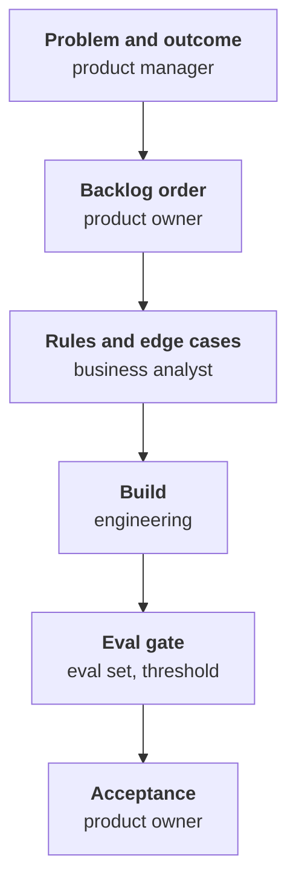

I have worked in two very different setups. In one, a product manager owned the problem end to end, and engineers took their ideas for improvements straight to them. In the other, product direction, backlog ownership, requirements analysis and portfolio intake were spread across several roles. The textbook definitions of those roles helped in neither.

What helped was writing down, early, who decides three things: why we build something, what we build next, and what exactly it must do. Most of the friction I have seen between engineering and product comes from one of those decisions having no owner, or two. On AI features, the hand-off for the third one changes as well: acceptance moves from a user story to an eval.

## Three titles, three questions

I map the three roles to three questions. The product manager answers why. The product owner answers what next. The business analyst answers what exactly.

Table: The three roles, by the question each one answers

|                  | Product manager                                 | Product owner                                         | Business analyst                                          |
| ---------------- | ----------------------------------------------- | ----------------------------------------------------- | --------------------------------------------------------- |
| Core question    | Why are we building this?                       | What do we build next?                                | What exactly must it do?                                  |
| Accountable for  | The outcome: a problem solved, a metric moved   | The value of the backlog: what gets done, in what order | Requirements that are complete, consistent and testable |
| Horizon          | Months to years                                 | The next few sprints                                  | The current and the next piece of work                    |
| Main artefacts   | Problem statements, outcome metrics, roadmap    | Product goal, ordered backlog, acceptance decisions    | Business rules, process models, acceptance criteria, edge cases |
| Decides          | Which problems are worth solving                | The order of the work, and whether an increment is accepted | How a need is specified; recommends, and the product owner decides scope |
| Failure mode     | A roadmap of features with no outcome behind them | A backlog administrator who cannot say no           | Writing down the solution a stakeholder asked for instead of the need behind it |
| One-line test    | Can they explain with a number why this matters? | Can they say no to a stakeholder and make it stick?  | Can they name the edge cases before engineers find them?  |

The last row is the one I use. Titles tell me little; the answers to those three tests tell me who actually holds each decision on a team.

## Why the definitions disagree

The sources that define these roles disagree with each other, so every company picks a mix.

The [Scrum Guide](https://scrumguides.org/scrum-guide.html) has a product owner and no analyst at all. The product owner is "accountable for maximizing the value of the product", orders the backlog, and is "one person, not a committee". Its only roles are the product owner, the Scrum Master and the developers, so analysis is simply work that someone on the team does.

[Marty Cagan](https://www.svpg.com/product-manager-vs-product-owner-revisited/) argued in 2016 that the product manager and the product owner should be the same person: he wrote that he still believed it was "critical to be a single person rather than two". His worry was companies using the product owner title to separate the business side from the person who works with the developers.

[IIBA](https://www.iiba.org/professional-development/career-centre/what-is-business-analysis/) defines business analysis as "the practice of enabling change in an organizational context", by defining needs and recommending solutions. It treats it as an activity more than a job: its list of titles for people who do it runs from business analyst and requirements engineer to product manager, product owner and data scientist, and it says many other jobs "rely heavily on business analysis skills".

[SAFe](https://framework.scaledagile.com/product-management) keeps product management and product ownership apart. Product Management works across an [Agile Release Train](https://framework.scaledagile.com/agile-release-train), "a long-lived team of Agile teams", owns strategy, vision and roadmap, and will "manage and prioritize the ART backlog". The [Product Owner](https://framework.scaledagile.com/product-owner) sits on one team, keeps that team's backlog aligned with customer and stakeholder needs, and is "part of the larger Product Management function".

In practice I see three setups, and each tends to leave one decision with no owner or with two:

- **Product-led.** A product manager owns why and what next, and works directly with engineers. What exactly is often nobody's: with no analyst, the edge cases fall to whichever engineer meets them first.
- **Scaled enterprise.** Product management above the team, a product owner inside it, analysts writing requirements and a portfolio function running intake. What next now has two owners, since the product manager's roadmap and the product owner's backlog both claim the order, and intake decisions can be made before engineering has seen the work.
- **Product owner in name only.** The title exists, but the order is set by a steering group or by whoever shouts loudest, and the product owner administers the backlog. Why and what next have an owner on paper and none in practice. This is the setup in which engineering managers drift into the role themselves; more on that below.

## What engineering needs from each role, and owes back

Each role gives engineering something it cannot do without, and each needs something back.

**The product manager.** Engineering needs the problem and the outcome it should move, with a number where one exists. It owes back feasibility, early: what is cheap, what is expensive, and what the technology makes possible that nobody asked for yet. Red flag: features arrive with no problem attached, and "why" is answered with a stakeholder's name.

**The product owner.** Engineering needs an ordered backlog and decisions that stick. It owes back honest estimates and honest status, and options when the plan slips. Red flag: the order changes after every stakeholder meeting, or everything is priority one.

**The business analyst.** Engineering needs the rules, the edge cases and worked examples before the work starts. It owes back questions asked early, and examples from the data the system already holds. Red flag: engineers find the edge cases in code review, or users find them in production.[^ba-to-po]

## Write the decision rights down in the first weeks

On any new team, in the first weeks, I write a one-page decision-rights table with the product and programme partners, before anyone's defaults harden. If I don't, the team ends up measured on milestones and utilisation instead of outcomes, because those are the numbers available when nobody has agreed on any others.

Each row is a decision, and the columns say who holds it; the names in the columns change from one setup to the next. A generic version:

Table: Decision rights, agreed in the first weeks

|                                                  | Decides                                 | Shapes                                       |
| ------------------------------------------------ | --------------------------------------- | -------------------------------------------- |
| Product direction                                | Product manager (product owner if there is none) | Engineering manager, with options, cost and risk |
| Backlog order                                    | Product owner                           | Engineering manager and tech lead propose; analyst flags dependencies |
| How the team builds: architecture, standards, the quality and eval bar | Engineering manager and engineers | Product owner hears the trade-offs |
| What the team accepts: intake, ready, done       | Product owner and engineering manager, jointly | Analyst for ready, engineers for done |
| Team metrics                                     | Product owner and engineering manager, jointly, outcomes first | Product manager |
| Benefit ownership: did the outcome happen?       | Product manager or the business sponsor | Product owner and engineering manager bring the evidence |

My own split has three parts.

**I own the how outright.** Architecture, standards, and the quality and eval bar stay with engineering. The Scrum Guide gives the developers sole discretion over how the work gets done ("No one else tells them how"), and as their manager I own the bar they build to.

**I agree the gates jointly.** Intake criteria and the definitions of ready and done are agreed with the product owner, because both sides pay when unready work gets in or unfinished work goes out.

**I co-shape the what.** I propose initiatives and bring options with cost and risk; the product owner makes the final call on order.

> An engineering manager who only owns the how ends up taking orders.

## Habits that keep the table true

A table agreed in week two is only true if the weeks after it match. These are the habits that keep it that way.

**Work as a trio rather than a relay.** In a relay, the product manager hands a problem to the product owner, the product owner hands a story to the analyst, and the analyst hands a specification to engineering, which sees the problem last. Teresa Torres describes the [product trio](https://www.producttalk.org/engineer-lead-product-trio/) as "our core decision-making team": in her version, a product manager, a designer and an engineer, usually the most senior one. My adaptation for teams with a product owner and an analyst: the product owner, the analyst (or the designer, where there is one) and a senior engineer shape the work together, before it is ready. My part is making sure that engineer is in the room early and has the time for it.

**Answer "yes, if", with three options.** When a request arrives, I answer with a cheap, a medium and a full option, each with its cost and risk, and the product owner chooses. A hypothetical example: a stakeholder asks for "an export of all orders" before a quarterly review.

- Cheap: a CSV of the report that already exists, run on request by the team. Small effort; the risk is a manual chore that never goes away.
- Medium: a download button on that report, with the two filters they use most. Medium effort; very large exports may be slow.
- Full: self-service exports with any filter, run in the background and logged. Large effort; it competes with the item the product owner ranked first.

Whatever the product owner picks, the decision is theirs and on the record, and the stakeholder hears it from the person who owns the order.

**Agree the capacity split once.** How capacity divides between new features, maintenance and unplanned work is agreed once with the product owner and written down, so it is not renegotiated every sprint. We change it when it stops matching reality, and we change it together.

**Share outcome metrics with the product owner.** If the product owner is measured on outcomes and the team on output, the two will pull against each other at every planning session. The same few outcome metrics go on both of our reports.

**Protect the product owner's authority.** The Scrum Guide says that those who want to change the backlog do so "by trying to convince the Product Owner", and that "the entire organization must respect their decisions". When a stakeholder brings a change to me instead, I send them to the product owner.

## My mistake: acting as the shadow product owner

That last habit comes from getting it wrong. When product capacity was thin, I started making product calls myself: what went first, and what a feature would include. It felt like helping. I could see an answer, the team was waiting, and the decision was not being made anywhere else.

What it cost: product decisions lost a single owner. Stakeholders learned to bring product changes and feasibility questions straight to me, which went around my product partners and strained the working relationship. Some features also ended up shaped by technical effort and what suited the team's capacity, more than by what the business needed most.

That last cost is the one to watch for if you came up as a senior or staff engineer. We are good at estimating effort, so when we make the product call, effort quietly becomes the criterion. Nobody decides that it should; it happens because effort is the thing we can see best.

What I changed afterwards: I send product requests back to the product owner, even when I could answer them, and I bring options with cost and risk rather than a decision.

## AI features change the hand-off

On AI work in a regulated workflow, three things were non-negotiable: a human in the loop, explainability, and eval coverage. Under those constraints, a user story stopped being a useful acceptance criterion. A story such as "As a reviewer, I want a suggested answer so that I can decide faster" cannot be accepted or rejected for a model: suggested correctly how often, on which cases, and what happens when it is wrong?

Acceptance became three things:

- **An eval set:** real cases with the expected result, including the awkward ones. Anthropic's guide to [defining success criteria and building evaluations](https://platform.claude.com/docs/en/test-and-evaluate/develop-tests) puts it briefly: "Don't forget to factor in edge cases!"
- **A pass threshold:** the score the feature must reach on that set before it ships.
- **Named failure modes:** the specific ways it can go wrong, listed, so that the product owner accepts each known risk by name as well as the overall score.

That moved work between the roles. In practice, engineering built the eval set and the product owner set the pass threshold, because the acceptable error rate is a business decision.

Figure: Who owns each step from problem to acceptance. On AI work, the eval gate is the step that changes.

Each arrow marks a change of decision owner. The trio still shapes the work together throughout.

What I would change next time is who builds the eval set. I would bring the analyst in to build the golden dataset from their knowledge of the process, because engineers who write their own test set end up grading their own homework. On AI work, the analyst's question, what exactly, is answered with examples, and the analyst knows which examples matter.

[^ba-to-po]: Analysts often move into the product owner role. The move is hardest on a new product with no settled mission, because the job then includes product management: vision, market and direction as well as the backlog. A [Scrum.org article](https://www.scrum.org/resources/blog/product-owner-vs-business-analyst) by Nicole de Swart and Michel van der Meulen recommends starting as the product owner of "an existing mature and stable product".
